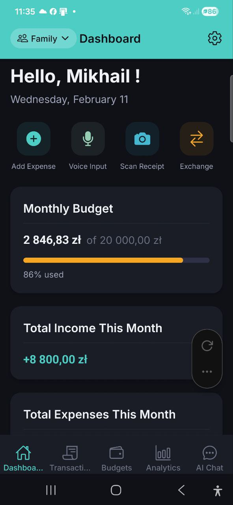
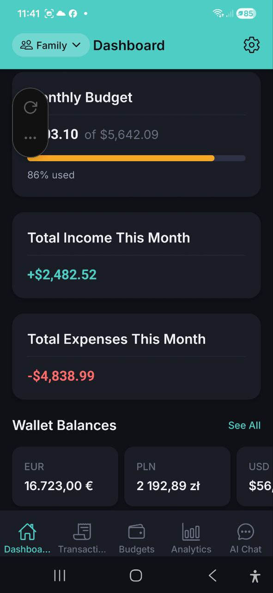

# Painel

> Sua central de controle financeiro. Veja de relance o status do orçamento, as receitas, as despesas e os saldos da carteira, com ações rápidas para adicionar despesas com um toque. Você pode mostrar ou ocultar cada seção em [Configurações](./11-settings.md) → Widgets do painel.

## Visão geral

O Painel é a primeira tela que você vê depois de entrar. Ele mostra a conta atual e os principais indicadores financeiros do mês corrente.

## Seletor de contas

No canto superior esquerdo, toque no nome da conta (por exemplo, **Família**) para abrir a lista **Trocar de conta**. Você pode alternar entre suas contas Pessoal, Compartilhada e Empresa. Todos os dados do Painel são atualizados para refletir a conta selecionada.

Ao lado do nome da conta há um **botão de moeda** separado (por exemplo, `zł`) — toque nele para trocar na hora a moeda de exibição.

## Ações rápidas

As ações rápidas abaixo do cabeçalho formam uma grade de atalhos de um toque para as tarefas mais comuns. Quando há mais ações do que cabem em uma linha, elas passam para a linha seguinte, para que todas continuem visíveis.

Ações disponíveis:

| Ação | O que faz |
|---|---|
| **Adicionar despesa** | Abre o formulário de despesa manual |
| **Escanear recibo** | Abre a câmera para fotografar um recibo e extrair os dados com IA |
| **Despesa por voz** | Fale sua despesa de forma natural |
| **Receita por voz** | Fale sua receita de forma natural (oculto por padrão) |
| **Escanear fatura** | Fotografe uma fatura para registrar uma receita (oculto por padrão) |
| **Câmbio** | Abre o formulário de câmbio de moeda |
| **Conversor** | Abre o conversor de moedas |
| **Transferências** | Abre o formulário de transferência entre carteiras |

Você pode personalizar essa faixa: vá em **Configurações → Widgets do painel**, abra a seção **Ações rápidas**, ative ou desative qualquer ação e arraste as alças para reordenar. **Receita por voz** e **Escanear fatura** ficam ocultas por padrão — ative-as ali se você registra receitas por voz ou escaneando faturas.

## Pontuação de saúde financeira

O widget **Pontuação de saúde financeira** mostra uma única pontuação de 0 a 100 que resume a saúde das suas finanças no mês corrente:

- **Verde (70–100)** — suas finanças estão em ótima forma
- **Amarelo (40–69)** — algumas áreas precisam de atenção
- **Vermelho (0–39)** — foram detectados problemas significativos

O indicador circular no canto superior direito do cartão se preenche na proporção da sua pontuação. Toque no cartão para abrir o detalhamento com quatro componentes:

| Componente | Pontos máx. | Descrição |
|---|---|---|
| Cumprimento do orçamento | 25 | % dos orçamentos ativos que não ultrapassam o limite |
| Taxa de economia | 25 | Converte sua % de economia mensal de forma linear (0% → 0 pts, 20% ou mais → 25 pts) |
| Progresso das metas | 25 | % das metas de economia ativas no ritmo certo para o prazo |
| Saúde das dívidas | 25 | Reduzida pela parte do valor ainda devido que está atrasada — uma dívida grande atrasada pesa mais que uma pequena |

> **“Ainda não há dados suficientes”** aparece quando menos de dois componentes têm dados (por exemplo, em uma conta nova, ainda sem orçamentos, metas, dívidas ou receitas).

A pontuação é calculada inteiramente no dispositivo — não precisa de internet nem de solicitações de IA.

## Widget de gamificação

Abaixo das ações rápidas, um cartão compacto mostra seu progresso na gamificação:

- **Nível** — seu nível atual, com uma barra de progresso de XP até o próximo nível
- **Sequência** — quantos dias seguidos você registrou, com um emoji de fogo ou de floco de neve

Toque neste cartão para abrir a tela completa de **Conquistas**, com todas as medalhas, os detalhes da sequência e os filtros por categoria.

> Veja [Conquistas e gamificação](./13-gamification.md) para saber como funcionam XP, níveis e conquistas.

## Cartão do orçamento mensal

- Mostra seus gastos atuais em relação ao orçamento mensal (por exemplo, **2 846,83 zl de 20 000,00 zl**)
- Barra de progresso por cores: verde (sob controle), amarelo (perto do limite), vermelho/laranja (quase no limite ou acima do orçamento)
- Mostra a **porcentagem usada** (por exemplo, 86% usado)
- Toque no cartão para ir para a aba **Orçamento** e ver os detalhes

> **Observação:** Se nenhum orçamento mensal estiver definido, você verá uma dica para criar um.

## Receitas e despesas

Um cartão combinado mostra seus totais do mês lado a lado:

- **Receitas** (à esquerda, em verde) — o total de receitas do mês corrente (por exemplo, **+$2,482.52**). Toque para ir para a aba **Transações** (visão de receitas)
- **Despesas** (à direita) — o total de despesas do mês corrente (por exemplo, **-$4,838.99**). Toque para ir para a aba **Transações** (visão de despesas)

## Lucro líquido

Abaixo dos cartões de receitas e despesas, o widget **Lucro líquido** mostra quanto dinheiro você realmente economizou ou perdeu neste mês e acompanha a tendência dos últimos 6 meses em um gráfico de linhas:

- **Lucro líquido do mês corrente** — exibido acima do gráfico, em verde (positivo) ou vermelho (negativo)
- **Tendência de 6 meses** — um gráfico de linhas com o lucro líquido mensal (receitas − despesas) dos últimos 6 meses
- Toque em um ponto do gráfico para ver o valor exato daquele mês

> **Fórmula:** Lucro líquido = Total de receitas − Total de despesas (ambos convertidos para sua moeda base)

## Patrimônio líquido

O widget **Patrimônio líquido** mostra seu patrimônio total em todas as moedas da carteira, convertido para sua moeda base:

- **Patrimônio líquido total** — a soma de todos os saldos da carteira convertidos para a moeda das suas configurações, em verde (positivo) ou vermelho (negativo)
- **Detalhamento por moeda** — o saldo atual de cada moeda, listado abaixo do total

> **Observação:** O Patrimônio líquido só aparece depois que você define os saldos iniciais da carteira. Veja [Carteira e câmbio](./10-wallet-and-exchange.md) para configurá-los.

## Cartão da Auditoria de despesas

Abaixo da seção de dívidas, o cartão **Auditoria de despesas** mostra um resumo da auditoria mensal das suas despesas:

- **Economia potencial total** — quanto você poderia economizar por mês (uma estimativa)
- **3 principais achados** — uma lista rápida com pontos de gravidade e o valor de economia de cada um
- **Ver relatório completo** — toque para abrir a tela detalhada da Auditoria de despesas

Este cartão exige uma **assinatura Pro ou Business**. Quem está no plano Free vê uma sugestão de upgrade.

> Veja [Auditoria de despesas](./19-fat-finder.md) para o guia completo do recurso.

## Calendário

O widget **Calendário** mostra uma grade mensal com pontos coloridos nos dias com transações:

- **Ponto verde** — receita registrada naquele dia
- **Ponto vermelho** — despesa registrada naquele dia
- **Hoje** aparece destacado com um círculo laranja
- **Navegação entre meses** — use as setas esquerda/direita para trocar de mês

Abaixo da grade, uma linha de resumo mostra:

- **Receitas** — o total de receitas do mês selecionado (convertido para sua moeda base)
- **Despesas** — o total de despesas do mês selecionado
- **Lucro líquido** — receitas menos despesas, em verde se positivo, em vermelho se negativo

Toque em **Toque para ver os detalhes** para abrir a tela completa do Calendário, com três abas:

| Aba | Conteúdo |
|---|---|
| **Categorias** | Receitas e despesas por categoria — cada linha mostra o ícone, o nome, a porcentagem e o valor da categoria. O lucro líquido aparece no final |
| **Carteiras** | Saldo atual de cada carteira de moeda, com a porcentagem do total |
| **Transações** | Lista cronológica de todas as transações do mês. Toque em um dia do calendário para filtrar por esse dia; toque de novo para desmarcar |

> **Dica:** Todos os valores do Calendário são convertidos automaticamente para sua moeda base, para você ver totais corretos mesmo com várias moedas.

## Saldos da carteira

- Cartões com rolagem horizontal mostrando seu saldo em cada moeda (por exemplo, **EUR 16,723.00**, **PLN 2 192,89**, **USD $56...**)
- Toque em **Ver tudo** para abrir a visão completa da Carteira, com o detalhamento de cada moeda
- Se nenhum saldo estiver definido, você verá uma sugestão para adicionar o saldo inicial

## Puxar para atualizar

Puxe para baixo em qualquer ponto do Painel para atualizar todos os dados e sincronizar com o servidor.

## Perguntas frequentes

- **P: Por que o Painel mostra $0 em tudo?**
  **R:** Você ainda não adicionou despesas nem receitas. Use os botões de ações rápidas para adicionar sua primeira transação.

- **P: Posso personalizar o que aparece no Painel?**
  **R:** Sim. Vá em **Configurações → Widgets do painel** e ative ou desative cada seção. Suas preferências ficam salvas e continuam valendo depois de reiniciar o app. Você também pode arrastar os widgets para reordená-los. A faixa de ações rápidas se personaliza do mesmo jeito — abra a seção **Ações rápidas** em Configurações → Widgets do painel para mostrar, ocultar ou reordenar os botões.

---

*Veja também: [Despesas e receitas](./03-expenses-and-income.md) | [Carteira e câmbio](./10-wallet-and-exchange.md) | [Auditoria de despesas](./19-fat-finder.md) | [Análises](./06-analytics.md)*
