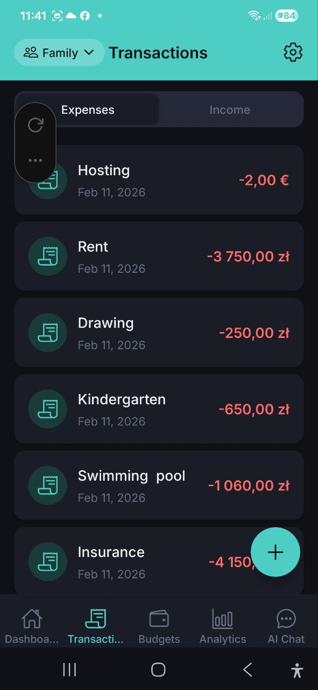
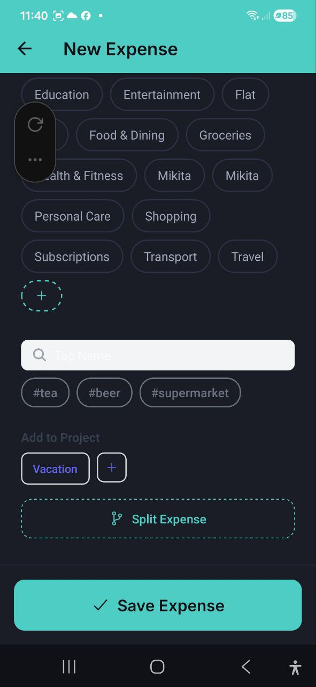

# Despesas e receitas

> Veja, adicione e gerencie todas as suas transações. Alterne entre as abas Despesas e Receitas, com suporte a várias moedas, categorias, tags, projetos e divisão de despesas.

## Lista de transações

A tela **Transações** tem duas abas no topo:
- **Despesas** — todas as suas despesas, ordenadas por data (as mais recentes primeiro)
- **Receitas** — todas as suas receitas

Cada transação mostra:
- Ícone da categoria
- Descrição (por exemplo, “Hospedagem”, “Aluguel”, “Creche”)
- Data
- Valor com a moeda, por cores: vermelho para despesas (por exemplo, **-3 750,00 zl**), verde para receitas

Toque em qualquer transação para ver todos os detalhes.

### Ações rápidas (toque longo)

Toque e segure qualquer transação da lista para abrir um menu de ações rápidas:
- **Editar** — abre a transação no modo de edição
- **Duplicar** — cria uma nova transação preenchida com os mesmos dados
- **Excluir** — remove a transação (com confirmação)

> **Observação:** Duplicar e Excluir só estão disponíveis para proprietários e editores da conta.

### Ações em massa

Nas despesas, o menu de toque longo também inclui **Selecionar vários**. Toque nessa opção para ativar o modo de seleção múltipla:
- Toque nas linhas para marcar as que você quer, ou use **Selecionar tudo** para marcar todas
- A barra inferior permite agir sobre todas as despesas selecionadas de uma vez: **Definir categoria**, **Adicionar tag** ou **Excluir**
- Toque em **Cancelar** para sair do modo de seleção múltipla sem fazer alterações

Use o botão flutuante **+** (canto inferior direito) para adicionar uma nova transação.

### Visões salvas

Com filtros ou busca ativos, toque em **+ Salvar visão**, dê um nome e ela aparece como chip acima da lista. Toque no chip para reaplicar; segure para renomear ou excluir. Os períodos são salvos de forma relativa (“este mês”). O plano gratuito guarda 5 visões, o Pro sem limite. As visões ficam neste dispositivo.

## Adicionando uma nova despesa (manual)

### Passo a passo

1. Toque no botão **+** na tela Transações, ou em **Adicionar despesa** no Painel
2. Se usar o botão **+**, escolha **Entrada manual** no menu
3. Toque no símbolo da moeda para trocar a moeda (USD, EUR, PLN, GBP, UAH, RUB, BYN)
4. Digite o **valor**
5. Digite uma **Descrição** (por exemplo, “Com o que foi essa despesa?”)
6. Toque na **Data** — ela vem preenchida com o dia de hoje; toque nela para registrar a despesa em um dia anterior
7. Selecione uma **Categoria** nos botões:
   - Alimentação e restaurantes, Mercado, Transporte, Compras, Entretenimento, Saúde e academia, Contas e serviços, Educação, Viagens, Café e bebidas, Assinaturas, Roupas, Cuidados pessoais
   - Toque no botão **+** para criar uma categoria personalizada
8. Pesquise e selecione **Tags** (por exemplo, #chá, #cerveja, #mercado) — opcional
9. Selecione **Adicionar ao projeto** (por exemplo, “Férias”) — opcional
10. Toque em **Dividir despesa** para dividir a despesa entre várias categorias — opcional
11. Toque em **Salvar despesa**

### Categorias

O app oferece 14 categorias de despesa integradas. Você também pode criar categorias personalizadas tocando no botão **+** no seletor de categorias. Cada categoria tem uma cor própria, para ser fácil de identificar nos gráficos e nas listas.

Toque no filtro de categoria acima da lista de transações para filtrar por categoria. Ele funciona tanto na aba Despesas quanto na aba Receitas:

- Escolha uma categoria para ver só essas transações
- Escolha **Sem categoria** para ver tudo o que ainda falta classificar
- Escolha **Todas** para limpar o filtro

O filtro de categoria se combina com o período indicado acima dele, então, para encontrar lançamentos mais antigos que ainda estão sem categoria, defina primeiro o período como **Tudo**.

### Sugerir categorias para despesas sem categoria

Quando sua conta tem despesas sem categoria — algo comum depois de escanear vários recibos — aparece um banner acima da lista de transações: **Despesas sem categoria: N**, com o botão **Sugerir categorias**.

Toque nele para abrir **Classificar despesas**. O app analisa suas despesas sem categoria (você verá **Analisando despesas…**) e as agrupa:

- ✚ **Nova categoria** — só será criada se você aplicar
- ● **Categoria existente** — uma categoria que você já tem
- **Não foi possível determinar** — tudo o que o assistente não teve confiança suficiente para classificar; escolha uma categoria manualmente ou deixe como está

Em cada grupo, você pode:
- Tocar no nome do grupo para renomear uma nova categoria antes de ela ser criada
- Tocar em **▾** ao lado de um grupo para mudar o destino do grupo inteiro — para outra categoria existente, outro nome de nova categoria ou **+ Criar nova categoria**
- Tocar em **Escolher** (ou **▾**) ao lado de uma despesa para mover só essa
- Desmarcar um grupo para deixar essas despesas como estão

Nada é criado nem alterado até você tocar em **Aplicar (N)** — que aparece como **Aplicar (N) · novas categorias: K** quando o plano inclui novas categorias. Depois, você verá **Classificadas: N · novas categorias: K**.

Algumas coisas que vale saber:
- As sugestões com IA são limitadas a algumas rodadas por conta por dia. Quando elas acabam, uma nota explica que, pelo resto do dia, só aparecem sugestões baseadas em regras — as sugestões que vêm de um estabelecimento que você já ensinou ao app (mudando a categoria dele antes) continuam sempre funcionando, sem limite diário.
- Despesas criptografadas não podem ser lidas pelo servidor para este recurso e são ignoradas; você verá quantas são, se houver alguma.
- Se não houver mais nada a sugerir, você verá **Nada a sugerir no momento.**
- Se o carregamento falhar, toque em **Tentar novamente**.
- Em uma conta compartilhada, os visualizadores não veem esse banner — classificar é uma alteração que só editores e o proprietário podem fazer.

Na tela de transações para computador (web), a mesma revisão abre em uma janela de diálogo.

A mesma revisão também está disponível na aba Receitas — toque em **Sugerir categorias** ali para as receitas sem categoria.

### Tags

As tags ajudam você a organizar as despesas com rótulos personalizados:
- Pesquise tags existentes no campo de busca
- Escolha entre as tags recentes ou populares
- A IA pode sugerir tags relevantes com base na descrição
- As tags aparecem como botões (por exemplo, **#chá**, **#cerveja**, **#mercado**)

### Projetos

Vincule despesas a projetos para acompanhá-las em conjunto:
- Selecione um projeto existente (por exemplo, **Férias**)
- Toque em **+** para criar um novo projeto
- Veja os totais gastos por projeto na seção Projetos
- Troque ou remova o projeto depois — abra a despesa, toque em **Editar** e escolha outro projeto ou toque em **Limpar**

### Estabelecimento

Registre onde você gastou — o estabelecimento (loja ou empresa):
- Preenchido automaticamente quando você escaneia um recibo ou importa transações do banco ou da Wise
- Adicione ou edite manualmente em qualquer despesa; comece a digitar para escolher entre os estabelecimentos que você já usou
- Aparece na despesa e na lista; toque no filtro de estabelecimento na aba Despesas para ver todos os gastos em um estabelecimento
- O filtro de estabelecimento permite escolher **vários estabelecimentos ao mesmo tempo** (toque de novo para remover um), e a aba Despesas mostra o **total do que está filtrado no momento**, convertido para sua moeda principal
- Gerencie seus estabelecimentos em **Configurações → Estabelecimentos**: renomear, juntar duplicados em um só ou remover um estabelecimento
- Quando você escaneia um recibo ou usa a voz, o estabelecimento é associado aos que você já tem, para não criar duplicados

### Dividir despesa

Divida uma única despesa entre várias categorias:
1. Toque em **Dividir despesa** no formulário da despesa
2. Adicione categorias com valores ou porcentagens
3. O total precisa ser igual ao valor original da despesa
4. Toque em **Confirmar divisão**

> **Dica:** Use **Sugerir divisão** para que a IA recomende como dividir a despesa.

### Despesas recorrentes

Transforme qualquer despesa em uma série que se registra sozinha — no formulário de criação ou depois, em uma despesa já salva:

1. Toque em **Repetir**
2. Escolha a frequência: **Semanal**, **Mensal** ou **Anual**
3. Salve — o app registra automaticamente uma nova cópia dessa despesa a cada período, no dia do vencimento

> **Dica:** Você não precisa decidir isso quando registra a despesa pela primeira vez. Abra qualquer despesa que ainda não faça parte de uma série, toque em **Editar**, ative **Repetir**, escolha o período e salve — é a mesma chave do formulário de criação.

Uma despesa que já faz parte de uma série mostra, na tela de detalhes, o banner **Faz parte de uma série recorrente** em vez da chave, com o período (por exemplo, “Repete mensalmente”). Toque em **Parar recorrência** para encerrar a série — as cópias anteriores continuam, só o registro automático futuro é interrompido.

### Formas mais rápidas de adicionar despesas

Digitar cada despesa à mão é o jeito mais lento. Depois que você adiciona umas dez despesas à mão, o app mostra uma única vez uma sugestão com opções mais rápidas — cada uma abre a sua própria tela:

- **Escanear um recibo** — tire uma foto; o valor, a loja e os itens são preenchidos
- **Falar** — fale a despesa e ela é escrita para você
- **Telegram ou WhatsApp** — mande para o bot uma mensagem, uma mensagem de voz ou uma foto do recibo
- **Importar um extrato bancário** — traga muitas transações de uma vez a partir de um arquivo
- **Notificações do banco** (Android) — os alertas de pagamento do app do seu banco viram despesas

A sugestão aparece só uma vez, e nem aparece se você já usa uma dessas formas. Toque em **Agora não** para fechá-la; todas as opções continuam disponíveis no lugar de sempre no app.

## Adicionando receitas

### Passo a passo

1. Vá até a aba **Transações** e mude para a aba **Receitas**
2. Toque no botão **+**
3. Toque no símbolo da moeda para escolher a moeda
4. Digite o **valor**
5. Digite uma **Descrição** (por exemplo, “De onde veio essa receita?”)
6. Toque na **Data** — ela vem preenchida com o dia de hoje; toque nela para registrar a receita em um dia anterior
7. Selecione uma **Categoria**: Salário, Freelance, Investimentos, Presentes ou Outras receitas
8. Adicione **Notas**, se quiser
9. Toque em **Salvar receita**

## Detalhes da despesa

Toque em qualquer despesa para ver todos os detalhes:

- **Descrição** e valor com a moeda
- **Data** da despesa
- **Categoria** com indicador de cor
- **Notas** (se houver)
- **Adicionado por** — aparece em contas compartilhadas; mostra o nome do membro da conta que criou esse lançamento
- **Status da sincronização** — pendente, sincronizado, conflito ou erro
- **Origem** — Entrada manual, Entrada por voz, Leitura de recibo, Importado ou Capturado automaticamente (as linhas vindas de notificações ou de importações do banco ficam marcadas, para você diferenciá-las) · **Grupo compartilhado** marca a sua parte de uma despesa de grupo (veja Grupos compartilhados), e **Vinculado ao grupo** um pagamento que fica fora dos totais porque a sua parte já é contada
- **Itens do recibo** — os itens individuais (nos recibos escaneados, ou extraídos depois com **Extrair itens**)
- **Imagem do recibo** — ver, compartilhar, salvar na galeria, substituir ou excluir a foto do recibo. Recibos em PDF mostram uma prévia do documento que abre com um toque. Se ainda não houver recibo anexado, toque em **Anexar recibo** para adicionar um — escolha **Tirar foto**, **Escolher da galeria** ou **Escolher PDF**. Funciona em qualquer despesa, inclusive as adicionadas manualmente. Se o recibo foi anexado depois que a despesa foi criada, toque em **Extrair itens** no cartão do recibo para ler o recibo de novo com IA e trazer os itens para a despesa (com confirmação se já houver itens; cada execução usa uma solicitação de IA)

### Ações nos detalhes da despesa:
- **Editar** — altera a despesa, inclusive a **moeda** (toque no botão de moeda ao lado do valor; o valor em si não é convertido, só muda a moeda indicada); se a despesa ainda não fizer parte de uma série recorrente, você também pode ativar **Repetir** aqui para iniciar uma
- **Copiar** — cria uma cópia
- **Excluir** — remove a despesa (com confirmação)

## Detalhes da receita

Toque em qualquer receita para ver os detalhes:
- Descrição, data, categoria, notas
- **Adicionado por** — em contas compartilhadas, mostra quem criou essa receita
- **Editar** — altera a receita, inclusive a **moeda** (toque no botão de moeda ao lado do valor; o valor em si não é convertido, só muda a moeda indicada) — ou exclui o lançamento

## Perguntas frequentes

- **P: Posso adicionar despesas em moedas diferentes?**
  **R:** Sim! Toque no símbolo da moeda no formulário da despesa para alternar entre USD, EUR, PLN, GBP, UAH, RUB e BYN. Você também pode mudar a moeda de uma despesa já salva — toque em **Editar** e depois no botão de moeda ao lado do valor. Isso só muda a moeda indicada; o valor não é convertido.

- **P: Posso mudar a moeda de uma receita depois de salvá-la?**
  **R:** Sim — abra a receita, toque em **Editar**, toque no botão de moeda ao lado do valor e escolha uma nova moeda. Assim como nas despesas, isso só muda a moeda indicada; o valor não é convertido.

- **P: Como edito uma despesa existente?**
  **R:** Toque na despesa na lista para abrir os detalhes e depois toque em **Editar**.

- **P: Qual é a diferença entre categorias e tags?**
  **R:** Cada despesa tem uma única categoria (por exemplo, “Alimentação e restaurantes”), mas pode ter várias tags (por exemplo, #almoço, #trabalho). As categorias são usadas nos orçamentos e nos gráficos; as tags dão mais flexibilidade para filtrar.

- **P: Por que a aba Transações abre na hora, mesmo sem internet?**
  **R:** O app guarda suas transações localmente no dispositivo. Quando você abre a aba, a lista aparece imediatamente a partir dessa cópia local, e as novidades do servidor são carregadas em segundo plano. Se a lista estiver vazia no primeiro uso, aparece rapidamente um indicador de carregamento enquanto o dispositivo busca seus dados.

### Calcular no campo de valor

No campo de valor você pode digitar uma conta simples, por exemplo `12.50+3.20*2`. Use `+ − × ÷` e parênteses; `,` ou `.` funcionam como separador decimal. O resultado aparece abaixo do campo e é esse número que fica salvo. Se a conta não for válida, Salvar fica desativado.

### Sugestão da moeda local

Quando você registra uma despesa no exterior e o acesso à localização já está permitido, um pequeno chip sugere a moeda local (ex.: «Na Tchéquia? Usar CZK»). Toque para trocar; a escolha fica salva por 14 dias. Toque no X para parar de sugerir esse país. O app nunca pede a localização só para isso.

---

*Veja também: [Entrada por voz e escaneamento de recibos](./04-voice-and-receipt.md) | [Orçamentos](./05-budgets.md)*
