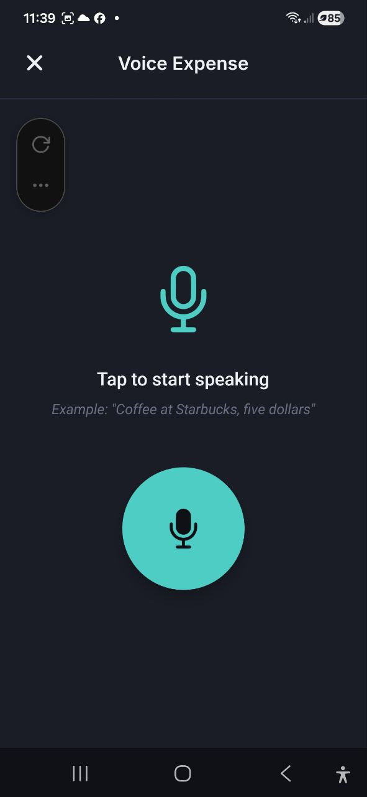
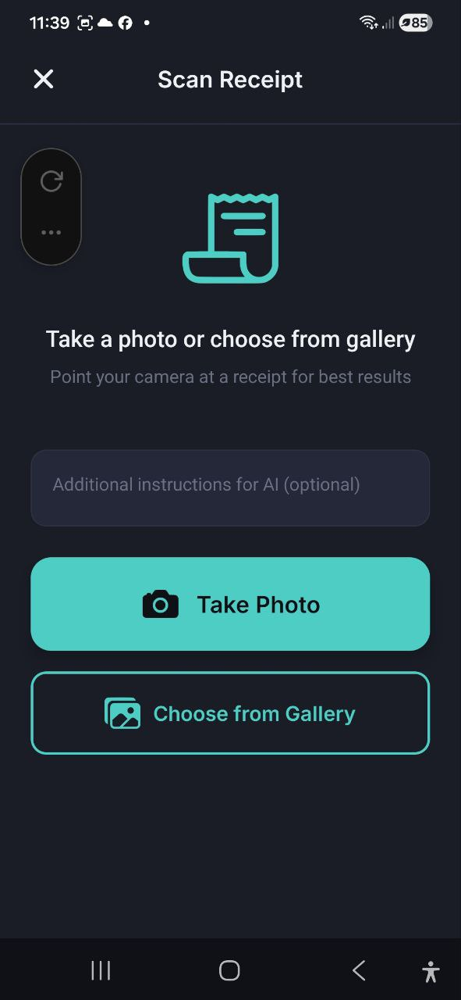

# Entrada por voz e escaneamento de recibos

> Deixe a IA trabalhar. Fale a despesa com naturalidade ou fotografe um recibo — o app extrai automaticamente o valor, a descrição, o estabelecimento e a categoria.

## Despesa por voz

### Como funciona

1. Toque em **Entrada por voz** nas ações rápidas do Painel, ou toque em **+** na tela Transações e escolha **Entrada por voz**
2. Você verá um grande ícone de microfone com o texto **“Toque para começar a falar”**
3. Toque no botão do microfone para começar a gravar
4. Fale com naturalidade, por exemplo: *“Café no Starbucks, cinco dólares”*
5. Toque de novo para parar a gravação
6. O app processa sua fala e extrai os dados da despesa

### Tela de confirmação

Depois do processamento, você verá uma confirmação com os dados reconhecidos:

- **Valor** — extraído da sua fala (editável)
- **Descrição** — a que se refere a despesa (editável)
- **Estabelecimento** — onde você gastou (editável)
- **Categoria** — atribuída automaticamente (editável)
- Indicador de **confiança** — Confiança alta ou Confiança média

Revise os dados, faça as correções necessárias e então:
- Toque em **Salvar despesa** para confirmar e salvar
- Toque em **Tentar novamente** para gravar de novo

Depois de salvar, você pode tocar em **Adicionar outra** para gravar uma nova despesa por voz.

### Dicas para melhores resultados

- Fale com clareza e diga tanto o item/descrição quanto o valor
- Diga o nome do estabelecimento, se for relevante (por exemplo, “Almoço no McDonald's, doze euros”)
- Informe a moeda se ela for diferente da sua moeda padrão
- Mantenha a simplicidade — uma despesa por gravação

## Escanear recibo

### Como funciona

1. Toque em **Escanear recibo** nas ações rápidas do Painel, ou toque em **+** na tela Transações e escolha **Escanear recibo**
2. Você verá três opções:
   - **Tirar foto** — abre a câmera para fotografar o recibo
   - **Escolher da galeria** — selecione uma foto existente
   - **Enviar PDF** — escolha um arquivo PDF (faturas digitais, recibos escaneados de até 10 MB)
3. Se quiser, escreva **Instruções adicionais para a IA** (por exemplo, “Dividir em partes iguais entre duas pessoas”, “Ignorar a gorjeta”)
4. O app analisa o recibo e extrai os dados

### Tela de confirmação

Depois da análise da IA, você verá:

- **Valor total** — extraído do recibo (editável)
- **Descrição** — resumo gerado (editável)
- **Estabelecimento** — nome da loja/restaurante (editável)
- **Categoria** — atribuída automaticamente (editável)
- **Data** — tirada do recibo (editável)
- **Itens** — itens individuais com quantidades e preços (se forem detectados) — toque em um item para editá-lo, excluí-lo ou adicionar um que o escaneamento não pegou (veja **Editar itens** abaixo)
- **Desconto** — valor do desconto (se constar no recibo)
- Indicador de **confiança** — alta ou média
- Opção **Salvar imagem do recibo** — mantém a foto anexada à despesa

Revise e corrija os dados e então:
- Toque em **Salvar despesa** para confirmar
- Toque em **Escanear de novo** para tentar outra foto

### Ampliar o recibo

Toque na pequena foto do recibo na tela de confirmação — ou no recibo na tela de detalhes de uma despesa — para abri-lo em tela cheia. No celular, faça o gesto de pinça para ampliar (até 5×), toque duas vezes para ampliar naquele ponto e toque duas vezes de novo para ver o recibo inteiro, e arraste com um dedo para se mover enquanto estiver ampliado. No navegador, role a roda do mouse para ampliar onde está o ponteiro, arraste para se mover, clique duas vezes para ampliar ou reduzir, ou use os botões **+**, **−** e de ajuste no canto. O recibo sempre abre mostrando a página inteira. Recibos em PDF abrem como antes.

### Dicas para melhores resultados

- Fotografe com boa iluminação — evite sombras e reflexos
- Garanta que o recibo inteiro esteja visível e plano
- Segure a câmera com firmeza para evitar fotos tremidas
- Use **Instruções adicionais para a IA** para casos especiais (por exemplo, “Isto está em EUR”, “Ignorar o primeiro item”)

### Editar itens

A extração por IA nem sempre é perfeita — um dígito de um preço pode se perder, um desconto pode se misturar a um preço unitário ou o escaneamento pode deixar passar uma linha inteira. Você não precisa escanear de novo nem excluir a despesa inteira para corrigir:

- **Toque em qualquer item** da lista para editar o nome, a quantidade, o preço unitário ou o preço total. Toque em **Salvar** para aplicar a correção.
- **Toque no ícone da lixeira** ao lado de um item para removê-lo — útil para uma linha duplicada ou inventada.
- **Toque em + Adicionar item** no fim da lista para adicionar uma linha que o escaneamento não pegou.

Todos os itens são listados — não há limite, por mais itens que o recibo tenha. Qualquer alteração atualiza na hora a divisão por categoria e os totais, então o que você salva sempre corresponde ao que está na tela. O total geral do recibo, o desconto e o vasilhame ficam como foram escaneados; só os itens individuais podem ser editados.

### Divisão por categoria

Recibos de supermercado costumam misturar vários tipos de itens na mesma compra — alimentos, produtos de limpeza, bebidas alcoólicas. Quando o app reconhece mais de um tipo de item em um recibo, ele divide automaticamente a despesa entre as categorias correspondentes, em vez de colocar tudo em uma só.

- Na tela de confirmação, aparece acima da lista de itens uma fileira de chips de categoria, com o título **Dividir por categoria** (por exemplo, “Mercado 180 · Casa 35 · Bebidas alcoólicas 25”), mostrando como o total será dividido.
- Toque em **Alterar categorias** para abrir a lista de todos os itens e ajustar a categoria de cada um. Suas alterações valem na hora — e ficam memorizadas, para que o mesmo produto seja classificado corretamente na próxima vez que você o escanear.
- Se os itens não somarem um valor próximo o bastante do total do recibo, o app usa uma única categoria em vez de adivinhar.
- O vasilhame de garrafas e latas é reconhecido e mostrado em uma categoria própria, para você ver quanto dos seus gastos corresponde a vasilhame já pago.
- Isso também conta para os seus orçamentos por categoria — um orçamento em uma categoria que só aparece dentro de uma divisão de recibo, como Bebidas alcoólicas ou um orçamento de vasilhame, finalmente acompanha os gastos corretamente, e um orçamento de Mercado deixa de contar os produtos de casa ou o vasilhame do mesmo recibo.
- Às vezes nenhuma das suas categorias existentes serve para um grupo de itens. Quando isso acontece, o app sugere uma categoria nova, mostrada como um chip marcado com **+** (por exemplo, “+ Produtos de limpeza 10”). Nada é criado ainda — toque em **Alterar categorias** para passar esses itens para uma das suas categorias existentes, ou deixe como sugerido. A nova categoria só é criada de fato quando você salva o recibo.
- O app não inventa mais uma categoria que duplique uma que você já tem — uma tradução, um sinônimo ou uma parte de uma categoria existente (por exemplo “Pão” ao lado de “Mercado”). Esses itens vão para a sua categoria existente ou para uma subcategoria dela; uma categoria nova só é sugerida para um tipo de gasto realmente novo, e o app nunca cria subcategorias por você.

Funciona do mesmo jeito se você escanear pelo app ou pelos bots do Telegram, WhatsApp ou Slack.

### Escanear uma pilha de recibos

Acumulou uma semana de recibos de papel? Depois de salvar um, a mensagem de confirmação oferece duas opções em vez de simplesmente fechar a tela:

- **Escanear outro** — volta direto para a câmera sem sair da tela, para você dar conta de uma pilha inteira em sequência
- **Concluído** — encerra e leva você de volta para onde começou

Enquanto você escaneia, um pequeno contador mostra quantos recibos você salvou nesta sessão. A cada 15 recibos, o app mostra um lembrete amigável de que você pode continuar ou fazer uma pausa — seu progresso já está salvo de qualquer forma. O contador zera quando você sai da tela; ele serve só para dar uma noção de progresso durante uma sessão.

### Recibo comprido em várias fotos

Um recibo comprido demais para uma única foto legível pode ser fotografado em partes e lido como **um só** recibo.

**No app**

1. Na tela do recibo, toque em **Recibo comprido? Fotografe por partes**
2. Fotografe o recibo de cima para baixo, com uma pequena sobreposição entre as fotos (a última linha de uma foto deve aparecer de novo no topo da seguinte) — você pode adicionar até **4 partes**
3. Toque em **Ler recibo**. Você recebe um único cartão de confirmação com cada linha uma só vez; as linhas sobrepostas não são contadas duas vezes
4. Se os totais das linhas não baterem com o total do recibo, o app avisa e oferece **Refazer partes** em vez de salvar

Cada parte conta como um escaneamento de recibo no seu limite mensal de IA, então um recibo em três partes usa três escaneamentos. Um PDF não pode ser combinado com fotos. A despesa guarda todas as fotos: abra o recibo na despesa e toque em uma parte para vê-la.

**Nos bots do Telegram, WhatsApp e Slack**

Envie as fotos uma depois da outra. A primeira foto é lida na hora. Enquanto o cartão de confirmação ainda estiver aberto, envie a próxima foto — o bot pergunta se é uma **Continuação** ou um **Recibo novo**. Escolha **Continuação** e o cartão é refeito a partir de todas as fotos juntas (as correções que você digitou no cartão antigo não são mantidas, então confira o novo). As fotos precisam ser JPEG, PNG ou WebP e não muito grandes; o bot avisa se alguma for recusada.

### Recibos já escaneados

O app avisa antes que um recibo entre duas vezes nas suas despesas:

- **O mesmo arquivo de novo** — se você escolher uma foto ou um PDF que já foi escaneado e salvo, o app pergunta *antes* de lê-lo, então nenhuma solicitação de IA é gasta. Escolha **Abrir** para ver a despesa salva, **Escanear mesmo assim** para lê-lo de novo, ou **Cancelar**.
- **O mesmo recibo, foto nova** — depois da leitura, se já existir uma despesa com a mesma loja, o mesmo valor e a mesma data (±1 dia), a tela de confirmação mostra um aviso amarelo com um botão **Abrir**. Você ainda pode salvar: pode ser de fato uma segunda compra.
- **Já registrado pelo banco** — se a despesa correspondente veio de uma notificação do banco ou de uma importação de extrato bancário, o aviso informa isso e oferece **Juntar em uma só despesa**. Com a opção marcada, ao salvar o recibo é mantido (itens, foto e categoria) e substitui o lançamento do banco, para que a compra seja contada uma só vez. A caixa começa desmarcada quando só o valor e a data coincidem — confira antes de juntar.
- **Já adicionado manualmente** — se você mesmo registrou esta compra antes — digitada, por voz ou em uma mensagem ao bot (por exemplo, “Netto”, enquanto o recibo imprime “Netto nr 541”) — o aviso informa isso e oferece a mesma opção **Juntar em uma só despesa**. Esta caixa começa desmarcada, porque uma despesa digitada manualmente pode ser uma compra diferente — marque-a se for a mesma. O recibo substitui seu lançamento; suas notas, tags e projeto são transferidos. Se você deixar como está, o par também aparece mais tarde nos alertas, com um botão para juntar.

Os bots do Telegram, WhatsApp e Slack dão os mesmos avisos, com um botão **Escanear mesmo assim**. Quando a correspondência é um lançamento seu ou a cópia do banco, ao tocar em **Adicionar despesa** o bot pergunta se você quer juntar: **Juntar** mantém o recibo e incorpora o outro lançamento a ele, **Manter os dois** salva o recibo separadamente.

### Compartilhar a partir de outro app (Android)

Recebeu um recibo como captura de tela, uma confirmação do app do banco ou um recibo eletrônico em PDF? Você não precisa abrir o escâner:

1. Em qualquer app (galeria, Gmail, seu banco, o app de uma loja), toque em **Compartilhar**
2. Escolha **AI Budget**
3. O app abre direto na tela de confirmação já preenchida — confira e toque em **Salvar**

Você pode compartilhar **imagens e PDFs**, até **10 arquivos por vez** (um PDF de até 10 MB). Vários arquivos viram despesas separadas, uma após a outra — o título mostra seu progresso (“Recibo 2 de 5”) e **Próximo** leva você ao arquivo seguinte. Se um arquivo não puder ser lido, escolha **Pular** ou **Inserir manualmente**. Ao fechar a tela, o app pergunta antes de descartar os arquivos que ainda estão na fila. Cada arquivo conta como um escaneamento de recibo no seu limite de IA; se o limite acabar, os arquivos restantes ficam para depois.

**Textos de pagamento:** selecione um SMS do banco, um e-mail ou uma mensagem de chat, toque em **Compartilhar** e escolha AI Budget. O app lê o valor e o estabelecimento e abre o formulário de nova despesa já preenchido — confira e salve. Um texto que não pareça um pagamento (um anúncio, uma transação recusada) nunca vira uma despesa. Somente Android.

O compartilhamento funciona somente no Android. No iPhone e no app web, use **Escanear recibo**.

### Encaminhar recibos eletrônicos por e-mail

Muitas lojas físicas e on-line enviam por e-mail um recibo ou uma confirmação de pedido. Em vez de escaneá-lo, você pode encaminhá-lo para o seu endereço privado. Cada e-mail encaminhado aparece no app como uma despesa esperando por você. **Nada é salvo até você confirmar.**

> **Em liberação gradual.** Este recurso está sendo ativado aos poucos. Se você vir **Recibos por e-mail** em **Configurações**, já pode usá-lo. Se ainda não vir, ele ainda não chegou à sua conta.

#### Obter seu endereço

1. Abra **Configurações** → **Recibos por e-mail**
2. Toque em **Criar meu endereço**. Só proprietários e editores da conta podem fazer isso.
3. Em **Seu endereço privado**, toque em **Copiar**
4. Em **Adicionar recibos a**, escolha a conta onde os recibos confirmados serão salvos. Só aparecem as contas que você pode editar.

O endereço pertence a você, não à conta. Os membros de uma conta compartilhada nunca veem os e-mails que você encaminha.

#### Configurar o encaminhamento no Gmail

1. No Gmail, abra **Configurações** → **Ver todas as configurações** → **Encaminhamento e POP/IMAP** → **Adicionar um endereço de encaminhamento** e cole seu endereço privado
2. O Gmail envia um código de confirmação para esse endereço. Ele aparece no app em **Configurações** → **Recibos por e-mail**, em um cartão **Código de confirmação do Gmail**, com um botão **Copiar**. Digite o código no Gmail. O código só é mostrado no app, nunca em uma notificação, e só por cerca de 30 minutos. Se ele já tiver sumido, peça ao Gmail para enviá-lo de novo.
3. Crie um **filtro** (**Configurações** → **Filtros e endereços bloqueados**) para o endereço do remetente da loja, ou para um assunto como “recibo” ou “pedido”, e escolha **Encaminhar para** o seu endereço

Não encaminhe todos os seus e-mails. Use um filtro. Isso protege sua privacidade, e mensagens sem relação não gastam seu limite de IA.

#### Configurar o encaminhamento no Outlook

1. No Outlook, abra **Configurações** → **Email** → **Regras** e adicione uma regra para as mensagens da loja ou com “recibo” no assunto
2. Escolha a ação **Encaminhar para** e digite seu endereço privado

Algumas contas Outlook.com e Microsoft 365 bloqueiam o encaminhamento automático para endereços externos. Se for o caso da sua, encaminhe cada recibo manualmente. Um encaminhamento manual pelo celular funciona tão bem quanto.

#### Confirmar um recibo

Quando um recibo encaminhado é lido, você recebe uma notificação. Você também verá um banner na tela Transações, **Recibos por e-mail a confirmar: N**. Você sempre pode abrir a lista em **Configurações** → **Recibos por e-mail** → **Abrir a caixa de recibos por e-mail**.

- A aba **A confirmar** lista os recibos esperando por você. Toque em um para abrir a tela de confirmação de recibo de sempre, confira os dados e toque em **Salvar despesa**.
- Se o recibo parecer uma despesa que você já tem, você vê o mesmo aviso de duplicidade de um recibo escaneado, incluindo **Juntar em uma só despesa**.
- Toque em **Descartar** para descartar um recibo sem salvá-lo.
- A aba **Tratados** mostra o que foi ignorado: um recibo que você já tem, um e-mail sem nenhum recibo, um que não pôde ser lido, ou um que ficou sem leitura porque seu limite de IA foi atingido. Quando for o caso, toque em **Tentar novamente**.

Cada recibo eletrônico lido conta como um escaneamento de recibo no seu limite de IA. Duplicatas e e-mails sem recibo são ignorados sem gastá-lo. Se uma loja só enviar um link para o recibo, encaminhe o PDF, porque links nunca são abertos. Uma foto do recibo pode ficar guardada com a despesa. Um PDF ou um e-mail simples não é anexado. A lista precisa de conexão com a internet.

#### Se seu endereço vazar

Toque em **Trocar endereço**. O endereço antigo para de funcionar na hora, e os e-mails enviados para ele são rejeitados. Depois, atualize a regra de encaminhamento na sua caixa de e-mail para o novo endereço. O Gmail pede um código de confirmação de novo. Para parar de receber recibos eletrônicos de vez, toque em **Desativar endereço**.

#### Privacidade e retenção

- Nosso servidor lê um e-mail encaminhado enquanto o processa, assim como qualquer recibo que você escaneia.
- Só o recibo em si é guardado, nunca o e-mail inteiro. Links no e-mail nunca são abertos, e as imagens nunca são carregadas.
- O recibo armazenado é excluído assim que você o confirma ou descarta.
- Os itens que você não confirmar são excluídos automaticamente após 30 dias.
- Os recibos por e-mail **não estão disponíveis** para contas com **Nível 2 — Criptografia total**. Com a criptografia de Nível 1 eles funcionam, mas os itens não confirmados são excluídos após 7 dias. Veja [Criptografia](./15-encryption.md).

## Receita por voz

Registre pagamentos recebidos por voz — o mesmo fluxo da despesa por voz, otimizado para receitas.

### Como funciona

1. Toque em **Receita por voz** nas ações rápidas do Painel, ou toque no ícone do microfone no rodapé do formulário **Adicionar receita**
2. Toque no botão (verde) do microfone para começar a gravar
3. Fale com naturalidade, por exemplo: *“Recebi 500 do cliente, honorários de consultoria”*
4. Toque de novo para parar a gravação
5. O app extrai o valor, a descrição e a **categoria de receita** que melhor corresponde

### Tela de confirmação

- **Valor** — extraído da sua fala (editável)
- **Descrição** — a que se refere o pagamento (editável)
- **Categoria** — categoria de receita atribuída automaticamente (editável)
- **Moeda** — detectada ou, por padrão, a sua moeda base

Toque em **Salvar receita** para confirmar, ou em **Tentar novamente** para gravar de novo.

### Dicas para melhores resultados

- Diga o valor e uma breve descrição
- Informe a moeda se ela for diferente da sua moeda padrão

---

## Escanear fatura

Fotografe ou envie uma fatura ou um comprovante de pagamento para registrar a receita automaticamente.

### Como funciona

1. Toque em **Escanear fatura** nas ações rápidas do Painel, ou toque no ícone de documento no rodapé do formulário **Adicionar receita**
2. Escolha **Tirar foto**, **Escolher da galeria** ou **Enviar PDF**
3. Se quiser, escreva instruções adicionais para a IA
4. O app extrai o valor total, a data e a categoria

### Tela de confirmação

- **Valor total** — extraído do documento
- **Descrição** — resumo gerado
- **Categoria** — categoria de receita atribuída automaticamente
- **Data** — tirada do documento

Revise os dados, toque em ✓ para salvar ou no ícone de lápis para abrir o formulário completo **Adicionar receita** com os dados já preenchidos.

> **Observação:** O OCR de faturas extrai apenas o total e a data. Os itens das faturas são ignorados de propósito, para evitar contagem em dobro em documentos de cobrança com várias linhas.

---

## Perguntas frequentes

- **P: Quais idiomas a entrada por voz suporta?**
  **R:** A entrada por voz funciona melhor no idioma configurado no app. Ela suporta todos os idiomas do app.

- **P: Posso escanear recibos em qualquer idioma?**
  **R:** Sim, a IA consegue processar recibos na maioria dos idiomas e extrai os valores e os itens independentemente do idioma do recibo.

- **P: Quais arquivos PDF são suportados?**
  **R:** São suportados tanto PDFs digitais (por exemplo, faturas da Amazon ou do PayPal) quanto recibos escaneados em PDF. O tamanho máximo do arquivo é 10 MB. PDFs digitais com texto selecionável são processados mais rápido e com mais precisão. Para melhores resultados com PDFs escaneados, garanta que o escaneamento esteja nítido e com bom contraste.

- **P: Por que o valor ficou errado depois do escaneamento?**
  **R:** A extração por IA nem sempre é perfeita. Sempre revise a tela de confirmação e corrija os erros antes de salvar. Recibos borrados ou danificados podem gerar resultados menos precisos. Se um item específico estiver errado, toque nele para editá-lo diretamente — veja **Editar itens** acima.

- **P: A entrada por voz e o escaneamento de recibos usam minhas solicitações de IA?**
  **R:** Sim, cada entrada por voz ou escaneamento de recibo usa uma solicitação de IA da sua cota mensal.

- **P: Por que um recibo ficou dividido entre várias categorias nos meus gráficos?**
  **R:** Quando um recibo mistura claramente tipos diferentes de itens (por exemplo, mercado e bebidas alcoólicas), o app o divide automaticamente entre as categorias correspondentes nos seus gráficos de gastos — e também nos seus orçamentos por categoria. Toque em **Alterar categorias** na tela de confirmação do recibo para ajustá-lo — as correções ficam memorizadas para a próxima vez.

---

*Veja também: [Despesas e receitas](./03-expenses-and-income.md) | [Chat IA](./07-ai-chat.md)*

## Recibos de posto de gasolina

Se o recibo for de um posto de combustível e informar os litros e o preço por litro, a tela de confirmação oferece **Adicionar ao registro de combustível** para o seu veículo. Informe o odômetro e o abastecimento é registrado com a despesa; deixe vazio para salvar só a despesa. Se os números do recibo não batem, nada é preenchido.
