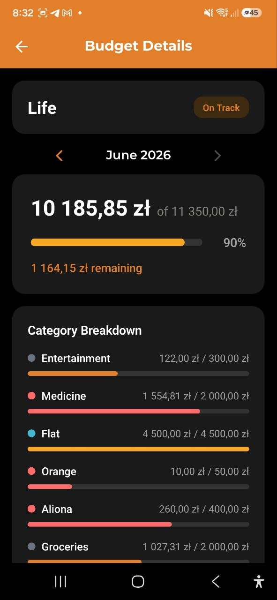

# Orçamentos

> Defina limites de gastos e acompanhe seu progresso em tempo real. Crie orçamentos para categorias específicas ou distribua o orçamento entre várias categorias, com períodos personalizáveis e limites de alerta automáticos.

## Visão geral

Os orçamentos ajudam você a controlar os gastos definindo limites para períodos específicos. O app compara suas despesas com esses limites e avisa quando você está chegando perto do orçamento ou passando dele.

## Lista de orçamentos

A aba **Orçamento** mostra todos os seus orçamentos ativos:

- **Nome do orçamento** e período (Diário, Semanal, Mensal, Anual, Personalizado)
- **Barra de progresso** — indicador visual dos gastos em relação ao limite
- **Valor gasto** em relação ao orçamento total (por exemplo, “2.846 zl de 20.000 zl”)
- **Selo de status**:
  - **Dentro do previsto** (verde) — os gastos estão dentro do limite
  - **Acima do orçamento** (vermelho) — os gastos passaram do limite
- Valor **restante** ou excedente

> **Observação:** Se você ainda não tiver nenhum orçamento, verá a mensagem: “Crie um orçamento para começar a controlar seus limites de gastos.”

## Criar um orçamento

### Passo a passo

1. Toque em **Criar orçamento** na aba Orçamento (ou no botão **+**)
2. Digite o **Nome do orçamento** (por exemplo, “Mercado mensal”) — é opcional: se ficar em branco, o orçamento recebe o nome da categoria ou do período (“Orçamento mensal”)
3. Selecione a **Moeda**
4. Escolha o **Tipo de orçamento**:
   - **Geral** — define um único valor total, opcionalmente vinculado a uma categoria
   - **Por categoria** — distribui o orçamento entre várias categorias, cada uma com seu próprio limite
5. Informe o **Valor** (modo Geral) ou adicione categorias com valores (modo Por categoria)
6. Escolha um **Período**:
   - **Diário** — reinicia todo dia
   - **Semanal** — reinicia toda semana
   - **Mensal** — reinicia todo mês
   - **Anual** — reinicia todo ano
7. Defina o limite **Alertar em** (padrão: 80%) — você recebe uma notificação quando os gastos atingem essa porcentagem
8. Toque em **Criar orçamento**

### Modo Por categoria

No modo **Por categoria**, você pode atribuir um limite de gastos a cada categoria de despesa:

- Toque em **Adicionar categoria** para escolher uma categoria da lista
- Informe o valor de cada categoria
- O orçamento total é igual à soma dos valores de todas as categorias
- Você pode adicionar quantas categorias precisar

## Recibos escaneados e orçamentos por categoria

Quando um recibo escaneado é dividido automaticamente entre categorias — mercado, produtos de casa, vasilhame de garrafas —, a parte de cada categoria agora conta para o orçamento dessa categoria, proporcionalmente à divisão. Um orçamento em uma categoria que só aparece dentro de uma divisão de recibo, como Bebidas alcoólicas ou um orçamento de vasilhame, finalmente acompanha os gastos em vez de mostrar sempre zero — e um orçamento de Mercado deixa de contar os produtos de casa ou o vasilhame do mesmo recibo.

Isso vale também para os recibos que você já escaneou, não só para os novos — os totais dos seus orçamentos, incluindo o Histórico de gastos, são atualizados automaticamente. Não é preciso escanear nada de novo.

## Detalhes do orçamento

Toque em qualquer orçamento para ver todos os detalhes:

- **Visualização do progresso** — barra com o gasto em relação ao limite
- **Status** — Dentro do previsto ou Acima do orçamento
- **Divisão por categoria** — nos orçamentos com várias categorias, veja o progresso de cada uma:
  - Ponto colorido + nome da categoria
  - Valores gastos / atribuídos
  - Barra de progresso por categoria (verde/amarelo/vermelho conforme o uso)
- **Subcategorias** — se uma categoria que você atribuiu tiver subcategorias (por exemplo, Mercado com Pão e Queijo), a linha dela soma o grupo inteiro e mostra embaixo a divisão por subcategoria, além de uma linha **Sem subcategoria** para os gastos classificados diretamente na categoria principal. Gastos em uma subcategoria que também tenha um valor atribuído próprio contam nas duas linhas, mas o total geral do orçamento conta cada despesa só uma vez. A estrutura atual de categorias também é usada para os períodos anteriores, então mover uma categoria altera os números anteriores.
- **Período** — o intervalo de tempo do orçamento
- **Limite de alerta** — o ponto em que a notificação é disparada (por exemplo, 80%)
- **Dias restantes** — quantos dias faltam no período atual
- **Total previsto** — estimativa do gasto total no fim do período, com base no ritmo atual
- **Ativo/Inativo** — o status atual do orçamento

### Ações:
- **Editar** (ícone de lápis) — alterar nome, valor, categorias, período ou limite de alerta
- **Excluir** — remover o orçamento (com confirmação)

## Histórico de gastos

O cartão **Histórico** mostra como você se saiu em relação a este orçamento nos últimos 6 períodos. Ele está disponível para todos os tipos de período, exceto Personalizado.

- **Gráfico de barras** — cada grupo mostra duas barras: seu gasto real (colorido) e o limite do orçamento (cinza) naquele período.
  - Barra verde — gasto dentro do limite
  - Barra vermelha — limite ultrapassado
- **Resumo de cumprimento** — por exemplo, “Acima do orçamento em 3 de 6 períodos” ou “Economia média: $42”
- **Excesso médio** — se você estourou o limite em alguns períodos, mostra o valor médio pelo qual o excedeu

> **Dica:** Use o cartão de histórico para identificar padrões repetidos de gastos acima do limite. Se você vir 3–4 barras vermelhas seguidas, considere aumentar o limite ou ajustar seus hábitos nessa categoria.

## Mês financeiro (início de período personalizado)

Por padrão, os orçamentos mensais seguem o mês do calendário. Se sua receita cai no meio do mês, o Proprietário da conta pode mudar o dia de início — por exemplo, o dia 10 faz o período de um orçamento mensal ir do dia 10 ao dia 9 do mês seguinte. Configure isso em **Configurações da conta → Mês financeiro** (veja [Contas](./09-accounts.md)). A alteração vale retroativamente para os períodos e o histórico anteriores, sem alterar nenhum dado de despesas ou receitas.

## Editar um orçamento

Toque no **ícone de lápis** na tela de detalhes do orçamento para entrar no modo de edição:

- Altere o nome, a moeda, o período ou o limite de alerta do orçamento
- Alterne entre os modos **Geral** e **Por categoria**
- No modo Por categoria: adicione, remova ou altere os valores das categorias
- Toque em **Salvar** para aplicar as alterações, ou em **Cancelar** para descartá-las

## Alertas de orçamento

O app monitora seus orçamentos automaticamente e envia notificações:

- **Alerta de limite** — quando os gastos atingem a porcentagem de alerta definida (por exemplo, 80%)
- **Alerta de orçamento estourado** — quando os gastos passam de 100%
- A cor da barra de progresso muda dinamicamente:
  - Verde — menos de 80% usado
  - Amarelo/Laranja — 80–100% usado
  - Vermelho — mais de 100% usado

> **Dica:** O cartão Orçamento mensal no Painel mostra de relance o status do seu orçamento principal.

## Perguntas frequentes

- **P: Posso ter vários orçamentos ao mesmo tempo?**
  **R:** Sim! Você pode criar quantos orçamentos precisar — para categorias, períodos diferentes ou para os gastos em geral.

- **P: Qual é a diferença entre os modos Geral e Por categoria?**
  **R:** O modo Geral define um único limite total (opcionalmente para uma só categoria). O modo Por categoria permite definir limites individuais para cada categoria — útil quando você quer acompanhar separadamente mercado, transporte e lazer dentro de um mesmo orçamento.

- **P: O que acontece quando o período de um orçamento termina?**
  **R:** O orçamento reinicia automaticamente para o novo período. Seus dados de gastos anteriores continuam disponíveis em Análises.

- **P: O orçamento acompanha despesas em todas as moedas?**
  **R:** Cada orçamento está vinculado a uma moeda. Só as despesas nessa moeda contam para o orçamento.

## Reduzir uma categoria em uma porcentagem

Ao escolher uma categoria ao criar um orçamento, você pode escolher **10 / 20 / 30% a menos** do que no mês passado, a média de 3 meses ou o mesmo mês do ano passado. O valor é preenchido para você; depois é um orçamento normal.

---

*Veja também: [Painel](./02-dashboard.md) | [Análises](./06-analytics.md)*
