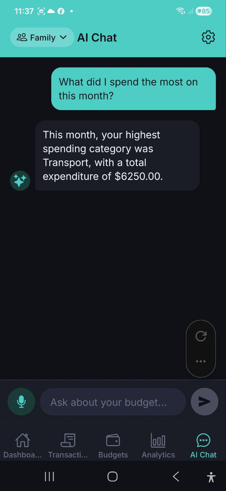

# Chat IA

> Faça perguntas sobre suas finanças em linguagem natural. Receba análises de gastos, conselhos de orçamento e dicas de economia personalizadas — com tecnologia de IA.

## Visão geral

A aba **Chat IA** é o seu assistente financeiro pessoal. Você pode fazer perguntas em linguagem simples e receber respostas detalhadas com base nos seus dados reais de gastos.

## Como usar

1. Toque na aba **Chat IA** (a aba mais à direita na navegação inferior)
2. Digite uma pergunta no campo de texto na parte de baixo (texto de exemplo: “Pergunte sobre seu orçamento...”)
3. Toque no botão de **enviar** (ícone de seta)
4. Leia a resposta da IA no balão do chat

O assistente de IA responde com uma análise baseada nos dados reais das transações da conta atual.

## Botões de ação rápida

Três botões predefinidos aparecem para as perguntas mais comuns:

| Botão | Pergunta enviada |
|---|---|
| **Maiores gastos** | “Com o que eu mais gastei este mês?” |
| **Situação do orçamento** | “Estou dentro do orçamento?” |
| **Dicas de economia** | “Me dê dicas para economizar dinheiro” |

Toque em um botão para enviar essa pergunta na hora.

## Entrada por voz no chat

1. Toque no botão do **microfone** (à esquerda do campo de texto)
2. Fale sua pergunta
3. O texto transcrito é processado e enviado

> **Observação:** enquanto a voz está sendo transcrita, aparece o status “Processando a voz...”.

## Exemplos de perguntas

**Perguntas de análise:**
- “Com o que eu mais gastei este mês?”
- “Quanto gastei com comida na semana passada?”
- “Estou dentro do orçamento?”
- “Compare meus gastos deste mês com os do mês passado”
- “Quais são minhas 3 principais categorias de despesa?”
- “Quanto gastei com transporte este ano?”
- “Me dê dicas para economizar dinheiro”
- “Nesse ritmo, quando meu orçamento mensal vai acabar?”

**Comandos em linguagem natural:**
- “Adicione uma despesa de 500₴ em mercado”
- “Crie um orçamento de 10000₴ para lazer em março”
- “Adicione uma receita de 50000₴ de salário”
- “Mostre minhas despesas da semana passada”
- “Qual é a situação do meu orçamento?”
- “Mostre a divisão por categorias deste mês”

Se a sua conta tiver um **Mês financeiro** (por exemplo, começando no dia do pagamento, dia 10), "este mês" e "mês passado" no chat se referem a esses períodos — este mês conta a partir do dia 10 — e um mês que você citar, como *outubro*, vai de 10 de outubro a 9 de novembro.

## Perguntando sobre um produto específico

Você pode perguntar quanto gastou com um produto, marca ou loja específicos:

- “Quanto gastei com cerveja?”
- “Quanto com café este ano?”

O assistente procura **dentro dos seus recibos escaneados**, e não só no nome da despesa — então um produto comprado numa grande compra de mercado também entra na conta, e só o preço desse item é somado (não o recibo inteiro). Ele entende **qualquer idioma, nomes de marcas e erros de digitação** — por exemplo, “пиво”, “beer” ou “cerveja” encontram as mesmas compras de cerveja. Se você não mencionar um período, a busca cobre todo o seu histórico.

## Perguntando sobre vasilhame

Em muitos países, as lojas cobram um depósito à parte pelas garrafas, latas e engradados retornáveis. Você pode perguntar ao assistente quanto já pagou por isso:

- “Quanto paguei de vasilhame?”
- “Quanto de kaucja este mês?”

O assistente responde com o total, de quantos recibos ele veio e as lojas onde você mais pagou. Pergunte do seu jeito — o termo local funciona em todos os idiomas que o app suporta (kaucja, Pfand, statiegeld, consigne, depósito, vasilhame, bottle deposit). Se você não mencionar um período, a resposta cobre todo o seu histórico.

O valor vem da linha de depósito impressa nos seus **recibos escaneados**, então também conta recibos que o app não conseguiu dividir em categorias. É o valor que você já **pagou**, não um reembolso que ainda possa receber — o app não acompanha quais embalagens você devolveu. Despesas digitadas manualmente não têm depósito e, em uma conta totalmente criptografada, o assistente não consegue ler os valores.

## Perguntando sobre descontos

Você pode perguntar ao assistente quanto recebeu de desconto nas suas compras:

- “Quanto economizei em descontos este mês?”
- “Quanto de rabat este ano?”

O assistente responde com o total, de quantos recibos ele veio e as lojas que deram os maiores descontos. Pergunte do seu jeito — o termo local funciona em todos os idiomas que o app suporta (rabat, Rabatt, korting, réduction, descuento, discount). Se você não mencionar um período, a resposta cobre todo o seu histórico.

O valor vem do desconto impresso nos seus **recibos escaneados**, então também conta recibos que o app não conseguiu dividir em categorias. Despesas digitadas manualmente e importações do banco/Wise não têm valor de desconto e, em uma conta totalmente criptografada, o assistente não consegue ler os valores.

## Histórico de conversas

Você pode navegar pelas conversas anteriores com a IA e reabri-las a qualquer momento:

1. Toque no botão **Histórico** (ícone de relógio) no topo da aba do chat
2. Aparece uma lista das conversas anteriores, com título e data
3. Toque em uma conversa para carregar as mensagens
4. Você pode continuar a conversa digitando uma nova mensagem
5. Para começar do zero, toque no botão **Nova conversa** (canto superior esquerdo, visível quando uma conversa anterior está carregada)

> Depois do primeiro carregamento, o histórico de conversas também fica salvo localmente para acesso offline.

### Gerenciando uma conversa

Cada conversa da lista tem seu próprio menu **⋯**. No navegador, ele aparece
quando você passa o cursor sobre uma linha (ou quando ela é a conversa aberta); no celular
ele fica sempre visível, e um toque longo na linha abre o mesmo menu.

- **Renomear conversa** dá à conversa um nome escolhido por você. Até você fazer isso,
  o título é a primeira coisa que você digitou nela, o que raramente é o nome que
  você daria. Renomear não muda a posição da conversa na lista.
- **Fixar** mantém uma conversa no topo da lista, acima de uma linha divisória,
  não importa há quanto tempo você a usou. Fixar é **só seu** — muda a
  ordem que você vê, não a dos outros, e você pode fixar uma conversa
  compartilhada que outra pessoa iniciou. Toque em **Desafixar** para soltá-la.
- **Excluir** remove a conversa e as mensagens dela para sempre. Não dá para
  desfazer. Se a conversa for compartilhada, a confirmação diz isso claramente,
  porque excluí-la remove a conversa para todos os membros da conta, não só para
  você.

Você só pode renomear e excluir as conversas que você iniciou. Em uma conversa compartilhada
iniciada por outra pessoa, o menu oferece apenas **Fixar** — a única coisa que
faz sentido ali, já que a ordem da sua própria lista só diz respeito a você.

## Conversas compartilhadas

Se você compartilha uma conta com outros membros, pode transformar uma conversa em um **chat em grupo compartilhado**, em que todos conversam com a IA juntos.

- **Ativar ou desativar o compartilhamento:** quem iniciou a conversa vê a opção no topo do chat. No navegador, é um par de botões, **Privada** e **Compartilhada**, com a opção atual preenchida — assim você vê que a outra existe e pode tocar nela. No celular, o mesmo botão tem uma pequena seta de troca para mostrar que pode ser alternado. Qualquer membro pode compartilhar uma conversa que criou — não só o proprietário da conta. Você não pode alterar o compartilhamento de uma conversa que outra pessoa iniciou (ali você verá um rótulo “Compartilhada” somente leitura). A opção só aparece quando a conta tem mais de um membro.
- **Decidindo antes de começar:** a opção também funciona em uma conversa vazia.
  Escolha **Compartilhada** antes de digitar qualquer coisa e a conversa fica compartilhada
  desde a primeira mensagem, o que poupa todo mundo de ler a primeira metade de uma conversa
  de que ninguém nunca ficou sabendo.
- **Todos veem a conversa:** em uma conversa compartilhada, as mensagens dos outros membros aparecem com o nome deles, e as novas mensagens surgem automaticamente enquanto você está com o chat aberto.
- **Falar com uma pessoa em vez da IA:** digite **@** e escolha um membro para mencioná-lo. Quando você menciona um membro, a IA fica em silêncio — a mensagem é para essa pessoa, não para o assistente. Se você não mencionar ninguém, a IA responde normalmente.
- **Notificações:** se você mencionar um membro que não está vendo o chat no momento, ele recebe uma notificação push para não perder a mensagem. Isso respeita a configuração de notificação “Atividade em contas compartilhadas”.

> As conversas privadas funcionam exatamente como antes — só você as vê, e a IA sempre responde.

## Recursos do chat

- **Histórico de conversas** — as mensagens anteriores ficam preservadas durante a sessão e podem ser reabertas pelo botão Histórico
- **Indicador de digitação** — mostra “Pensando...” enquanto a IA processa sua pergunta
- **Tratamento de erros** — se algo der errado, você verá uma mensagem de erro com a opção de tentar de novo
- **Comandos em linguagem natural** — crie despesas, receitas, orçamentos e categorias e consulte dados em linguagem simples
- **Confirmação de ações** — ao criar registros financeiros, a IA mostra uma prévia e pede confirmação antes de salvar
- **Detecção inteligente de idioma** — a IA responde automaticamente no seu idioma (inglês, russo, ucraniano, bielorrusso, alemão, espanhol, francês, polonês, português)
- **Reconhecimento de moedas** — suporta os símbolos: ₴ (UAH), $ (USD), € (EUR), zł (PLN), £ (GBP), ₽ (RUB)
- **Bot do Telegram** — use o mesmo Chat IA pelo Telegram. Envie texto, voz ou fotos de recibos diretamente para o bot
- **Detecção automática de conta** — mencione o nome de uma conta na mensagem (por exemplo, “Mostre as despesas em Família”) e a IA consulta essa conta automaticamente

## Limites de solicitações de IA

Cada mensagem que você envia usa uma solicitação de IA da sua cota mensal:

| Plano | Solicitações de IA por mês |
|---|---|
| **Free** | 5 |
| **Pro** | 200 |
| **Business** | Ilimitadas |

Quando suas solicitações acabarem, o app vai sugerir que você faça upgrade do plano.

## Comandos em linguagem natural

Você pode **executar ações reais** direto do chat:

### Criando registros

1. Digite um comando como: **“Adicione uma despesa de 500₴ em mercado”**
2. A IA mostra um **cartão de confirmação** com:
   - Valor e moeda
   - Categoria (detectada automaticamente ou padrão)
   - Data (hoje, por padrão)
3. Toque em **Confirmar** para criar a despesa, ou em **Cancelar** para rejeitá-la
4. Depois da confirmação, a despesa é salva e você verá uma mensagem de sucesso

**Comandos de criação suportados:**
- **Despesas:** “Adicione uma despesa de 500₴ em mercado”, “Gastei 1200₴ com transporte ontem”
- **Receitas:** “Adicione uma receita de 50000₴ de salário”, “Recebi um bônus de 5000₴”
- **Orçamentos:** “Crie um orçamento de 10000₴ para lazer em março”, “Defina um orçamento mensal de 3000₴ para comida”
- **Categorias:** “Crie a categoria de despesa Comida”, “Adicione a categoria de receita Freelance”

### Comandos de dívidas e empréstimos

Gerencie suas dívidas direto do chat — sem precisar abrir a tela de Dívidas:

- **“A Sara me pagou $80”** → registra um pagamento parcial da dívida da Sara (mostra a confirmação antes)
- **“Emprestei $200 para o João até sexta”** → cria um novo registro de dinheiro que você emprestou
- **“Peguei 5000₴ emprestado da minha mãe”** → cria um novo registro de dinheiro que você pegou emprestado
- **“Mostre minhas dívidas”** → lista na hora todas as dívidas ativas com os saldos restantes

> Se você tiver várias dívidas com o mesmo nome de contato, a IA vai perguntar de qual você está falando.

### Comandos de metas de economia

Atualize o progresso das suas metas de economia sem sair do chat:

- **“Guardei $200 para o fundo das férias”** → atualiza o saldo atual da meta Férias
- **“Adicione 500₴ à meta do carro”** → aumenta o saldo da meta Carro
- **“Defina meu fundo de emergência como $3000”** → define o valor atual diretamente

> A IA identifica os nomes a partir da sua lista de metas ativas. Confirme a ação no cartão de prévia antes que ela seja salva.

### Consultando dados

Estes comandos são executados **na hora** e mostram os resultados:

- **“Mostre minhas despesas da semana passada”** → exibe a lista de despesas com o total
- **“Qual é a situação do meu orçamento?”** → mostra todos os orçamentos com barras de progresso
- **“Mostre a divisão por categorias deste mês”** → exibe os gastos por categoria com porcentagens
- **“Mostre minhas dívidas”** → lista todas as dívidas ativas com os valores devidos

> Quer conferir um número? Toque em qualquer despesa listada na resposta da IA (incluindo os recibos recentes mostrados sob um total de vasilhame ou de descontos) para abrir a tela de detalhes completa, com o recibo.

### Desfazendo a última ação

Errou logo depois de confirmar algo — valor errado, categoria errada, ou simplesmente mudou de ideia? Diga **“desfazer”**, **“desfaça isso”** ou **“cancele isso”** na mesma conversa.

1. Digite **“desfazer”** (ou “cancele isso”, “apague o último” — qualquer jeito de dizer funciona, em qualquer idioma)
2. A IA mostra um cartão de confirmação descrevendo o que vai desfazer
3. Toque em **Confirmar** para reverter, ou em **Cancelar** para deixar como está

Desfazer só alcança a **última** ação que você confirmou naquela conversa, e só até cerca de **15 minutos** depois da confirmação — ele não volta várias mensagens até algo em que você talvez já tenha mexido depois. Funciona para uma despesa, receita ou dívida recém-criada, um pagamento de dívida e uma atualização do saldo de uma meta de economia. Se você já editou esse registro depois de criá-lo, ou se passou tempo demais, o assistente avisa e sugere que você o edite manualmente.

## Perguntas frequentes

- **P: A IA tem acesso a todos os meus dados financeiros?**
  **R:** A IA pode acessar suas despesas, receitas, orçamentos e categorias da conta selecionada no momento. Ela não acessa outras contas nem dados pessoais além das transações financeiras.

- **P: Posso usar o Chat IA offline?**
  **R:** Não, o Chat IA precisa de conexão com a internet para processar suas perguntas.

- **P: A IA deu uma resposta errada. O que devo fazer?**
  **R:** As respostas da IA se baseiam nos seus dados, mas às vezes podem ser imprecisas. Você pode reformular a pergunta para obter resultados melhores, tocar em qualquer despesa listada para conferi-la na própria tela de detalhes e no recibo, ou verificar os dados na aba Análises.

- **P: Posso desfazer uma ação confirmada?**
  **R:** Sim — diga “desfazer” ou “cancele isso” na mesma conversa, logo depois de confirmar. Isso reverte a última ação que você confirmou, até cerca de 15 minutos depois da confirmação. Veja [Desfazendo a última ação](#desfazendo-a-última-ação) acima. Depois desse prazo, ou para algo mais antigo, exclua manualmente na aba Transações.

- **P: O que acontece se eu rejeitar uma ação?**
  **R:** Se você tocar em “Cancelar” em um cartão de confirmação, a ação é rejeitada e nada é salvo. A IA confirma a rejeição.

- **P: Posso usar o Chat IA pelo Telegram?**
  **R:** Sim! Vincule seu Telegram nas Configurações e converse diretamente com o bot de IA. Todos os recursos funcionam do mesmo jeito — texto, voz, comandos e escaneamento de recibos. Veja [Bot do Telegram](./22-telegram-bot.md) para mais detalhes.

- **P: Como a IA sabe sobre qual conta estou perguntando?**
  **R:** Se você mencionar o nome de uma conta na mensagem (por exemplo, “despesas em Família”), a IA consulta essa conta automaticamente. Caso contrário, usa sua conta padrão atual.

- **Q: Posso perguntar à IA como o próprio app funciona?**
  **A:** Sim. Pergunte com palavras simples, por exemplo "como divido um recibo?" ou "onde altero minha moeda?". A IA responde com base nesta central de ajuda e mostra um cartão com os artigos usados — toque em um para abri-lo. Se não houver artigo correspondente, ela avisa. O texto de ajuda pode ficar um pouco atrás da versão mais recente do app.

---

*Veja também: [História dos gastos](./08-spending-story.md) | [Análises](./06-analytics.md)*
