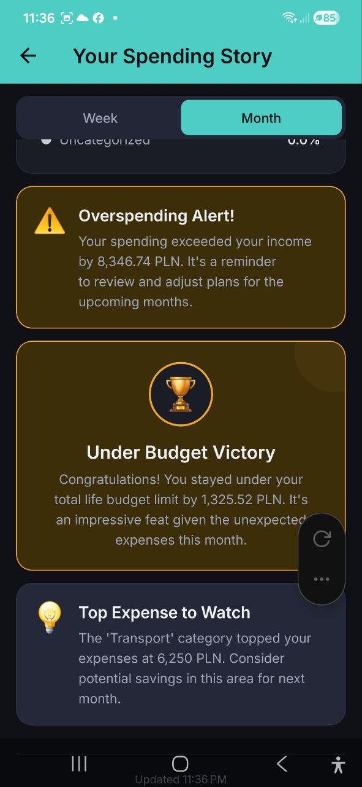

# História dos gastos

> Receba um relatório narrativo das suas finanças gerado por IA. Veja conquistas, alertas e insights apresentados como uma história visual envolvente.

## Visão geral

O recurso **História dos gastos** cria um relatório personalizado, em estilo narrativo, da sua atividade financeira. Ele destaca os principais acontecimentos, as conquistas e os pontos de atenção em um formato de cartões fácil de ler.

## Como acessar

- Na aba **Análises**, toque no banner **Ver a história dos seus gastos**
- A história é gerada automaticamente com base no período selecionado

## Seletor de período

No topo da tela da história dos gastos:

- **Semana** — história sobre as finanças da semana atual
- **Mês** — história sobre as finanças do mês atual

Toque para alternar entre as visualizações. O conteúdo da história é atualizado de acordo.

## Blocos da história

A IA gera vários tipos de blocos de insights:

### Alerta de gastos acima da receita (aviso)
- Cartão amarelo com ícone de aviso
- Aparece quando seus gastos ultrapassam sua receita
- Exemplo: *“Seus gastos ultrapassaram sua receita em 8.346,74 PLN. É um lembrete para revisar e ajustar os planos para os próximos meses.”*

### Vitória abaixo do orçamento (conquista)
- Cartão dourado com ícone de troféu
- Aparece quando você ficou abaixo do limite de um orçamento
- Exemplo: *“Parabéns! Você ficou 1.325,52 PLN abaixo do limite do seu orçamento total de vida. É um feito impressionante, considerando as despesas inesperadas deste mês.”*

### Principal despesa para ficar de olho
- Cartão azul com ícone de lâmpada
- Destaca a categoria com mais gastos
- Exemplo: *“A categoria ‘Transporte’ liderou suas despesas, com 6.250 PLN. Considere possíveis economias nessa área no próximo mês.”*

### Outros elementos da história
- **Divisão por categorias** com porcentagens
- **Resumos narrativos** que descrevem seu panorama financeiro geral
- **Comparações** com períodos anteriores
- **Gráficos e visualizações** incorporados na história

## Moeda

A história é contada na sua **moeda de exibição** — a escolhida no botão de moeda da tela inicial. Despesas, receitas e valores de orçamento registrados em outras moedas são convertidos para ela pela cotação de hoje antes de a história ser escrita, para que os totais fechem; a história avisa quando os valores foram convertidos e, por isso, são aproximados. Uma única cobrança alta em outra moeda não decide mais a moeda da história inteira. Mudar a moeda de exibição gera a história de novo na nova moeda.

## Ações

- **Gerar novamente** — toque para pedir uma história nova com dados atualizados
- **Compartilhar história** — compartilhe a história dos seus gastos com outras pessoas
- Indicação **Atualizado** — mostra quando a história foi gerada pela última vez

## Requisitos

- **Assinatura Pro ou Business** necessária — usuários do plano Free veem um convite para fazer upgrade
- **Dados de transações suficientes** — o app precisa de despesas suficientes para gerar insights relevantes. Se não houver dados suficientes, você verá: “Ainda não há dados suficientes para gerar uma história”
- Cada geração da história usa solicitações de IA da sua cota mensal

## Perguntas frequentes

- **P: Com que frequência devo conferir a história dos gastos?**
  **R:** A história é mais útil no fim de cada semana ou mês. Toque em **Gerar novamente** para ter a análise mais recente.

- **P: Posso compartilhar a história dos gastos?**
  **R:** Sim, toque em **Compartilhar história** para compartilhá-la pelas opções de compartilhamento do seu dispositivo.

---

*Veja também: [Análises](./06-analytics.md) | [Chat IA](./07-ai-chat.md)*
