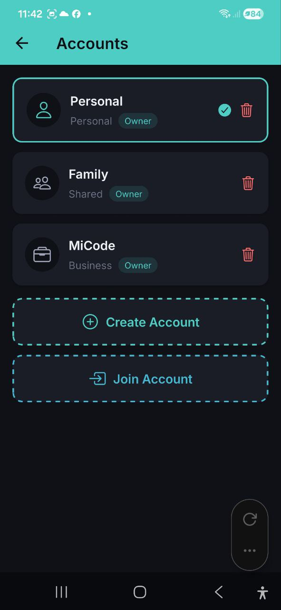
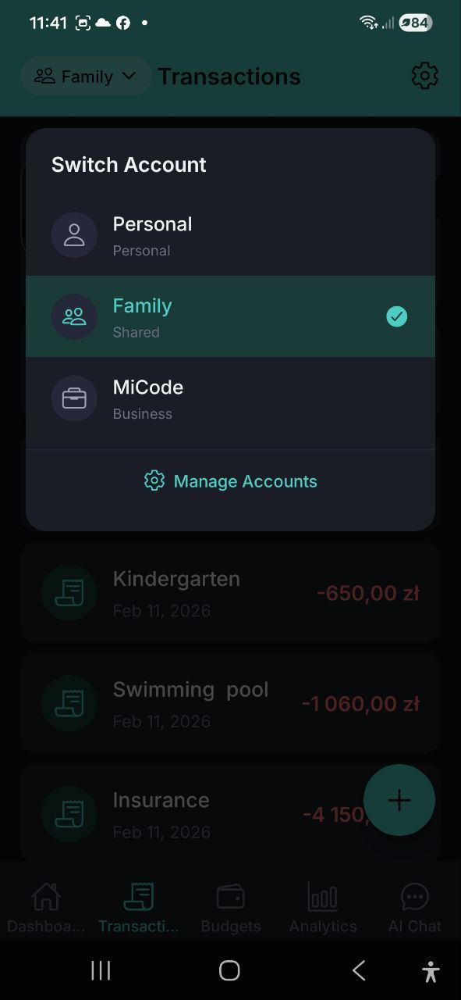
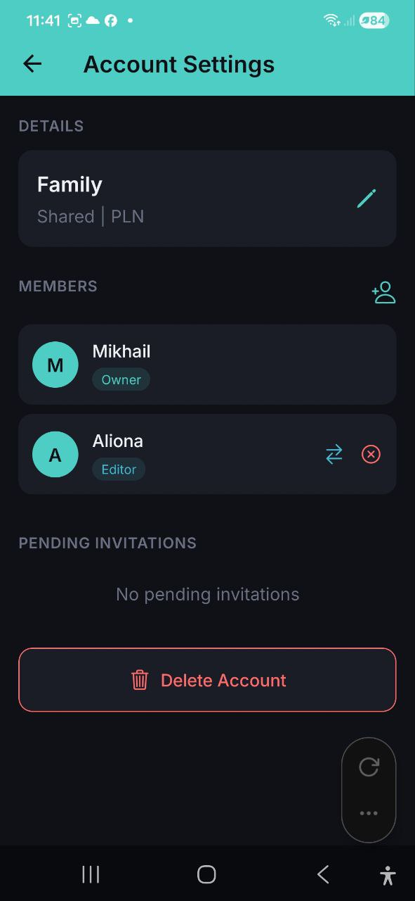

# Contas

> Organize suas finanças em contas separadas. Use Pessoal para o controle individual, Compartilhada para orçamentos da família e Empresa para despesas da empresa. Convide membros com controle de acesso por funções.

## Visão geral

O app suporta várias contas para separar diferentes contextos financeiros. Cada conta tem suas próprias despesas, receitas, orçamentos e carteira.

## Tipos de conta

| Tipo | Ícone | Finalidade |
|---|---|---|
| **Pessoal** | Ícone de pessoa | Controle individual de despesas |
| **Compartilhada** | Ícone de pessoas | Orçamentos da família ou de um grupo (por exemplo, “Família”) |
| **Empresa** | Ícone de maleta | Despesas de uma empresa ou equipe (por exemplo, “MiCode”) |
| **Investimento** | Ícone de tendência de alta | Acompanhar carteiras de investimento e ativos |
| **Viagem** | Ícone de avião | Conta compartilhada temporária para um grupo de viagem — divida as despesas entre os membros e acerte as contas sobre quem deve a quem ([Carteira de viagem em grupo](./35-group-trip-wallet.md)) |

Cada conta mostra o tipo e a sua função (Proprietário, Editor ou Visualizador).

## Trocando de conta

1. Toque no **nome da conta** no canto superior esquerdo de qualquer tela (por exemplo, “Família”)
2. O menu **Trocar de conta** se abre com todas as suas contas
3. Toque na conta para a qual você quer trocar
4. A conta ativa fica marcada com um visto verde
5. Todas as telas passam a mostrar os dados da conta selecionada

Toque em **Gerenciar contas** na parte de baixo do menu para ir à lista completa de contas.

## Mudando a moeda de exibição

Mude a moeda em que todos os seus totais são exibidos — de qualquer tela, sem abrir as Configurações.

Na tela inicial, o jeito mais rápido é o **botão de moeda** dedicado, ao lado do nome da conta — toque nele e escolha uma moeda. Nas outras telas:

1. Toque no **nome da conta** no canto superior esquerdo de qualquer tela. O símbolo da moeda atual aparece ao lado do nome (por exemplo, `Pessoal · $`).
2. No menu que se abre, procure a seção **Moeda de exibição** abaixo da sua lista de contas.
3. Toque na moeda desejada (USD, EUR, PLN, GBP, UAH, RUB, BYN).
4. Todos os valores do app são convertidos na hora para a moeda selecionada, pelas cotações mais recentes.

> Esta é a sua moeda de exibição pessoal e fica salva para a próxima vez. Ela só muda a forma como os valores são *exibidos* — suas transações mantêm as moedas originais. Cada membro (incluindo os Visualizadores) pode escolher a própria moeda de exibição.

## Criando uma conta

1. Abra a lista de contas (por **Gerenciar contas** ou pelas Configurações)
2. Toque em **Criar conta**
3. Digite um **Nome da conta** (por exemplo, “Meu orçamento”)
4. Selecione o **Tipo de conta**: Pessoal, Compartilhada, Empresa, Investimento ou Viagem
5. Selecione a **Moeda** desta conta
6. Toque em **Criar conta**

> **Observação:** o plano Free permite 3 contas, o Pro até 5 e o Business contas ilimitadas.

## Participando de uma conta

Se alguém encontrou você pela busca e enviou um convite direto, você não precisa de código:

1. Você recebe uma notificação push quando o convite chega
2. Toque nela (ou abra o sino de **Alertas** e mude para a aba **Convites**)
3. Toque em **Aceitar** para participar, ou em **Recusar** para descartar o convite
4. Os convites aceitos adicionam a conta à sua lista de contas na hora

Se, em vez disso, você recebeu um código ou link de convite:

1. Toque em **Participar de uma conta** na lista de contas
2. Digite o **código de convite** que você recebeu
3. Toque em **Participar**
4. Você verá uma mensagem de sucesso: “Você agora participa da conta!”
5. A conta passa a aparecer na sua lista de contas

## Configurações da conta

Toque em qualquer conta para abrir as configurações dela:

### Detalhes
- **Nome** da conta (editável pelo Proprietário)
- **Tipo** e **moeda** da conta (somente exibição)
- **Mês financeiro** (só o Proprietário) — muda o que “este mês” significa para os seus orçamentos

### Mês financeiro

Por padrão, os orçamentos seguem o mês do calendário (do dia 1 ao último dia). Se o seu salário ou sua principal receita cai em outro dia — digamos, no dia 10 —, você pode fazer os orçamentos seguirem esse dia:

1. Abra as Configurações da conta e toque na linha **Mês financeiro** (mostra “Mês do calendário (dia 1)” ou “O mês começa no dia N”)
2. Na janela que se abre, escolha **Mês do calendário (dia 1)** para voltar ao padrão, ou um dia de **1 a 31**
3. Toque em **Salvar**

> **Observação:** por enquanto, isso afeta só os **orçamentos** — como os períodos deles são calculados e quais gastos contam para cada um. Análises, relatórios e outras visualizações mensais continuam usando o mês do calendário.
>
> A mudança do dia é retroativa: os períodos e o histórico de orçamentos anteriores são recalculados de acordo, mas nenhum dado de despesas ou receitas muda.
>
> Se você escolher um dia que não existe em todos os meses (por exemplo, 31), o período simplesmente começa no último dia dos meses mais curtos (por exemplo, dia 28 ou 29 em fevereiro).

Visível só para o Proprietário da conta — Editores e Visualizadores não veem essa linha nas Configurações da conta. Mas, depois de definida, a data de início continua determinando os períodos e o histórico de orçamentos que todos os membros veem.

### Membros
- Lista de todos os membros da conta com as respectivas funções
- Cada membro mostra: avatar, nome e selo da função (Proprietário, Editor, Visualizador)

### Convidando membros

1. Abra as Configurações da conta
2. Toque no **ícone de convite** (ícone de pessoa com +, no canto superior direito da seção Membros)
3. Escolha o método de convite:
   - **Busca** — se a pessoa já tiver o app, procure por nome ou e-mail, selecione-a nos resultados, escolha a função e toque em **Enviar convite**. Ela recebe uma notificação push na hora — não precisa de código.
   - **Por e-mail** — digite o endereço de e-mail da pessoa, selecione a função (Editor ou Visualizador) e toque em **Enviar convite**
   - **Por link** — é gerado um código que você pode compartilhar. Toque para copiar ou compartilhar por apps de mensagens

### Gerenciando membros (só o Proprietário)

- **Alterar função** — toque no ícone de alteração de função ao lado de um membro para atribuir uma nova função
- **Remover membro** — toque no ícone de remoção para remover um membro (com confirmação)

### Convites pendentes

- Veja os convites que ainda não foram aceitos
- **Cancelar convite** — revogue um convite pendente

## Funções e permissões

| Permissão | Proprietário | Editor | Visualizador |
|---|---|---|---|
| Ver despesas e receitas | Sim | Sim | Sim |
| Adicionar/editar despesas | Sim | Sim | Não |
| Adicionar/editar receitas | Sim | Sim | Não |
| Criar/editar orçamentos | Sim | Sim | Não |
| Gerenciar membros | Sim | Não | Não |
| Editar as configurações da conta | Sim | Não | Não |
| Excluir a conta | Sim | Não | Não |

### Descrição das funções
- **Proprietário** — controle total da conta, pode gerenciar membros e configurações
- **Editor** — pode adicionar e editar despesas, receitas e orçamentos
- **Visualizador** — só pode ver os dados (acesso somente leitura)

## Excluindo uma conta

1. Abra as Configurações da conta
2. Role até o final e toque em **Excluir conta**
3. Confirme a exclusão

> **Atenção:** excluir uma conta remove permanentemente todos os dados dela (despesas, receitas, orçamentos). Essa ação não pode ser desfeita.

## Saindo de uma conta

Se você é membro (e não Proprietário) de uma conta compartilhada:
1. Abra as Configurações da conta
2. Toque em **Sair da conta**
3. Confirme — você será removido da conta

## Trocando de conta no Telegram

Ao usar o bot do Telegram, você pode trocar de conta de duas formas:

1. **Manualmente** — envie `/account` e toque no botão da conta
2. **Automaticamente** — mencione o nome de uma conta na mensagem (por exemplo, “Mostre as despesas em Família”) e a IA consulta essa conta para a solicitação atual

A detecção automática não muda sua conta padrão — ela vale só para a mensagem atual. Use `/account` para trocar de forma permanente.

## Perguntas frequentes

- **P: Quantas contas posso ter?**
  **R:** Free: 3 contas, Pro: até 5, Business: ilimitadas.

- **P: Posso transferir a propriedade de uma conta?**
  **R:** No momento, quem cria a conta é sempre o Proprietário. Entre em contato com o suporte para transferências de propriedade.

- **P: Em uma conta compartilhada, consigo ver quem adicionou uma despesa?**
  **R:** As despesas em contas compartilhadas mostram qual membro as criou.

- **P: Posso usar contas diferentes no bot do Telegram?**
  **R:** Sim. Envie `/account` para trocar sua conta padrão, ou simplesmente mencione o nome da conta na mensagem para consultas pontuais. Veja [Bot do Telegram](./22-telegram-bot.md) para mais detalhes.

---

*Veja também: [Configurações](./11-settings.md) | [Planos de assinatura](./12-subscription.md)*
