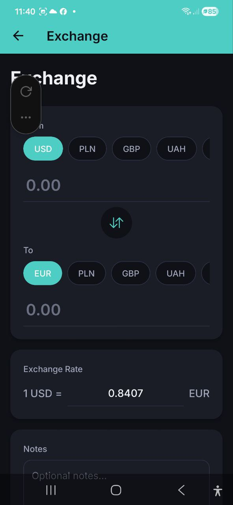

# Carteira e câmbio

> Acompanhe saldos em várias moedas e faça câmbio entre elas com cotações em tempo real. A carteira é atualizada automaticamente conforme você adiciona despesas e receitas.

## Visão geral

O recurso Carteira permite acompanhar seus saldos reais em cada moeda suportada. Conforme você adiciona despesas e receitas, a carteira é atualizada automaticamente para refletir sua situação financeira atual.

## Saldos da carteira

Acesse a Carteira por:
- **Painel** — toque em **Ver tudo** ao lado da seção Saldos da carteira
- **Painel** — toque no botão de ação rápida **Transferências** para acessar as transferências rapidamente
- **Configurações** — vá em Carteira > **Saldos**

Para cada moeda, você verá:

| Campo | Descrição |
|---|---|
| **Saldo atual** | Seu saldo em tempo real nesta moeda |
| **Saldo inicial** | O saldo de partida que você definiu |
| **Receita total** | Soma de todas as receitas nesta moeda |
| **Total gasto** | Soma de todas as despesas nesta moeda |
| **Câmbio recebido** | Valor recebido em operações de câmbio |
| **Câmbio enviado** | Valor gasto em operações de câmbio |
| **Transferências recebidas** | Valor recebido de outras contas |
| **Transferências enviadas** | Valor enviado para outras contas |

A fórmula: **Saldo atual = Saldo inicial + Receita total - Total gasto + Câmbio recebido - Câmbio enviado + Transferências recebidas - Transferências enviadas**

Uma moeda aparece sozinha na carteira assim que você registra dinheiro nela — uma despesa, receita, câmbio ou transferência. Enquanto você não definir um saldo inicial para ela, esse saldo é 0, então o cartão mostra exatamente o resultado das suas transações. Se você remover uma moeda da carteira, ela continua oculta mesmo que você continue registrando transações nela — defina um saldo para ela de novo para trazer o cartão de volta.

## Saldo total

Se você tem saldos em várias moedas, a carteira exibe um cartão **Saldo total** no topo. Esse cartão converte todos os seus saldos para a moeda escolhida nas configurações (definida em **Configurações** > **Moeda**) pelas cotações mais recentes, dando a você uma visão única e combinada das suas finanças.

Você pode mudar a moeda de exibição aqui mesmo: toque em um botão de moeda acima do total para recalcular na hora o total e o gráfico Histórico do saldo nessa moeda. Essa troca vale só para a visualização da tela Carteira — não muda a configuração de moeda do app inteiro e volta ao padrão quando você sai da tela.

## Histórico do saldo

No topo da tela Carteira, o cartão **Histórico do saldo** mostra, em um gráfico de barras, como seu saldo total mudou a cada mês:

- **Barras verdes** indicam que seu saldo cresceu naquele mês; **barras vermelhas** indicam que diminuiu.
- Toque em qualquer barra para ver a variação exata daquele mês.
- Use o seletor **6M / 12M** para alternar entre os últimos 6 ou 12 meses.
- Os valores seguem a moeda escolhida nos botões de moeda, convertidos pelas cotações mais recentes.
- Se você corrigiu seu saldo, essa correção aparece como uma parte cinza separada da barra (com legenda), para você ver quanto dinheiro ficou sem registro. Toque na barra para ver a variação registrada e a correção separadamente.

## Definindo o saldo inicial

Defina o saldo de partida de cada moeda:

1. Vá em **Configurações** > **Carteira** > **Definir saldo**
2. Selecione a **Moeda** (USD, EUR, PLN, GBP, UAH, RUB ou BYN)
3. Digite o **Valor** — seu saldo real atual nessa moeda
4. Toque em **Salvar**

Você verá uma confirmação: “Saldo definido com sucesso”.

> **Dica:** defina os saldos iniciais quando começar a usar o app, para que a carteira reflita suas finanças com precisão desde o primeiro dia.

## Câmbio de moedas

Faça câmbio entre as carteiras das suas moedas:

### Passo a passo

1. Toque em **Câmbio** nas ações rápidas do Painel, ou vá em **Configurações** > **Carteira**
2. Selecione a moeda **De** (por exemplo, USD) — toque em um botão de moeda para selecioná-la
3. Selecione a moeda **Para** (por exemplo, EUR) — toque em um botão de moeda para selecioná-la
4. Digite o valor no campo “De” ou no campo “Para” — o outro é calculado automaticamente
5. A **Cotação** é obtida automaticamente (por exemplo, “1 USD = 0,8407 EUR”)
6. Você pode tocar no botão de **inverter** (setas no centro) para trocar as moedas de lugar
7. Se quiser, edite a cotação manualmente caso tenha conseguido uma cotação diferente
8. Adicione **Observações** opcionais (por exemplo, “Câmbio no aeroporto” ou “Transferência bancária”)
9. Toque em **Trocar** para concluir

### Recursos

- **Cotações em tempo real** — obtidas e exibidas automaticamente
- **Botão de inverter** — troque rapidamente as moedas De e Para de lugar
- **Cotação manual** — edite a cotação se a sua cotação real for diferente
- **Campo de observações** — adicione contexto ao câmbio
- **Câmbios recentes** — veja seu histórico de câmbio

### Alertas de cotação

Você não precisa ficar conferindo a cotação o tempo todo. Na tela Câmbio, o cartão **Alertas de cotação** define um valor-alvo para o par selecionado e avisa você quando a cotação em tempo real chegar nele.

1. Selecione as moedas **De** e **Para** que interessam a você
2. Toque no **+** do cartão **Alertas de cotação**
3. Digite seu valor-alvo — o campo aparece como `1 <De> = ___ <Para>`
4. Escolha **acima de** ou **abaixo de**. O app pré-seleciona a opção que corresponde ao número digitado (acima de, se o valor-alvo for maior que a cotação atual; abaixo de, se for menor); toque na outra opção para mudar
5. Toque em **Adicionar alerta**

A cotação é verificada nos nossos servidores uma vez por hora, então funciona com o app fechado. Quando o valor-alvo é atingido, você recebe uma notificação — *“1 EUR agora vale 4,3512 PLN. Toque para trocar.”* — e, ao tocar nela, a tela Câmbio abre com esse par já selecionado.

Cada alerta dispara **uma única vez** e depois para, para que uma cotação oscilando em torno do seu valor-alvo não fique notificando você várias vezes. Crie um novo alerta se quiser continuar acompanhando esse par.

O cartão mostra os alertas do par selecionado, então trocar as moedas troca a lista — toque em **Mostrar tudo** no cartão, ou em **Alertas de cotação** na tela Carteira, para ver a lista completa.

É nessa tela que ficam todos os seus alertas: os que ainda estão aguardando e os que já dispararam, com a cotação e a data em que dispararam. Como um alerta só dispara uma vez, esse histórico é o único registro no app de que ele disparou — a notificação em si pode ser descartada. Ali você pode criar um alerta para qualquer par sem passar pelo formulário de câmbio, excluir qualquer alerta com o ícone de lixeira e manter até 20 aguardando ao mesmo tempo.

Os alertas de cotação são **pessoais**: valem para todas as suas contas, ninguém mais os vê, e um visualizador pode criá-los como qualquer outra pessoa. Não existe uma chave separada nas configurações de notificação — excluir o alerta é a forma de desativá-lo.

### Câmbios recentes

Abaixo do formulário de câmbio, você encontra os 5 câmbios de moeda mais recentes, com:
- Moedas trocadas (De → Para)
- Valores
- Cotação usada
- Data
- Observações (se adicionadas)

Toque em **Mostrar tudo** para abrir a tela completa Todos os câmbios.

### Histórico de câmbio

A tela **Todos os câmbios** exibe a lista completa de todos os seus câmbios de moeda. Acesse-a tocando em **Mostrar tudo** na seção Câmbios recentes.

Filtros disponíveis:
- **Moeda** — filtre por um par de moedas específico
- **Período** — escolha entre **Todo o período**, **Este mês**, **Últimos 3 meses** ou **Este ano**

### Editando ou excluindo um câmbio

Toque em qualquer câmbio do histórico para abrir a tela de detalhes. Ali você pode:
- Tocar no ícone de **lápis** para editar os valores, a cotação ou as observações — e depois em **Salvar**
- Tocar no ícone de **lixeira** para excluir o câmbio (aparece um pedido de confirmação)

Os saldos da carteira são recalculados automaticamente após edições ou exclusões.

## Transferências entre contas

As transferências entre contas permitem mover dinheiro entre contas diferentes — por exemplo, da sua conta Empresa para a sua conta Pessoal. Isso é diferente de um câmbio de moedas, que converte entre moedas dentro da mesma conta.

### Passo a passo

1. Vá em **Configurações** > **Carteira** > **Transferência**
2. Selecione **Da conta** (a conta de origem) — cada botão de conta mostra o saldo atual
3. Selecione **Para a conta** (a conta de destino)
4. Escolha a **Moeda**
5. Digite o **Valor** a transferir. **Disponível:**, abaixo do campo, mostra o saldo da conta de origem na moeda escolhida — toque em **Máx.** para preencher tudo
6. Se as contas usarem moedas diferentes, aparece um campo **Cotação** — ajuste-o se a sua cotação real for diferente
7. Escolha a **Data** — por padrão é hoje, então toque nela para registrar uma transferência feita antes
8. Adicione **Observações** opcionais (por exemplo, “Economia do mês” ou “Reembolso”)
9. Toque em **Transferir** para concluir

Se o valor for maior que o saldo que o app conhece, você verá um aviso — mas a transferência é salva mesmo assim. Ela nunca é bloqueada, porque você pode estar registrando uma transferência depois de feita, ou o saldo inicial da conta pode nunca ter sido definido.

Um travessão (—) no lugar de um saldo significa que o app ainda não tem um valor para essa conta. Os saldos das contas que não são aquela em que você está trabalhando vêm do servidor, então podem faltar na primeira vez que você abrir o formulário offline.

### Transferências frequentes

Se você já transferiu dinheiro antes, aparece uma linha **Frequentes** no topo do formulário com os trajetos que você mais usa (por exemplo, *Pessoal → Poupança 2000 PLN*). Toque em um deles e o formulário é preenchido — contas, moedas e o valor da última vez que você usou esse trajeto. Mude o que quiser antes de salvar.

Trajetos que envolvem uma conta à qual você não tem mais acesso não são sugeridos.

### Transferências recentes

Abaixo do formulário de transferência, você encontra as 5 transferências entre contas mais recentes, com:
- Contas de origem e destino (De → Para)
- Valor e moeda
- Cotação (se as moedas forem diferentes)
- Data
- Observações (se adicionadas)

Toque em **Mostrar tudo** para abrir a tela completa Todas as transferências.

### Histórico de transferências

A tela **Todas as transferências** exibe a lista completa de todas as suas transferências entre contas. Acesse-a tocando em **Mostrar tudo** na seção Transferências recentes.

Filtros disponíveis:
- **Conta** — filtre por uma conta de origem ou destino específica
- **Período** — escolha entre **Todo o período**, **Este mês**, **Últimos 3 meses** ou **Este ano**

### Editando uma transferência

Abra uma transferência em **Transferências recentes** ou na tela Todas as transferências e toque em **Editar**. Você pode alterar:
- As duas contas — a de origem e a de destino
- Os valores e a cotação
- A data
- As observações e a opção **Contar como receita**

Mudar uma conta também muda aquele lado da transferência para a moeda da própria conta. Se **Contar como receita** estiver ativado, o registro de receita correspondente também passa para a nova conta de destino.

Você pode mover qualquer um dos lados para qualquer outra conta da qual participa — inclusive uma mudança que deixa de fora da transferência a conta em que você está trabalhando. É exatamente assim que se corrige uma transferência que caiu na conta errada: ela passa a aparecer no histórico das duas contas às quais agora pertence e some da conta que ela não envolve mais.

Registrar, editar e excluir transferências funciona offline: a alteração fica no seu dispositivo e é enviada na próxima vez que a tela Carteira for aberta com conexão. Se o servidor recusar uma alteração — por exemplo, porque você não tem mais acesso a uma das contas escolhidas —, o app avisa e a transferência fica exatamente como estava.

Em uma conta compartilhada, todos os membros veem as transferências que envolvem essa conta, não importa quem as registrou; o saldo da conta sempre as contou de qualquer forma. Qualquer membro que poderia ter feito a transferência — ou seja, que participa das duas contas e não é visualizador do lado que paga — também pode corrigi-la ou excluí-la.

## Moedas suportadas

| Código | Moeda |
|---|---|
| USD | Dólar americano |
| EUR | Euro |
| PLN | Zloty polonês |
| GBP | Libra esterlina |
| UAH | Hryvnia ucraniana |
| RUB | Rublo russo |
| BYN | Rublo bielorrusso |

## Perguntas frequentes

- **P: De onde vêm as cotações?**
  **R:** As cotações são obtidas de um serviço online e atualizadas regularmente. Elas representam valores aproximados de mercado.

- **P: Posso fazer câmbio se não tiver saldo suficiente?**
  **R:** O app avisa que o saldo é insuficiente, mas você ainda pode registrar o câmbio para manter seus registros corretos.

- **P: Um câmbio de moedas conta como despesa?**
  **R:** Não. Os câmbios de moedas são separados das despesas — eles movem dinheiro entre as carteiras das moedas sem afetar seus totais de despesas.

- **P: Qual é a diferença entre uma transferência e um câmbio?**
  **R:** Um câmbio converte entre moedas dentro da mesma conta. Uma transferência move dinheiro entre contas diferentes (por exemplo, de Empresa para Pessoal).

- **P: Uma transferência afeta o saldo da minha carteira?**
  **R:** Sim. A carteira da conta de origem diminui e a carteira da conta de destino aumenta nos valores transferidos.

## Corrigindo um saldo

Se a carteira se distanciou do dinheiro que você realmente tem — pequenas compras que você nunca registrou —, não é preciso sair caçando cada uma:

1. Vá em **Configurações** > **Carteira** e toque em **Corrigir** no cartão da moeda
2. Digite o **saldo real** — o app mostra a diferença
3. Toque em **Salvar correção**

A diferença é registrada como um ajuste de saldo. Não é uma despesa nem uma receita, então orçamentos e análises não mudam. Se faltou dinheiro, o app mostra quanto ficou sem registro neste mês e oferece **Configurar lembretes de registro**.

> **Observação:** corrigir um saldo exige conexão com a internet. Visualizadores e contas de viagem arquivadas não podem corrigir um saldo.

As moedas suportadas também incluem CZK, SEK, NOK, DKK, HUF, RON e CHF.

---

*Veja também: [Painel](./02-dashboard.md) | [Configurações](./11-settings.md)*
