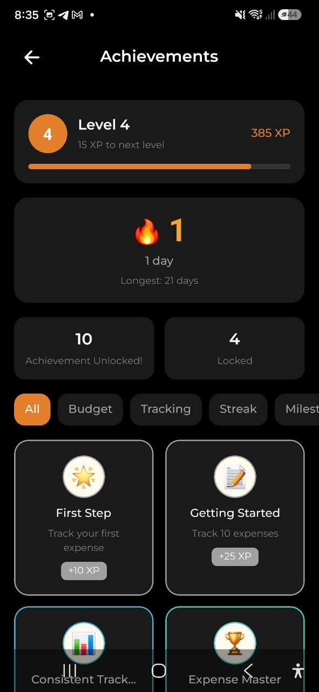

# Conquistas e gamificação

> Mantenha a motivação com conquistas, sequências diárias, XP e níveis. Acompanhe seus hábitos financeiros e ganhe medalhas conforme você cria constância.

## Visão geral

O sistema de gamificação recompensa você por registrar suas finanças com regularidade. Cada despesa, receita e orçamento que você gerencia conta para o seu progresso. Ganhe conquistas, mantenha sequências diárias e suba de nível enquanto cria hábitos financeiros melhores.

## Widget do Painel

Na tela inicial, você vê um card compacto de gamificação que mostra:

- **Nível** — seu nível atual, com uma barra de progresso de XP
- **Sequência** — sua sequência diária de registros atual (emoji de fogo quando está ativa, floco de neve quando está inativa)

Toque no widget para abrir a tela completa **Conquistas**.

## Conquistas

Conquistas são marcos que recompensam comportamentos financeiros específicos. Cada conquista tem:

- **Ícone** — um emoji que representa a conquista
- **Título e descrição** — o que você precisa fazer para ganhá-la
- **Raridade** — Comum, Rara, Épica ou Lendária
- **Recompensa de XP** — os pontos de experiência ganhos ao concluí-la
- **Progresso** — a porcentagem já cumprida (nas conquistas ainda não concluídas)

### Categorias de conquistas

| Categoria | Exemplos |
|---|---|
| **Marco** | Registrar a primeira despesa, chegar a 10/50/100/500 despesas |
| **Orçamento** | Criar o primeiro orçamento, ficar dentro do orçamento por 1 ou 3 meses |
| **Sequência** | Manter uma sequência de registros de 3/7/30/100 dias |
| **Economia** | Registrar a primeira receita, fechar um mês com receitas maiores que as despesas |

### Vendo as conquistas

1. Toque no widget de gamificação no Painel ou abra a tela Conquistas
2. Use os **filtros por categoria** (Todas, Orçamento, Registro, Sequência, Marco, Economia) para navegar
3. **Toque em qualquer medalha** para ver a descrição completa, a raridade, o valor em XP e o seu progresso

As conquistas concluídas aparecem coloridas, com a borda da sua raridade. As conquistas bloqueadas aparecem em cinza, com uma barra de progresso.

## Sequência diária

A sequência conta os dias seguidos em que você registra pelo menos uma despesa ou receita. Ela volta a zero se você pular um dia.

- **Sequência ativa** — mostrada com um emoji de fogo e o número de dias
- **Sequência interrompida** — mostrada com um emoji de floco de neve e um convite para recomeçar
- **Maior sequência** — seu recorde pessoal é guardado e exibido na tela Conquistas

> **Dica:** Adicione pelo menos uma transação por dia para manter sua sequência!

> **Lembrete de registro:** Se você não registrar despesas por 3 dias ou mais, o app envia uma notificação push para incentivar você a voltar. O lembrete se repete a cada 3 dias (dia 3, 6, 9…). Ative ou desative em **Configurações → Notificações → Lembrete de registro**.

## XP e níveis

- Cada conquista concluída dá XP (pontos de experiência)
- São necessários **100 XP** para subir um nível
- As recompensas vão de **10 XP** (conquistas comuns) a **500 XP** (conquistas lendárias)
- Seu nível e o progresso de XP aparecem tanto no widget do Painel quanto na tela Conquistas

## Raridade das conquistas

| Raridade | Cor | Faixa de XP |
|---|---|---|
| **Comum** | Cinza | 10-25 XP |
| **Rara** | Azul | 25-50 XP |
| **Épica** | Verde-azulado | 50-100 XP |
| **Lendária** | Dourado | 100-500 XP |

As conquistas lendárias têm um efeito especial de brilho dourado quando são desbloqueadas.

## Notificação de conquista desbloqueada

Quando você ganha uma nova conquista (por exemplo, depois de adicionar uma despesa), aparece uma janela de comemoração mostrando:

- O ícone e o nome da conquista
- O XP ganho
- Um botão para fechar

Essa notificação aparece automaticamente e não atrapalha o que você está fazendo.

## Perguntas frequentes

- **P: Como as conquistas são acompanhadas?**
  **R:** As conquistas são avaliadas automaticamente sempre que você adiciona uma despesa, uma receita ou um orçamento. Não é preciso fazer nada manualmente.

- **P: Minha sequência é zerada se eu estiver sem internet?**
  **R:** Sua sequência é calculada no servidor com base no seu fuso horário. Se você adicionar uma transação sem internet, ela será avaliada assim que você sincronizar.

- **P: As conquistas estão disponíveis no plano Free?**
  **R:** Sim! Todas as conquistas, sequências e recursos de gamificação são gratuitos para todos os usuários.

- **P: Posso ver meu progresso nas conquistas bloqueadas?**
  **R:** Sim, toque em qualquer medalha de conquista bloqueada para ver a porcentagem de progresso atual e o que falta para desbloqueá-la.

---

*Veja também: [Painel](./02-dashboard.md) | [Despesas e receitas](./03-expenses-and-income.md)*
