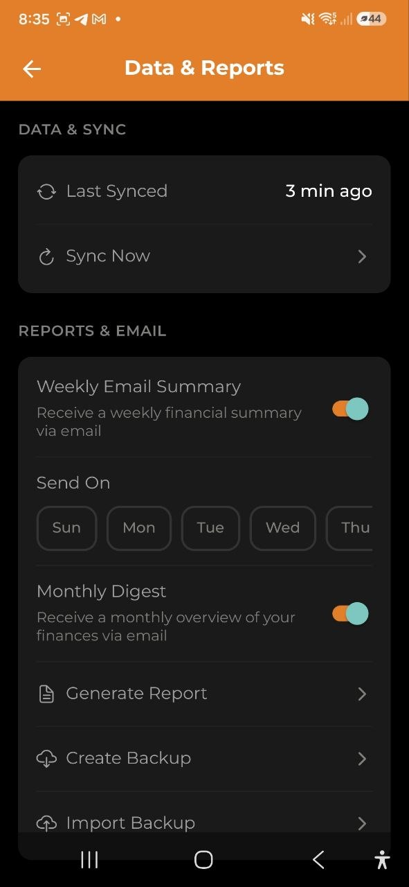

# Exportação e relatórios

> Gere relatórios das suas finanças em PDF, Excel e CSV. Veja resumos mensais dos gastos, crie backups criptografados e receba resumos automáticos por e-mail.

## Visão geral

A tela **Exportação e relatórios** permite gerar relatórios financeiros, ver resumos mensais, baixar e compartilhar relatórios e gerenciar backups dos seus dados. Acesse pela aba Análises, no botão **Exportar relatório**, ou em **Configurações** > **Relatórios e e-mail** > **Gerar relatório**.

## Formatos de relatório

Três formatos de exportação disponíveis:

| Formato | Descrição | Disponibilidade |
|---|---|---|
| **CSV** | Valores separados por vírgula, compatível com o Excel e o Google Sheets | Todos os planos |
| **PDF** | Relatório formatado com resumo, detalhamento por categoria e lista de transações | Todos os planos |
| **Excel** | Pasta de trabalho com várias planilhas: Resumo, Despesas e Receitas | Todos os planos |

Gerar relatórios e criar backups é gratuito em todos os planos. Só o envio automático por e-mail, descrito abaixo, exige um plano pago.

Os totais aparecem na **sua moeda de exibição** — a que está no seletor da tela inicial, e não a moeda de uma transação específica. Valores registrados em outra moeda são convertidos pelas cotações atuais antes de qualquer soma, e o relatório informa isso. Cada transação da lista mantém a própria moeda, então você sempre vê o que foi realmente registrado. Se uma cotação não estiver disponível, esse valor fica de fora dos totais, em vez de ser somado na moeda errada, e o relatório também informa isso.

## Gerando um relatório

1. Escolha um **formato** (CSV, PDF ou Excel)
2. Escolha um **período**:
   - **Semana passada** — os últimos 7 dias
   - **Este mês** — do dia 1º do mês até hoje
   - **Último trimestre** — o último trimestre *completo* do calendário (se você gerar em agosto, é abril-junho). Um período fechado, então os números não mudam mais
   - **Este ano** — de 1º de janeiro até hoje
   - **Mês específico** — qualquer mês inteiro dos últimos 24
   - **Período personalizado** — com a data de início e de fim que você escolher
3. Toque em **Gerar**
4. O relatório é gerado e **salvo**. No Android, um seletor de pastas abre e o arquivo é gravado onde você escolher - em seguida o app mostra o caminho. No iOS, o menu de compartilhamento abre para você usar “Salvar em Arquivos”. No app web, o arquivo é simplesmente baixado. Se você cancelar o seletor de pastas, nada é salvo; o relatório continua disponível mais abaixo.
5. O relatório também aparece em **Relatórios recentes**, mais abaixo, para acesso futuro

Se a sua conta tiver um **Mês financeiro** (por exemplo, começando no dia do pagamento, dia 10), **Este mês** começa nesse dia e **Mês específico** cobre esse período — *outubro* vai de 10 de outubro a 9 de novembro. Semana, trimestre e ano continuam no calendário.

Abaixo dos botões, você vê as datas exatas que o relatório vai cobrir — as mesmas impressas no cabeçalho do arquivo. Se um período personalizado estiver incompleto ou se a data de início for posterior à de fim, o botão **Gerar** fica desativado.

Se você abrir esta tela pelo botão **Exportar relatório** na aba Análises, o período que você estava vendo vem junto - volte até junho lá e o relatório será preparado para junho, não para o mês atual. Um período ainda em andamento termina hoje; um período já encerrado cobre toda a sua duração.

Os relatórios ficam armazenados por 7 dias e depois são excluídos automaticamente.

## Resumo mensal

Um retrato da atividade financeira do mês atual:

- **Receita total** e **Total de despesas**
- **Taxa de economia** — porcentagem da receita que foi economizada
- **Principais categorias** — as categorias com mais gastos, com os valores
- Os dados ficam em cache por 7 dias e são atualizados automaticamente
- Sempre o mês **atual** — não segue o período escolhido acima

## Relatórios recentes

Uma lista dos relatórios gerados recentemente, mostrando:

- Ícone do formato (CSV/PDF/Excel)
- Nome do arquivo e data de criação
- Tamanho do arquivo
- Botão **Baixar** — salva o arquivo diretamente no seu aparelho (Android: escolha a pasta pelo Storage Access Framework; iOS: salve em Arquivos)
- Botão **Compartilhar** — abre o menu de compartilhamento do sistema para enviar o relatório por e-mail, mensagem ou outros apps

## Backup dos dados

Disponível em **todos os planos**:

- **Criar backup** — cria um backup completo em JSON dos dados da sua conta (despesas, receitas, orçamentos, categorias, tags, projetos, carteiras etc.)
  - **Onde o arquivo é salvo:** No Android, um seletor de pastas abre e o backup é gravado na pasta que você escolher — em seguida o app mostra o caminho exato. Se você pular o seletor (ou no iOS), o menu de compartilhamento do sistema abre para você usar “Salvar em Arquivos”, Downloads ou um serviço de armazenamento em nuvem. A mensagem de sucesso só aparece depois que o arquivo foi de fato salvo ou compartilhado.
- **Importar backup** — importa um backup exportado anteriormente
- Se a criptografia estiver ativada, os campos criptografados entram no backup do jeito que estão

Acesse o backup em **Configurações** > **Relatórios e e-mail**.

## Relatórios por e-mail

Resumos automáticos entregues na sua caixa de entrada:

| Recurso | Descrição | Plano necessário |
|---|---|---|
| **Resumo semanal por e-mail** | Visão geral semanal dos gastos com as principais categorias | Business |
| **Resumo mensal** por e-mail | Resumo mensal com comparação com o mês anterior | Pro e Business |

O resumo mensal chega no dia 1º com o mês do calendário que acabou de terminar. Se a conta tiver um **Mês financeiro** (por exemplo, começando no dia do pagamento, dia 10), ele chega nesse dia e cobre o período que acabou de terminar — de 10 de outubro a 9 de novembro — comparado com o anterior.

Configure-os em **Configurações** > **Relatórios e e-mail**:

- Ativar/desativar os e-mails semanais e mensais
- Escolher o dia da semana dos relatórios semanais (segunda-feira por padrão)

## Criptografia e relatórios

- **Nível 0** (sem criptografia) — todos os dados aparecem corretamente nos relatórios
- **Nível 1** (criptografia de texto) — os valores aparecem corretamente; os nomes das categorias e as descrições podem aparecer vazios nos relatórios gerados pelo servidor. O resumo mensal obtém os nomes das categorias a partir dos dados locais do seu aparelho
- **Nível 2** (criptografia total) — os relatórios não estão disponíveis (os valores estão criptografados no servidor)

## Perguntas frequentes

- **P: Por que os nomes das categorias aparecem vazios no meu relatório em PDF?**
  **R:** Se você ativou a E2EE (Nível 1), os nomes das categorias estão criptografados no servidor. O relatório gerado pelo servidor não consegue descriptografá-los. Os valores continuam corretos.

- **P: Por quanto tempo os relatórios ficam armazenados?**
  **R:** Os relatórios são excluídos automaticamente depois de 7 dias. Baixe-os logo depois de gerar.

- **P: Posso exportar dados de uma conta compartilhada?**
  **R:** Sim, qualquer membro da conta pode gerar relatórios e backups da conta compartilhada.

- **P: O que entra em um backup?**
  **R:** Tudo: despesas, receitas, orçamentos, categorias, tags, projetos, carteiras, transferências e câmbios de moeda da conta atual.

---

*Veja também: [Análises](./06-analytics.md) | [Configurações](./11-settings.md) | [Planos de assinatura](./12-subscription.md) | [Criptografia](./15-encryption.md)*
