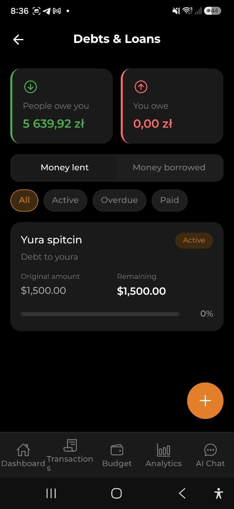

# Dívidas e empréstimos

> Registre o dinheiro que você empresta e o que pega emprestado. Veja quem deve a você, a quem você deve, registre pagamentos e acompanhe os vencimentos — tudo integrado às suas despesas e receitas.

## Visão geral

O recurso Dívidas e empréstimos permite acompanhar dois tipos de obrigações financeiras:

- **Dinheiro emprestado a outros** — dinheiro que você deu a alguém (registrado como despesa marcada como dívida)
- **Dinheiro que você pegou emprestado** — dinheiro que alguém deu a você (registrado como receita marcada como dívida)

Os pagamentos funcionam do mesmo jeito:
- Quando alguém **paga você**, isso é registrado como receita vinculada à despesa original da dívida
- Quando **você paga** alguém, isso é registrado como despesa vinculada à receita original da dívida

O status da dívida é calculado automaticamente:
- **Ativa** — ainda há saldo em aberto
- **Paga** — a dívida foi totalmente quitada
- **Atrasada** — o vencimento já passou e ainda há saldo em aberto

## Criar uma dívida

O jeito mais rápido de adicionar uma dívida é pela tela **Dívidas e empréstimos**:

1. Abra a tela **Dívidas e empréstimos** (pelo widget do Painel ou pelas Configurações)
2. Toque no botão **+** no canto inferior direito
3. Escolha **Emprestar dinheiro** ou **Pegar dinheiro emprestado**
4. Preencha o valor, a descrição, o nome da pessoa e, se quiser, o vencimento
5. Toque em **Salvar**

Você também pode criar dívidas manualmente pelos formulários de despesa ou de receita (veja abaixo).

## Emprestar dinheiro

### Passo a passo

1. Vá em **Transações** e toque no botão **+**
2. Selecione **Entrada manual**
3. Digite o **valor** que você está emprestando
4. Digite uma **descrição** (por exemplo, “Empréstimo para o João”)
5. Ative a opção **Emprestar dinheiro**
6. Digite o **nome da pessoa** — para quem você está emprestando
7. Se quiser, defina um **vencimento** — quando você espera receber o dinheiro de volta
8. Toque em **Salvar despesa**

A despesa será marcada como dívida e aparecerá na tela Dívidas e empréstimos.

> **Observação:** O valor afeta o saldo da carteira como uma despesa comum (dinheiro saindo).

## Pegar dinheiro emprestado

### Passo a passo

1. Vá em **Transações**, mude para a aba **Receitas** e toque em **+**
2. Digite o **valor** que você está pegando emprestado
3. Digite uma **descrição** (por exemplo, “Empréstimo da Maria”)
4. Ative a opção **Pegar dinheiro emprestado**
5. Digite o **nome da pessoa** — de quem você está pegando emprestado
6. Se quiser, defina um **vencimento** — quando você precisa devolver
7. Toque em **Salvar receita**

A receita será marcada como dívida e aparecerá na tela Dívidas e empréstimos.

> **Observação:** O valor afeta o saldo da carteira como uma receita comum (dinheiro entrando).

## Registrar um pagamento

### Quando alguém paga você (dinheiro que você emprestou)

1. Abra a **despesa** original (o empréstimo que você fez)
2. Toque em **Registrar pagamento**
3. Você será levado a um novo formulário de receita, já preenchido com o nome da pessoa e a moeda
4. Digite o **valor do pagamento** (pode ser parcial)
5. Toque em **Salvar receita**

### Quando você paga alguém (dinheiro que você pegou emprestado)

1. Abra a **receita** original (o empréstimo que você recebeu)
2. Toque em **Registrar pagamento**
3. Você será levado a um novo formulário de despesa, já preenchido com o nome da pessoa e a moeda
4. Digite o **valor do pagamento** (pode ser parcial)
5. Toque em **Salvar despesa**

> **Dica:** Você pode registrar vários pagamentos parciais. O saldo restante é atualizado automaticamente.

## Tela Dívidas e empréstimos

Acesse a tela Dívidas e empréstimos em **Configurações > Dívidas e empréstimos**, ou tocando no widget de dívidas no Painel.

### Cartões de resumo

No topo da tela, dois cartões de resumo mostram:
- **Devem a você** — o total que os outros ainda devem a você (em verde)
- **Você deve** — o total que você ainda deve aos outros (em vermelho)

Os valores são convertidos automaticamente para sua moeda base com as cotações atuais.

### Abas

Alterne entre duas visualizações:
- **Dinheiro emprestado a outros** — dívidas em que você emprestou dinheiro a alguém
- **Dinheiro que você pegou emprestado** — dívidas em que você pegou dinheiro emprestado de alguém

### Filtros

Filtre as dívidas por status:
- **Todas** — mostra todas as dívidas
- **Ativas** — só dívidas com saldo em aberto
- **Atrasadas** — só dívidas com o vencimento já passado
- **Pagas** — só dívidas totalmente quitadas

### Cartão da dívida

Cada dívida mostra:
- **Nome da pessoa** — com quem é a dívida
- **Descrição** — a que se refere a dívida
- **Selo de status** — Ativa (azul), Atrasada (vermelho) ou Paga (verde)
- **Valor original** — o valor inicial da dívida, na moeda original
- **Valor restante** — quanto ainda falta pagar
- **Barra de progresso** — indicação visual do andamento do pagamento (porcentagem)
- **Vencimento** — quando a dívida vence (se tiver sido definido)

Toque em um cartão de dívida para ver todos os detalhes da despesa ou receita, onde você pode registrar pagamentos.

## Lembretes por notificação

Quando uma dívida tem vencimento, o app envia notificações automáticas para você não perder o controle:

- **3 dias antes do vencimento** — um lembrete antecipado: “Dívida vence em 3 dias: João”
- **No dia seguinte ao vencimento** — um alerta de atraso: “Dívida atrasada: João”

As notificações vão para quem registrou a dívida (o titular da dívida), não para a outra pessoa.

Para ativar ou desativar esses lembretes, vá em **Configurações → Notificações e integrações → Lembretes de dívidas**.

## Widget do Painel

O widget Dívidas e empréstimos fica sempre visível no Painel (quando ativado nas configurações de widgets):

- **Quando você tem dívidas:** mostra os totais “Devem a você” e “Você deve”, além de um botão **+** para abrir rapidamente a tela Dívidas e empréstimos
- **Quando você não tem dívidas:** mostra um estado vazio com o botão **Adicionar dívida** para começar

Toque no widget para ir direto para a tela Dívidas e empréstimos.

## Várias moedas

As dívidas podem estar em qualquer moeda suportada. Os totais de resumo no Painel e na tela de dívidas são convertidos automaticamente para sua moeda base com cotações em tempo real. Os cartões de cada dívida sempre mostram os valores na moeda original.

## Perguntas frequentes

- **P: Posso emprestar dinheiro em uma moeda e receber o pagamento em outra?**
  **R:** Os pagamentos são registrados na mesma moeda da dívida original, para garantir um acompanhamento preciso.

- **P: Emprestar dinheiro afeta meu orçamento?**
  **R:** Sim. Emprestar é registrado como despesa e pegar emprestado como receita. Os dois afetam o saldo da carteira e o acompanhamento do orçamento como qualquer outra transação.

- **P: Posso editar uma dívida depois de criá-la?**
  **R:** Sim. Toque na dívida para ver os detalhes e use o botão Editar. Você pode alterar a descrição, o nome da pessoa e o vencimento.

- **P: O que acontece quando uma dívida é totalmente quitada?**
  **R:** O status muda automaticamente para “Paga” e a barra de progresso mostra 100%. A dívida continua no histórico para consulta.

- **P: Como excluo uma dívida?**
  **R:** Abra os detalhes da dívida e toque em Excluir. Lembre-se de que isso também exclui a despesa ou receita associada.

---

*Veja também: [Despesas e receitas](./03-expenses-and-income.md) | [Carteira e câmbio](./10-wallet-and-exchange.md)*
