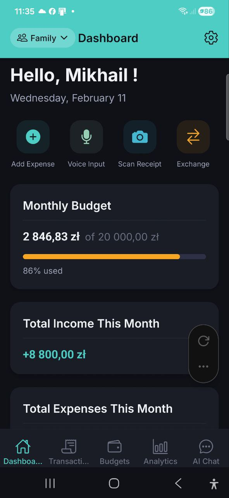

# Widgets da tela inicial

> Adicione widgets Android à tela inicial para acessar seus dados de gastos na hora — ou para adicionar despesas sem nem abrir o app.

## O que são widgets?

Widgets são pequenos painéis interativos que ficam na tela inicial do Android. O AI Budget Assistant oferece quatro widgets:

| Widget | Tamanho | O que mostra |
|--------|------|---------------|
| **Orçamento – Hoje** | Pequeno | Total gasto hoje + variação em relação a ontem |
| **Orçamento – Semana** | Médio | Gráfico de barras dos últimos 7 dias |
| **Orçamento – Visão geral** | Grande | Barras de progresso dos orçamentos + principais categorias de gastos |
| **Orçamento – Adição rápida** | Faixa compacta | Três botões que abrem o app com um toque |

> **Só Android.** O iOS não oferece suporte a widgets na tela inicial. Todos os mesmos recursos estão disponíveis dentro do app.

---

## Como adicionar um widget

1. **Toque e segure** em uma área vazia da tela inicial
2. Toque em **Widgets**
3. Role até encontrar **AI Budget Assistant**
4. **Toque e segure** o widget que você quer e arraste-o para a tela inicial
5. Solte para posicioná-lo

Repita para adicionar vários widgets.

---

## Orçamento – Hoje (pequeno)



O menor widget mostra um resumo rápido do dia:

- **Total de hoje** — o valor gasto
- **Indicador de variação** — se você gastou mais ou menos do que ontem (verde = menos, vermelho = mais)

**Tamanho**: 110 × 40 dp (cerca de 1 coluna × 1 linha na maioria dos launchers)

Toque no widget para abrir o app.

---

## Orçamento – Semana (médio)

O widget médio mostra um panorama da semana em um piscar de olhos:

- **Gráfico de barras** dos gastos de cada um dos últimos 7 dias
- **Total de hoje** exibido abaixo do gráfico

**Tamanho**: 250 × 110 dp (cerca de 2 colunas × 2 linhas)

Toque no widget para abrir o app.

---

## Orçamento – Visão geral (grande)

O widget grande é o seu painel financeiro na tela inicial:

- **Barras de progresso** de cada orçamento ativo — mostram quanto do período do orçamento você já usou
- **Principais categorias** de gastos, com os valores do período atual

**Tamanho**: 250 × 180 dp (cerca de 2 colunas × 4 linhas)

Toque no widget para abrir o app.

---

## Orçamento – Adição rápida

O widget Adição rápida permite começar a adicionar uma despesa com um só toque — sem precisar abrir o app antes.

```
┌──────────────────────────────────────┐
│   🎤 Voz   │  📷 Escanear  │ ✏️ Adicionar │
└──────────────────────────────────────┘
```

| Botão | O que acontece |
|--------|-------------|
| 🎤 **Voz** | Abre o app na tela de gravação de voz |
| 📷 **Escanear** | Abre o app no leitor de recibos |
| ✏️ **Adicionar** | Abre o app no formulário de despesa manual |

**Tamanho**: 250 × 60 dp (faixa horizontal compacta)

> **Dica:** A Adição rápida não exibe dados — está sempre atualizada e não gasta bateria com atualizações em segundo plano.

---

## Atualização dos dados dos widgets

| Widget | Intervalo de atualização |
|--------|-----------------|
| Orçamento – Hoje | A cada 30 minutos |
| Orçamento – Semana | A cada 30 minutos |
| Orçamento – Visão geral | A cada 30 minutos |
| Orçamento – Adição rápida | Estático, nunca é atualizado |

Os widgets com dados leem o armazenamento local do aparelho, então funcionam mesmo sem conexão com a internet.

---

## Perguntas frequentes

**P: Por que os widgets não aparecem na lista de widgets?**
R: Verifique se o app está instalado e se você já entrou na sua conta pelo menos uma vez. Se os widgets ainda não aparecerem, tente reiniciar o launcher ou reinstalar o app.

**P: Meu widget mostra “Ainda sem dados”. O que devo fazer?**
R: Abra o app e adicione pelo menos uma despesa, ou verifique se a sincronização terminou. O widget é atualizado em até 30 minutos, ou você pode forçar uma sincronização manualmente em **Configurações → Sincronizar agora**.

**P: Os widgets estão disponíveis no iOS?**
R: Não. Os widgets da tela inicial exigem Android. No iOS, todos os mesmos recursos estão disponíveis dentro do app.

**P: Posso redimensionar os widgets?**
R: Orçamento – Hoje e Orçamento – Adição rápida têm tamanho fixo. Orçamento – Semana pode ser redimensionado na horizontal. Orçamento – Visão geral pode ser redimensionado na horizontal e na vertical.

## Atalhos do launcher (Android)

Toque e segure o ícone do app para ir direto para **Adicionar despesa**, **Escanear recibo** ou **Voz**. Não é preciso configurar nada.

---

*Veja também: [Entrada por voz e escaneamento de recibos](./04-voice-and-receipt.md) | [Despesas e receitas](./03-expenses-and-income.md)*
