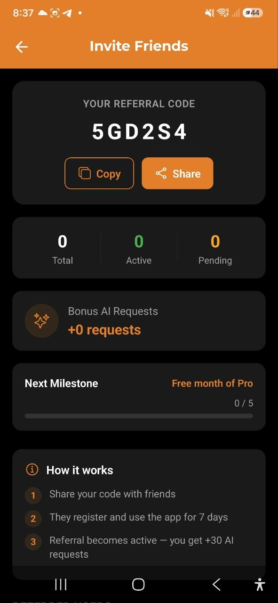

# Convidar amigos — Programa de indicação

> Convide amigos, ganhe solicitações de IA bônus e desbloqueie marcos. Compartilhe seu código de indicação exclusivo e seja recompensado quando seus amigos usarem o app de verdade.

## Visão geral

O Programa de indicação permite que você convide amigos para o AI Budget Assistant. Quando eles se cadastram com seu código e usam o app ativamente por 7 dias, você ganha **+30 solicitações de IA bônus**. Os amigos indicados ganham um **período de teste estendido de 14 dias**, em vez dos 7 dias padrão.

## Seu código de indicação

Todo usuário tem um código de indicação exclusivo de 6 caracteres. Você o encontra na tela **Convidar amigos**:

1. Vá em **Configurações** → **Convidar amigos**
2. Seu código aparece no topo da tela
3. Use **Copiar** para copiar o código para a área de transferência
4. Use **Compartilhar** para enviá-lo por qualquer app de mensagens — a mensagem já traz um link, e o amigo que abri-lo encontra seu código já preenchido

O app também sugere isso a você em um momento específico: depois que um amigo pagou você de volta por uma divisão de conta. É o único lugar em que ele pergunta — e, se você fechar a sugestão duas vezes, ele para de perguntar.

## Como funciona

1. **Compartilhe seu código** — envie para amigos por qualquer mensageiro ou rede social
2. **O amigo se cadastra** — pelo seu link, o código já vem preenchido; se for digitado à mão, é um campo opcional
3. **Período de espera de 7 dias** — a indicação fica com o status “Pendente”
4. **O amigo usa o app** — ele precisa usar o app ativamente (abrir e adicionar despesas) dentro desses 7 dias
5. **A indicação fica Ativa** — você recebe **+30 solicitações de IA** de bônus

## Status das indicações

| Status | Significado |
|---|---|
| **Pendente** | O amigo se cadastrou; aguardando 7 dias pela confirmação de atividade |
| **Ativa** | O amigo foi confirmado como usuário ativo e o bônus foi concedido a você |
| **Expirada** | Passaram-se 30 dias sem que o amigo se tornasse ativo |

## Estatísticas

A tela Convidar amigos mostra as estatísticas das suas indicações:

- **Total** — quantas pessoas usaram seu código
- **Ativas** — indicações ativas confirmadas (bônus concedido)
- **Pendentes** — aguardando confirmação de atividade

## Solicitações de IA bônus

Para cada indicação que fica **Ativa**, você recebe **+30 solicitações de IA**. Essas solicitações bônus são somadas ao limite mensal do seu plano e não são zeradas a cada mês.

O total de solicitações bônus aparece na tela Convidar amigos.

## Marcos

À medida que você acumula indicações ativas, desbloqueia marcos:

| Marco | Recompensa |
|---|---|
| **5 indicações ativas** | Um mês de Pro grátis (código promocional enviado para seu e-mail) |
| **10 indicações ativas** | Selo de Embaixador |

Seu progresso até o próximo marco aparece como uma barra de progresso na tela Convidar amigos.

## Vantagens para os amigos indicados

Os amigos que se cadastram com seu código de indicação recebem:

- **Período de teste estendido de 14 dias** (em vez do período de teste padrão de 7 dias)
- A data de término do período de teste aparece na tela **Assinatura**

## Compartilhar o app sem código

Quer recomendar o app sem passar pelo programa de indicação? Abra **Configurações → Compartilhar o AI Budget**. O menu de compartilhamento do celular abre com uma mensagem curta, um link para o Google Play e um link para o navegador, para quem usa iPhone ou computador. Na versão web, se o navegador não conseguir compartilhar, a mensagem é copiada para você colar.

## Perguntas frequentes

- **P: Onde encontro meu código de indicação?**
  **R:** Vá em Configurações → Convidar amigos. Seu código aparece no topo.

- **P: Por que minha indicação ainda está “Pendente”?**
  **R:** As indicações ficam pendentes por pelo menos 7 dias. Nesse período, o amigo também precisa usar o app ativamente (abrir, adicionar despesas).

- **P: Quando uma indicação expira?**
  **R:** Se o amigo indicado não se tornar um usuário ativo em 30 dias, a indicação expira.

- **P: As solicitações de IA bônus são zeradas todo mês?**
  **R:** Não, as solicitações bônus de indicações são permanentes e não são zeradas.

- **P: Posso usar meu próprio código de indicação?**
  **R:** Não, não é permitido indicar a si mesmo.

---

*Veja também: [Assinatura](./12-subscription.md) | [Chat IA](./07-ai-chat.md)*
