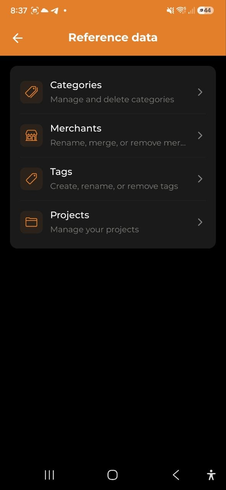

# Dados de referência

> Categorias, estabelecimentos, tags e projetos são a base para organizar suas despesas. Gerencie todos eles em **Configurações → Dados de referência**.

## Visão geral

Os quatro tipos de dados de referência são gerenciados em um único lugar nas Configurações. A interface é sempre a mesma: **toque em uma linha para editar**, toque em **+** para adicionar e toque no **ícone de lixeira** para excluir.

> Função **Visualizador**: membros com acesso de Visualizador podem consultar os dados de referência, mas não podem adicionar, renomear nem excluir.

## Categorias

As categorias classificam suas despesas e receitas. Cada uma tem um nome e uma cor.

- Toque em uma categoria para renomeá-la ou mudar a cor
- Os nomes das categorias precisam ser únicos dentro de cada tipo, então renomear uma categoria para um nome que outra já usa é recusado, com uma explicação
- Toque em **+** ao lado de “Categorias de despesas” ou “Categorias de receitas” para criar uma nova
- Toque no ícone de lixeira para excluir uma categoria
  - A exclusão é bloqueada se a categoria estiver em uso por despesas ou orçamentos ativos
  - Categorias do sistema (predefinidas) não podem ser excluídas
- Se uma categoria que você atribuiu não aparecer nos seus outros dispositivos, abra o app uma vez com internet — as atribuições são reenviadas automaticamente
- Uma categoria que ainda é usada por despesas, orçamentos ou subcategorias não pode ser excluída — exclua ou reatribua esses itens primeiro

**Dica:** Use cores bem diferentes nas categorias que você quer identificar rapidamente nos gráficos.

## Estabelecimentos

Os estabelecimentos são criados automaticamente quando você adiciona despesas — por digitação manual, leitura de recibos ou voz. Use a tela Estabelecimentos para limpar duplicatas ou corrigir erros de digitação.

- Toque em um estabelecimento para renomeá-lo
- Renomear reúne todas as despesas existentes com o nome antigo sob o novo nome (atualização em massa)
- Excluir remove o nome do estabelecimento de todas as despesas correspondentes (as despesas em si são mantidas)

> Não é possível criar estabelecimentos manualmente — eles aparecem automaticamente conforme você adiciona despesas.

### Regras de categoria

O app aprende com as suas correções. Sempre que você muda a categoria de uma despesa que tem nome de estabelecimento, uma **regra de categoria** é salva automaticamente. Na próxima vez que esse estabelecimento aparecer — em um extrato bancário importado ou em um CSV do Wise, em um recibo escaneado ou em uma notificação bancária capturada automaticamente (Android) — o app aplica sua regra e atribui a categoria sem nenhuma correção manual.

- As regras aprendidas aparecem na seção **Regras de categoria**, no final da tela Estabelecimentos
- Cada linha mostra o nome do estabelecimento e a categoria correspondente
- Toque no ícone de lixeira para excluir uma regra (o app deixa de atribuir essa categoria automaticamente)
- Toque no ícone de atualizar ao lado de uma regra para **aplicá-la de novo** — isso encontra as despesas desse estabelecimento já classificadas em outra categoria e oferece movê-las também para a categoria da regra, para que as despesas mais antigas acompanhem as regras que você ensinou depois
- As regras ficam salvas no servidor e são sincronizadas em todos os seus dispositivos

**Exemplo:** Você importa um extrato do Revolut e corrige “AMAZON” → Compras. Na importação do mês seguinte, as transações da Amazon vão automaticamente para Compras.

## Tags

As tags permitem marcar despesas com palavras-chave livres, independentemente das categorias.

- Toque em **+** para criar uma tag (digite um nome e escolha uma cor)
- Toque em uma tag para renomeá-la ou mudar a cor
- Toque no ícone de lixeira para remover a tag de todas as despesas

**Dica:** Use tags para acompanhar coisas de curta duração: “Viagem de trabalho”, “Reforma”, “Orçamento de presentes”.

## Projetos

Os projetos agrupam despesas por objetivo ou atividade — trabalho para clientes, viagens, reforma da casa e assim por diante.

- Toque em **+** para criar um projeto (nome, descrição opcional, cor, limite de orçamento opcional)
- Toque em um projeto para abrir a tela de detalhes
  - Veja todas as despesas vinculadas, o total gasto e o orçamento restante
  - Use o **ícone de lápis** (canto superior direito) para editar o projeto
  - Use o **ícone de lixeira** (canto superior direito) para excluí-lo
- Para vincular uma despesa a um projeto, abra a despesa e escolha um projeto no campo Projeto

**Dica:** Defina um orçamento para um projeto para acompanhar os gastos em relação a uma meta e ver o valor restante.

---

*Veja também: [Despesas e receitas](./03-expenses-and-income.md) | [Análises](./06-analytics.md) | [Configurações](./11-settings.md)*
