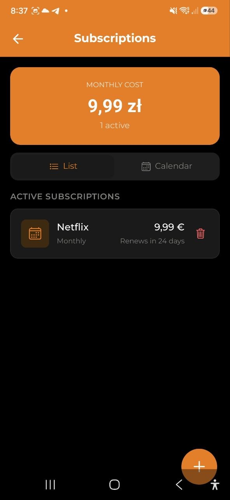

# Gerenciador de assinaturas

> Acompanhe todas as suas cobranças recorrentes em um só lugar — serviços de streaming, ferramentas SaaS, academia e muito mais.

## O que é o Gerenciador de assinaturas?

O Gerenciador de assinaturas é um controle dedicado aos seus pagamentos recorrentes. Diferente das transações, as assinaturas não são detectadas automaticamente — você as adiciona manualmente ou pelo botão **“Acompanhar esta assinatura”** em uma descoberta do Fat Finder.

Cada assinatura guarda:
- Nome (Netflix, Spotify, academia…)
- Valor e moeda
- Ciclo de cobrança (mensal, anual, trimestral, semanal)
- Data da próxima renovação
- Categoria (opcional)
- Observações (opcional)

## Adicionar uma assinatura

**Manualmente:**
1. Vá em **Configurações → Assinaturas** (ou toque no link Assinaturas na tela inicial)
2. Toque no botão **+**
3. Preencha o nome, o valor, o ciclo de cobrança e a data da próxima renovação
4. Toque em **Salvar**

**Pelo Fat Finder:**
Se o Fat Finder detectar uma cobrança recorrente, toque em **“Acompanhar esta assinatura”** no card da descoberta. O nome e o valor já vêm preenchidos — é só confirmar a data de renovação.

## Faixa de custo mensal

No topo do Gerenciador de assinaturas aparece seu **custo total equivalente por mês** — todas as assinaturas ativas convertidas em um valor mensal:
- Assinaturas mensais → o valor como está
- Assinaturas anuais → valor ÷ 12
- Assinaturas trimestrais → valor ÷ 3
- Assinaturas semanais → valor × (52 ÷ 12)

## Contagem até a renovação

Cada assinatura mostra quantos dias faltam para a próxima renovação:
- **Vermelho** — atrasada ou renovando hoje
- **Amarelo** — renova nos próximos 3 dias
- **Normal** — faltam mais de 3 dias

## Notificações de renovação

Você recebe uma notificação push **3 dias antes** de cada renovação. Para gerenciar isso:

1. Vá em **Configurações → Notificações**
2. Ative ou desative **Renovações de assinaturas**

## Editar e desativar

Toque em qualquer assinatura para abrir a tela de edição. Você pode:
- Atualizar o valor, o ciclo de cobrança ou a data de renovação
- Adicionar ou mudar a categoria
- Alternar entre **Ativa / Inativa** — assinaturas inativas continuam na lista, mas ficam fora do total mensal
- Excluir a assinatura de vez

## Função Visualizador

Se a sua função na conta for **Visualizador**, você pode ver a lista de assinaturas, mas não pode adicionar, editar nem excluir assinaturas.
