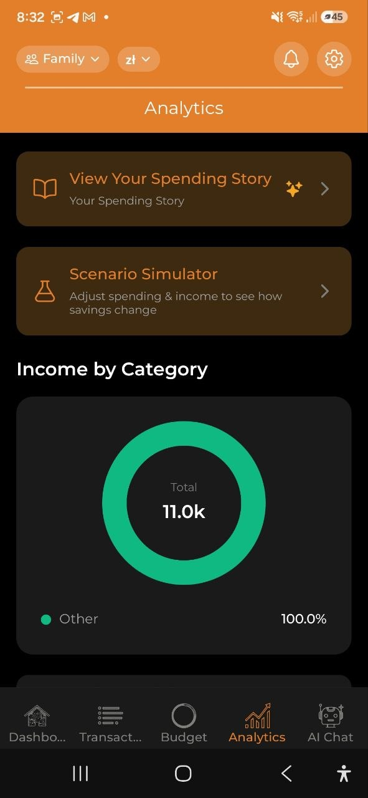

# Analytics

> Visualize your spending patterns with interactive charts. Filter by time period and currency, drill down into details, and get AI-powered insights to understand your finances better.

## Overview

The **Analytics** tab provides a comprehensive view of your spending through charts, insights, and data exploration. All data is based on your expenses in the selected account.

## Time Range & Filters

At the top of the Analytics screen:

- **Time range toggle**: **Week** | **Month** | **Year**
- **Currency filter**: **All** currencies, or select a specific one (USD, EUR, PLN, etc.)

The selected range affects all charts and insights below.

## Summary Cards

- **Total Spent** — your total expenses for the selected period
  - **vs. last period** — "more than last week/month/year" or "less than last week/month/year" with percentage
  - **vs. 3-month average** — shown below the period comparison once you have at least 1 prior full month of data, e.g. "18% above 3-month avg" (green = below average, red = above average)
- **Avg per Day** — average daily spending

## AI Insights Carousel

A horizontal scrollable carousel of AI-generated insights (Pro plan required):

- **Spending Anomalies** — unusual spending detected (e.g., "78% more than usual on Transport")
- **Budget Predictions** — when your budget is projected to run out
- **Savings Opportunities** — suggestions for reducing spending
- **Category Comparisons** — how your spending compares across categories
- **Trend Changes** — significant shifts in spending patterns

Each insight card has severity: critical (red), warning (yellow), or info (blue).

> **Note:** Free plan users see a prompt to upgrade: "Upgrade to Pro for AI insights."

## Charts

### Income by Category (Donut Chart)

- Breaks down your income by category for the selected period
- Shows only when you have income entries with categories (e.g., Salary, Freelance, Dividends, Rental)
- Color-coded in a green/teal palette to distinguish from expense charts
- Uncategorized income is grouped as "Other"
- Appears above the spending trend chart
- Income categories work the same way: parents show the total of their subcategories, and tapping one drills into it.

### Spending Trend (Bar Chart)

- Shows daily or monthly spending over the selected period
- Interactive: tap any bar to drill down into that time segment

### Spending by Category (Donut Chart)

- Category breakdown with percentages
- Color-coded by category
- Tap a slice of a parent category (marked ›) to drill into its subcategories; tapping a slice without subcategories only highlights it
- **Subcategories roll up** — the donut shows top-level categories only, and a parent's amount includes its subcategories. Parents with subcategories are marked with ›. Tap one (the slice or its row) to redraw the donut for that parent: its subcategories, plus “<Parent> (no subcategory)” for spending recorded on the parent itself. Tap the breadcrumb “All categories › <Parent>” to go back. The drill resets whenever the analytics data is rebuilt — a new or edited transaction, a sync, a language change, or a change of period, account or currency. Spending on a deleted subcategory stays a separate top-level slice, because the app does not keep deleted categories on the device. “vs average” chips for a parent use the rolled-up amount. The same works on the desktop web analytics cards.

### Budget vs Actual (Grouped Bar Chart)

- Side-by-side comparison of budget limits vs. actual spending
- Shows **On Track** or **Over Budget** per category
- Only appears if you have active budgets

### Spending by Day of Week (Weekday Chart)

- Pattern analysis showing which days you spend the most
- Insight: "You spend the most on Saturdays"

### By Merchants

- Top merchants where you spent money in the selected period
- Shows up to 8 individual merchants; the rest are grouped as "Other"
- Only appears when at least one expense has a merchant value

If the same shop appears under several names, open **Settings → Merchants** to tidy them up: tap **Select**, tick the variants, and **Merge** them into one name. The app also suggests likely groups (for example several *Biedronka* entries) that you can merge in a single tap — so they count as one merchant in these charts.

### By Member

- Who created how much of the spending in the selected period.
- Only appears on shared accounts with at least two members who have spending.

### By Tags / By Projects

- **Tag Breakdown** — spending grouped by your custom tags
- **Project Comparison** — spending grouped by projects
- Helps track themed spending (e.g., all #coffee expenses or "Vacation" project costs)

## Drill-Down

Tap any chart element to explore deeper:

1. **Year** view — tap a month bar to zoom into that month
2. **Month** view — tap a week to zoom into that week
3. **Week** view — tap a day to see daily transactions
4. **Day** view — see individual transactions

Use the **Back** button to navigate up through levels.

## Quick Insights

Below the charts, you'll find text-based quick insights:

- **Top Category** — your highest spending category this period
- **Peak Spending Day** — the day with the most spending
- **Daily Budget Tip** — recommended daily spending to stay on track
- **Receipt Savings** — total amount saved from discounts. Tap it to see which stores gave you the biggest discounts and the receipts they came from.
- **Deposits Paid** — total returnable-packaging deposit ("kaucja"/"Pfand"/"statiegeld") paid on scanned receipts. Tap it for the same store/receipt breakdown. This is what you paid at checkout, not a refund — returned bottles and cans aren't tracked.

Both rows only appear once you have a discount or deposit recorded for the period, and only when your account isn't fully encrypted (in that case the app can't read the figures to break them down).

## Top Receipt Items

A table showing your most frequently purchased receipt items:
- Item name
- Total spent
- Number of purchases

## Export

Tap **Export Report** to open the [Export & Reports](./16-export-reports.md) screen where you can generate PDF, Excel, and CSV reports, view monthly digests, and manage data backups.

## Child costs

See what each child costs you, without any guessing.

- **Add children:** Settings > Reference data > Children. Only a name and a colour are stored. Archive a child instead of deleting; their expenses stay attributed.
- **Attribute a whole expense:** on a new or existing expense choose one or more children. With several children the amount is split equally unless you edit the shares. An expense uses whole-expense attribution or receipt-line attribution, not both; the app asks before switching.
- **Attribute receipt lines:** after scanning a receipt, assign individual lines (diapers, school supplies) to a child. The app remembers your choice and suggests it next time. A suggestion is never applied without you. "Extract items" keeps the attribution of products that are still on the receipt and tells you how many it could not carry over.
- **Bulk:** select several expenses and choose Assign to child. Expenses with line attribution are skipped and the count is shown.
- **Totals:** the child screen (and a card on the Analytics tab) shows this month, this year and a category breakdown in your display currency. A total marked with ≈ includes an approximation because an exchange rate was missing; such amounts are left out rather than guessed. Planned expenses and split-bill receivables are not counted.
- **800+ and coverage:** when an income looks like the 800+ benefit (for example "800+" or "rodzina 800" in the description) the app offers to mark it for a child. Coverage is the benefit received divided by what that child cost in the same period.
- **Share card:** create a picture of a child's totals. The child's name is hidden by default; you can switch it on.
- **Statement PDF (Pro, editors):** a "zestawienie" of a child's costs for a period of up to 24 months, with totals, a monthly and category breakdown, the list of expenses and the receipts. Every page carries a footer saying it was prepared in the app from data entered by the user, and the "data as of" time. It is a summary of your own records, not a legal document and not certified. It contains only what has reached the server, so the app syncs first and asks you to wait if something is still pending. It is not available on accounts with end-to-end encryption.
- **Separated parents:** keep the children on a personal account, so the other parent does not see your other spending. A shared account shows everything to all members.

## FAQ

- **Q: Why don't I see any charts?**
  **A:** Charts appear after you have expense data. Add some expenses first, then check Analytics.

- **Q: How are AI insights generated?**
  **A:** Insights are generated by analyzing your spending patterns, comparing with historical data, and identifying anomalies. This requires a Pro or Business subscription.

---

*See also: [Budgets](./05-budgets.md) | [Spending Story](./08-spending-story.md) | [Export & Reports](./16-export-reports.md)*
