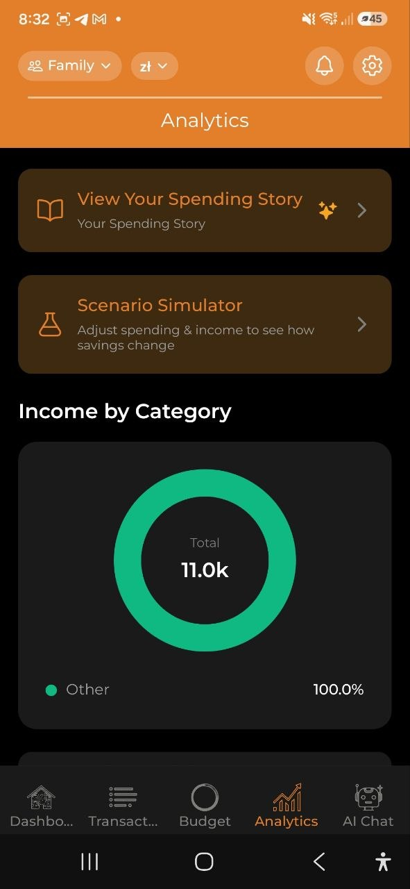

# Analisis

> Visualiza tus patrones de gasto con graficos interactivos. Filtra por periodo de tiempo y moneda, profundiza en los detalles y obtiene informacion basada en IA para entender mejor tus finanzas.

## Vista general

La pestana **Analisis** ofrece una vista completa de tus gastos a traves de graficos, informacion e exploracion de datos. Todos los datos se basan en tus gastos en la cuenta seleccionada.

## Rango de tiempo y filtros

En la parte superior de la pantalla de Analisis:

- **Selector de rango de tiempo**: **Semana** | **Mes** | **Ano**
- **Filtro de moneda**: **Todas** las monedas, o selecciona una especifica (USD, EUR, PLN, etc.)

El rango seleccionado afecta a todos los graficos e informacion que aparecen debajo.

## Tarjetas de resumen

- **Total gastado** — tus gastos totales para el periodo seleccionado
  - **vs. periodo anterior** — "mas/menos que la semana/mes/ano pasado" con porcentaje
  - **vs. promedio de 3 meses** — p.ej. "18% sobre el promedio de 3 meses" (verde = por debajo, rojo = por encima), aparece tras al menos 1 mes completo anterior
- **Promedio por dia** — gasto diario promedio

## Carrusel de informacion IA

Un carrusel horizontal desplazable con informacion generada por IA (requiere plan Pro):

- **Anomalias de gasto** — gasto inusual detectado (por ejemplo, "78% mas de lo habitual en Transporte")
- **Predicciones de presupuesto** — cuando se proyecta que se agotara tu presupuesto
- **Oportunidades de ahorro** — sugerencias para reducir gastos
- **Comparaciones de categorias** — como se compara tu gasto entre categorias
- **Cambios de tendencia** — cambios significativos en patrones de gasto

Cada tarjeta de informacion tiene un nivel de severidad: critico (rojo), advertencia (amarillo) o informativo (azul).

> **Nota:** Los usuarios del plan Gratuito ven un mensaje para mejorar: "Mejora a Pro para obtener informacion de IA."

## Graficos

### Ingresos por categoria (Grafico de dona)

- Muestra sus ingresos desglosados por categoria para el periodo seleccionado
- Solo aparece cuando hay entradas de ingresos con categorias (p. ej., Salario, Freelance, Dividendos, Alquiler)
- Codificado en colores en una paleta verde/turquesa para distinguirlo de los graficos de gastos
- Los ingresos sin categoria se agrupan como "Otros"
- Aparece encima del grafico de tendencia de gastos
- Las categorías de ingresos funcionan igual: las principales muestran el total de sus subcategorías y al tocarlas se entra en el detalle.

### Tendencia de gastos (Grafico de barras)

- Muestra el gasto diario o mensual durante el periodo seleccionado
- Interactivo: toca cualquier barra para profundizar en ese segmento de tiempo

### Gastos por categoria (Grafico de dona)

- Desglose por categoria con porcentajes
- Codigo de colores por categoria
- Toca el segmento de una categoría principal (marcada con ›) para ver sus subcategorías; un segmento sin subcategorías solo se resalta al tocarlo
- **Las subcategorías se suman** — el gráfico muestra solo las categorías principales, y el importe de una categoría principal incluye sus subcategorías. Las categorías principales con subcategorías llevan la marca ›. Toca una (el segmento o su fila) para redibujar el gráfico de esa categoría: sus subcategorías, más «<Principal> (sin subcategoría)» para el gasto registrado en la propia categoría principal. Toca la ruta «Todas las categorías › <Principal>» para volver. El detalle se restablece cada vez que se recalculan los datos de análisis: una transacción nueva o editada, una sincronización, un cambio de idioma o un cambio de periodo, cuenta o moneda. El gasto de una subcategoría eliminada sigue siendo un segmento propio de primer nivel, porque la aplicación no guarda en el dispositivo las categorías eliminadas. Los indicadores «vs. media» de una categoría principal usan el importe acumulado. Lo mismo funciona en las tarjetas de análisis de la versión web de escritorio.

### Presupuesto vs. Real (Grafico de barras agrupadas)

- Comparacion lado a lado de los limites del presupuesto vs. gasto real
- Muestra **En camino** o **Presupuesto excedido** por categoria
- Solo aparece si tienes presupuestos activos

### Gasto por dia de la semana (Grafico de dias)

- Analisis de patrones que muestra en que dias gastas mas
- Informacion: "Gastas mas los sabados"

### Por comerciantes

- Los principales comerciantes donde gastaste en el periodo seleccionado
- Muestra hasta 8 comerciantes individuales; el resto se agrupa como "Otros"
- Solo aparece cuando al menos un gasto tiene un comerciante asignado

Si la misma tienda aparece con varios nombres, abre **Ajustes → Comerciantes** para ordenarlos: toca **Seleccionar**, marca las variantes y **Combinar** en un solo nombre. La app también sugiere grupos probables (por ejemplo varias entradas de *Biedronka*) que puedes combinar con un solo toque, de modo que cuenten como un único comerciante en estos gráficos.

### Por miembro

- Quién registró cuánto del gasto en el período seleccionado.
- Solo aparece en cuentas compartidas con al menos dos miembros con gastos.

### Por etiquetas / Por proyectos

- **Desglose por etiquetas** — gasto agrupado por tus etiquetas personalizadas
- **Comparacion por proyectos** — gasto agrupado por proyectos
- Ayuda a rastrear gasto tematico (por ejemplo, todos los gastos de #cafe o costos del proyecto "Vacaciones")

## Exploracion detallada

Toca cualquier elemento del grafico para profundizar:

1. Vista de **Ano** — toca una barra de mes para acercarte a ese mes
2. Vista de **Mes** — toca una semana para acercarte a esa semana
3. Vista de **Semana** — toca un dia para ver las transacciones diarias
4. Vista de **Dia** — consulta las transacciones individuales

Usa el boton **Atras** para navegar hacia arriba a traves de los niveles.

## Informacion rapida

Debajo de los graficos, encontraras informacion rapida en formato de texto:

- **Categoria principal** — tu categoria con mayor gasto en este periodo
- **Dia de mayor gasto** — el dia con mas gastos
- **Consejo de presupuesto diario** — gasto diario recomendado para mantenerte en el objetivo
- **Ahorros en recibos** — importe total ahorrado en descuentos. Tocalo para ver que tiendas te dieron los mayores descuentos y de que recibos provienen.
- **Depositos pagados** — importe total de deposito de envases retornables en los recibos escaneados. Tocalo para ver el mismo desglose por tienda/recibo. Esto es lo que pagaste en caja, no un reembolso; los envases devueltos no se registran.

Ambas filas solo aparecen si hay un descuento o deposito registrado para el periodo, y solo si tu cuenta no esta totalmente cifrada (en ese caso la app no puede leer los importes para desglosarlos).

## Articulos principales de recibos

Una tabla que muestra los articulos de recibos que compras con mas frecuencia:
- Nombre del articulo
- Total gastado
- Numero de compras

## Exportar

Toca **Exportar informe** para acceder a la pantalla de Exportacion e informes, donde puedes generar informes PDF, Excel o CSV, ver resumenes mensuales y gestionar copias de seguridad de datos. Ver [Exportacion e informes](./16-export-reports.md) para mas detalles.

## Costes de los hijos

Vea lo que cuesta cada hijo, sin adivinar.

- **Añadir hijos:** Ajustes > Datos de referencia > Hijos. Solo se guardan el nombre y el color. Archive a un hijo en lugar de borrarlo; sus gastos siguen atribuidos.
- **Atribuir un gasto entero:** en un gasto nuevo o existente elija uno o varios hijos. Con varios, el importe se reparte a partes iguales salvo que edite las partes. Un gasto usa la atribución completa o la de líneas del recibo, no ambas; la app pregunta antes de cambiar.
- **Atribuir líneas del recibo:** tras escanear un recibo, asigne líneas concretas (pañales, material escolar) a un hijo. La app recuerda su elección y la sugiere la próxima vez. Una sugerencia nunca se aplica sin usted. «Extraer artículos» conserva la atribución de los productos que siguen en el recibo e indica cuántos no pudo conservar.
- **En bloque:** seleccione varios gastos y elija Asignar a un hijo. Los gastos con atribución por líneas se omiten y se muestra el número.
- **Totales:** la pantalla del hijo (y una tarjeta en la pestaña Análisis) muestra este mes, este año y el desglose por categorías en su moneda de visualización. Un total con ≈ incluye una aproximación por falta de tipo de cambio; esos importes se excluyen en vez de adivinarse. Los gastos planificados y los cobros pendientes de cuentas divididas no cuentan.
- **800+ y cobertura:** cuando un ingreso parece la ayuda 800+ (por ejemplo «800+» o «rodzina 800» en la descripción), la app propone marcarlo para un hijo. La cobertura es la ayuda recibida dividida entre lo que costó ese hijo en el mismo periodo.
- **Tarjeta para compartir:** una imagen con los totales de un hijo. El nombre está oculto por defecto; puede mostrarlo.
- **Informe PDF (Pro, editores):** una «zestawienie» de los costes de un hijo de hasta 24 meses, con totales, desglose mensual y por categorías, lista de gastos y recibos. Cada página lleva un pie que indica que se elaboró en la app a partir de datos introducidos por el usuario y la hora de «datos a fecha». Es un resumen de sus propios registros, no un documento legal ni certificado. Solo incluye lo que ha llegado al servidor, así que la app sincroniza primero y le pide esperar si algo está pendiente. No está disponible en cuentas con cifrado de extremo a extremo.
- **Padres separados:** mantengan a los hijos en una cuenta personal para que el otro progenitor no vea el resto de sus gastos. Una cuenta compartida lo muestra todo a todos los miembros.

## Preguntas frecuentes

- **P: Por que no veo ningun grafico?**
  **R:** Los graficos aparecen cuando tienes datos de gastos. Agrega algunos gastos primero y luego consulta Analisis.

- **P: Como se genera la informacion de IA?**
  **R:** La informacion se genera analizando tus patrones de gasto, comparando con datos historicos e identificando anomalias. Esto requiere una suscripcion Pro o Business.

---

*Ver tambien: [Presupuestos](./05-budgets.md) | [Historia de gastos](./08-spending-story.md) | [Exportacion e informes](./16-export-reports.md)*
