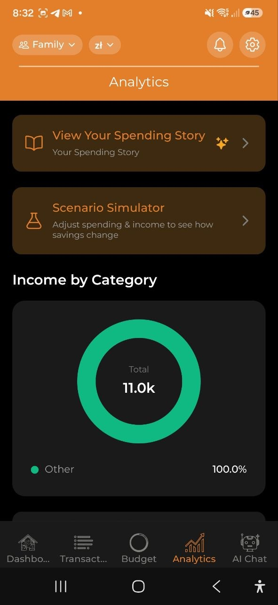

# Analisis

> Visualiza tus patrones de gasto con graficos interactivos. Filtra por periodo de tiempo y moneda, profundiza en los detalles y obtiene informacion basada en IA para entender mejor tus finanzas.

## Vista general

La pestana **Analisis** ofrece una vista completa de tus gastos a traves de graficos, informacion e exploracion de datos. Todos los datos se basan en tus gastos en la cuenta seleccionada.

## Rango de tiempo y filtros

En la parte superior de la pantalla de Analisis:

- **Selector de rango de tiempo**: **Semana** | **Mes** | **Ano**
- **Filtro de moneda**: **Todas** las monedas, o selecciona una especifica (USD, EUR, PLN, etc.)

Si tu cuenta tiene un **Mes financiero** (por ejemplo, que empieza el día de cobro, el 10), la vista **Mes** lo sigue: *octubre* abarca entonces del 10 de octubre al 9 de noviembre, y las fechas exactas aparecen bajo el nombre del mes. Las comparaciones con meses anteriores y las barras mensuales usan los mismos periodos. Las vistas Semana y Año siguen el calendario.

El rango seleccionado afecta a todos los graficos e informacion que aparecen debajo.

## Tarjetas de resumen

- **Total gastado** — tus gastos totales para el periodo seleccionado
  - **vs. periodo anterior** — "mas/menos que la semana/mes/ano pasado" con porcentaje
  - **vs. promedio de 3 meses** — p.ej. "18% sobre el promedio de 3 meses" (verde = por debajo, rojo = por encima), aparece tras al menos 1 mes completo anterior
- **Promedio por dia** — gasto diario promedio

Mientras el periodo está en curso, ambas comparaciones usan los mismos días: el día 5, tus primeros cinco días se comparan con los primeros cinco días del periodo anterior (y de los últimos tres meses), así un mes a medias nunca parece un gran ahorro. **Promedio por día** cuenta solo los días transcurridos. La línea del promedio de 3 meses aparece en la vista Mes.

## Ingresos vs gastos

Muestra lo que **ingresaste**, **gastaste** y **ahorraste** en el periodo seleccionado, y qué parte de tus ingresos ahorraste (tasa de ahorro). Si gastaste más de lo que ingresaste, la última cifra indica **Gastado de más**. Debajo, unas barras comparan ingresos y gastos mes a mes: los últimos 6 meses en la vista Mes y todos los meses del año en la vista Año.

## Fijos vs variables

Muestra qué parte de tus gastos es **fija** — dinero que sale cada periodo de todos modos — y lista los gastos fijos más grandes. Un gasto cuenta como fijo si es recurrente o si coincide con una de tus suscripciones activas del gestor de suscripciones (mismo nombre, o misma categoría e importe). Todo lo demás es variable. Para que el alquiler u otro pago periódico cuente como fijo, márcalo como recurrente o añádelo como suscripción. Los cargos que el gestor de suscripciones registra automáticamente al renovarse siempre cuentan como fijos, aunque les cambies el nombre o canceles la suscripción.

También puedes marcar una categoría de gasto entera como fija: abre **Ajustes → Categorías**, edita la categoría (por ejemplo, *Vivienda*) y activa **Contar como gasto fijo**. Se aplica a la cuenta actual y la comparten sus miembros; en un recibo dividido solo cuenta la parte de esa categoría.

## Próximos 30 días

Se muestra mientras ves el periodo actual. Es una estimación de tu saldo para cada uno de los próximos 30 días: el saldo de hoy, más los ingresos que llegan cada mes, menos las renovaciones de suscripciones y los gastos recurrentes en sus fechas, menos un día típico de gasto cotidiano. Si el saldo fuera a bajar de cero, la tarjeta indica a partir de qué día, y las barras bajo la línea lo muestran. **Próximamente** enumera los siguientes pagos e ingresos. Las aportaciones a metas de ahorro no se restan y los ingresos que no son mensuales no se cuentan, así que tómalo como una orientación, no como una promesa. Las compras planificadas y las deudas tuyas con fecha de vencimiento también se restan en su fecha (las vencidas, hoy); el dinero que otros te deben no se cuenta. Para ver la previsión con ese dinero, activa **Contar el dinero que te deben** en la tarjeta: lo que aún te deben se suma en cada fecha de vencimiento (lo vencido, hoy). Del mismo modo, **Contar ingresos irregulares** suma el día medio de los ingresos no mensuales (trabajos puntuales, reembolsos) de los últimos meses; solo aparece si tienes ingresos de ese tipo.

## Interanual

En las vistas de mes y año, esta tarjeta compara el periodo con el mismo periodo de hace un año: el total y las principales categorías, cada una con lo que gastaste entonces y la variación. Mientras el periodo sigue en curso compara el mismo número de días, así que la primera semana de este mes se compara con la primera semana del mismo mes del año pasado. Gastar más se ve en rojo y gastar menos en verde; una categoría sin gastos el año pasado se marca como **nuevo**. Si tu cuenta tiene un **Mes financiero**, «el mismo mes del año pasado» es ese mes financiero. La tarjeta aparece cuando hay gastos en el periodo del año pasado.

## Cuándo gasto

Una cuadrícula de tus últimos días, una columna por semana y una fila por día de la semana, coloreada según lo que gastaste ese día: cuanto más oscuro, más (cada tono es un cuarto de tus días con gastos). En el ordenador abarca los últimos 12 meses; en el móvil, tantos meses como quepan a un tamaño legible. Toca un día para ver su fecha y total; si no, la tarjeta indica tu día de más gasto. Debajo, **Media por día del mes** muestra cuánto gastas de media cada día del mes y qué tres días se llevan más. Si tu cuenta tiene un **Mes financiero**, el día 1 es su primer día, el de cobro. La app no conoce la hora de las compras, así que la tarjeta trabaja con días, no con horas. Aparece cuando tienes al menos 14 días con gastos.

## Patrimonio

Ábrelo desde la entrada **Patrimonio** en la pestaña Análisis o tocando la tarjeta **Net Capital** de la pantalla de inicio. Suma todo lo que tienes en todas tus cuentas —el dinero de cada cartera, el valor de mercado de tus inversiones y lo que otros te deben— menos tus propias deudas, en tu moneda de visualización. Ves la variación frente al mes pasado y frente a hace un año, las cuatro partes y los últimos 12 meses en barras: cada mes pasado se reconstruye a partir de tus registros y de los tipos de cambio de ese mes, así que el historial está desde el primer día. Una barra más clara indica que algunas inversiones se valoraron a su precio de compra porque no había precio de mercado para esa fecha. En **Cuentas** puedes desactivar una cuenta, por ejemplo una compartida que otro miembro también cuenta en su patrimonio; la elección se guarda en este dispositivo. Una cuenta cifrada por completo no se puede leer y no se cuenta.

## Carrusel de informacion IA

Un carrusel horizontal desplazable con informacion generada por IA (requiere plan Pro):

- **Anomalias de gasto** — gasto inusual detectado (por ejemplo, "78% mas de lo habitual en Transporte")
- **Predicciones de presupuesto** — cuando se proyecta que se agotara tu presupuesto
- **Oportunidades de ahorro** — sugerencias para reducir gastos
- **Comparaciones de categorias** — como se compara tu gasto entre categorias
- **Cambios de tendencia** — cambios significativos en patrones de gasto

Cada tarjeta de informacion tiene un nivel de severidad: critico (rojo), advertencia (amarillo) o informativo (azul).

> **Nota:** Los usuarios del plan Gratuito ven un mensaje para mejorar: "Mejora a Pro para obtener informacion de IA."

## Graficos

### Ingresos por categoria (Grafico de dona)

- Muestra sus ingresos desglosados por categoria para el periodo seleccionado
- Solo aparece cuando hay entradas de ingresos con categorias (p. ej., Salario, Freelance, Dividendos, Alquiler)
- Codificado en colores en una paleta verde/turquesa para distinguirlo de los graficos de gastos
- Los ingresos sin categoria se agrupan como "Otros"
- Aparece encima del grafico de tendencia de gastos
- Las categorías de ingresos funcionan igual: las principales muestran el total de sus subcategorías y al tocarlas se entra en el detalle.

### Tendencia de gastos (Grafico de barras)

- Muestra el gasto diario o mensual durante el periodo seleccionado
- Interactivo: toca cualquier barra para profundizar en ese segmento de tiempo

### Gastos por categoria (Grafico de dona)

- Desglose por categoria con porcentajes
- Codigo de colores por categoria
- Toca el segmento de una categoría principal (marcada con ›) para ver sus subcategorías; un segmento sin subcategorías solo se resalta al tocarlo
- **Las subcategorías se suman** — el gráfico muestra solo las categorías principales, y el importe de una categoría principal incluye sus subcategorías. Las categorías principales con subcategorías llevan la marca ›. Toca una (el segmento o su fila) para redibujar el gráfico de esa categoría: sus subcategorías, más «<Principal> (sin subcategoría)» para el gasto registrado en la propia categoría principal. Toca la ruta «Todas las categorías › <Principal>» para volver. El detalle se restablece cada vez que se recalculan los datos de análisis: una transacción nueva o editada, una sincronización, un cambio de idioma o un cambio de periodo, cuenta o moneda. El gasto de una subcategoría eliminada sigue siendo un segmento propio de primer nivel, porque la aplicación no guarda en el dispositivo las categorías eliminadas. Los indicadores «vs. media» de una categoría principal usan el importe acumulado. Lo mismo funciona en las tarjetas de análisis de la versión web de escritorio.

### Presupuesto vs. Real (Grafico de barras agrupadas)

- Comparacion lado a lado de los limites del presupuesto vs. gasto real
- Muestra **En camino** o **Presupuesto excedido** por categoria
- Solo aparece si tienes presupuestos activos

### Gasto por dia de la semana (Grafico de dias)

- Analisis de patrones que muestra en que dias gastas mas
- Informacion: "Gastas mas los sabados"

### Por comerciantes

- Los principales comerciantes donde gastaste en el periodo seleccionado
- Muestra hasta 8 comerciantes individuales; el resto se agrupa como "Otros"
- Solo aparece cuando al menos un gasto tiene un comerciante asignado
- Los nombres que solo se diferencian en mayúsculas o espacios (*Lidl*, *LIDL*) cuentan como un solo comercio; bajo cada nombre verás cuántas compras hiciste allí y la compra media

Si la misma tienda aparece con varios nombres, abre **Ajustes → Comerciantes** para ordenarlos: toca **Seleccionar**, marca las variantes y **Combinar** en un solo nombre. La app también sugiere grupos probables (por ejemplo varias entradas de *Biedronka*) que puedes combinar con un solo toque, de modo que cuenten como un único comerciante en estos gráficos.

### Por miembro

- Quién registró cuánto del gasto en el período seleccionado.
- Solo aparece en cuentas compartidas con al menos dos miembros con gastos.

### Por etiquetas / Por proyectos

- **Desglose por etiquetas** — gasto agrupado por tus etiquetas personalizadas
- **Comparacion por proyectos** — gasto agrupado por proyectos
- Ayuda a rastrear gasto tematico (por ejemplo, todos los gastos de #cafe o costos del proyecto "Vacaciones")

## Exploracion detallada

Toca cualquier elemento del grafico para profundizar:

1. Vista de **Ano** — toca una barra de mes para acercarte a ese mes
2. Vista de **Mes** — toca una semana para acercarte a esa semana
3. Vista de **Semana** — toca un dia para ver las transacciones diarias
4. Vista de **Dia** — consulta las transacciones individuales

Usa el boton **Atras** para navegar hacia arriba a traves de los niveles.

## Informacion rapida

Debajo de los graficos, encontraras informacion rapida en formato de texto:

- **Categoria principal** — tu categoria con mayor gasto en este periodo
- **Dia de mayor gasto** — el dia con mas gastos
- **Consejo de presupuesto diario** — gasto diario recomendado para mantenerte en el objetivo
- **Ahorros en recibos** — importe total ahorrado en descuentos. Tocalo para ver que tiendas te dieron los mayores descuentos y de que recibos provienen.
- **Depositos pagados** — importe total de deposito de envases retornables en los recibos escaneados. Tocalo para ver el mismo desglose por tienda/recibo. Esto es lo que pagaste en caja, no un reembolso; los envases devueltos no se registran.

Ambas filas solo aparecen si hay un descuento o deposito registrado para el periodo, y solo si tu cuenta no esta totalmente cifrada (en ese caso la app no puede leer los importes para desglosarlos).

## Articulos principales de recibos

Una tabla que muestra los articulos de recibos que compras con mas frecuencia:
- Nombre del articulo
- Total gastado
- Numero de compras

## Exportar

Toca **Exportar informe** para acceder a la pantalla de Exportacion e informes, donde puedes generar informes PDF, Excel o CSV, ver resumenes mensuales y gestionar copias de seguridad de datos. Ver [Exportacion e informes](./16-export-reports.md) para mas detalles.

## Costes de los hijos

Vea lo que cuesta cada hijo, sin adivinar.

- **Añadir hijos:** Ajustes > Datos de referencia > Hijos. Solo se guardan el nombre y el color. Archive a un hijo en lugar de borrarlo; sus gastos siguen atribuidos.
- **Por cuenta, eliminar o archivar:** los hijos pertenecen a la cuenta en la que estás (la pantalla la indica): cada cuenta, también una compartida, tiene su propia lista. Un hijo sin gastos asignados se puede eliminar (ábrelo y toca **Eliminar hijo**); uno con gastos solo se puede archivar, para que los gastos lo conserven. En una cuenta cifrada el nombre se guarda cifrado: desbloquea antes el cifrado en **Ajustes → Seguridad** o la app te lo indicará en lugar de guardar.
- **¿Creado en la cuenta equivocada?** Abre el hijo, toca **Mover a otra cuenta** y elige la cuenta (una que puedas editar). Solo se puede mover un hijo sin gastos asignados; para una cuenta cifrada el cifrado debe estar desbloqueado.
- **Una categoría para un hijo:** abre el hijo y elige **Categorías de este hijo** (por ejemplo, una categoría con su nombre o «Colegio»). Todos los gastos de esas categorías se le asignan automáticamente: los ya registrados al guardar y los nuevos según llegan (las importaciones bancarias, a la mañana siguiente). Los gastos que asignaste a mano, o con líneas de ticket asignadas, nunca cambian; quitar una categoría solo deshace lo que añadió la regla. Un gasto en el que la categoría es solo una parte de un ticket dividido no se asigna automáticamente.
- **Atribuir un gasto entero:** en un gasto nuevo o existente elija uno o varios hijos. Con varios, el importe se reparte a partes iguales salvo que edite las partes. Un gasto usa la atribución completa o la de líneas del recibo, no ambas; la app pregunta antes de cambiar.
- **Atribuir líneas del recibo:** tras escanear un recibo, asigne líneas concretas (pañales, material escolar) a un hijo. La app recuerda su elección y la sugiere la próxima vez. Una sugerencia nunca se aplica sin usted. «Extraer artículos» conserva la atribución de los productos que siguen en el recibo e indica cuántos no pudo conservar.
- **En bloque:** seleccione varios gastos y elija Asignar a un hijo. Los gastos con atribución por líneas se omiten y se muestra el número.
- **Totales:** la pantalla del hijo (y una tarjeta en la pestaña Análisis) muestra este mes, este año y el desglose por categorías en su moneda de visualización. Un total con ≈ incluye una aproximación por falta de tipo de cambio; esos importes se excluyen en vez de adivinarse. Los gastos planificados y los cobros pendientes de cuentas divididas no cuentan.
- **800+ y cobertura:** cuando un ingreso parece la ayuda 800+ (por ejemplo «800+» o «rodzina 800» en la descripción), la app propone marcarlo para un hijo. La cobertura es la ayuda recibida dividida entre lo que costó ese hijo en el mismo periodo.
- **Tarjeta para compartir:** una imagen con los totales de un hijo. El nombre está oculto por defecto; puede mostrarlo.
- **Informe PDF (Pro, editores):** un resumen de los costes de un hijo de hasta 24 meses, con totales, desglose mensual y por categorías, lista de gastos y recibos. Cada página lleva un pie que indica que se elaboró en la app a partir de datos introducidos por el usuario y la hora de «datos a fecha». Es un resumen de sus propios registros, no un documento legal ni certificado. Solo incluye lo que ha llegado al servidor, así que la app sincroniza primero y le pide esperar si algo está pendiente. No está disponible en cuentas con cifrado de extremo a extremo.
- **Padres separados:** mantengan a los hijos en una cuenta personal para que el otro progenitor no vea el resto de sus gastos. Una cuenta compartida lo muestra todo a todos los miembros.

## Gastos del coche

Si la cuenta tiene un vehículo, la tarjeta **Vehículos** muestra lo que costó cada uno en los últimos 12 meses, la media mensual y los dos tipos de gasto más grandes (por ejemplo, combustible y seguro). No sigue el filtro de periodo de arriba. Toca un vehículo para abrir su pantalla: elige un periodo (3, 6, 12 meses, 2 años o todo) y verás el total, la media mensual, todos los costes por km y el consumo; los gastos por mes en barras (toca un mes para ver solo sus gastos); el desglose por tipo (toca un tipo para filtrar la lista); el consumo entre depósitos llenos como línea; y cada repostaje y gasto, que abren su gasto. Los importes están en tu moneda de visualización; los que no tienen tipo de cambio aparecen en la lista pero no cuentan en los totales. **Gestionar** abre Ajustes → Vehículos, donde también marcas los gastos — consulta [Ajustes](./11-settings.md).

## Preguntas frecuentes

- **P: Por que no veo ningun grafico?**
  **R:** Los graficos aparecen cuando tienes datos de gastos. Agrega algunos gastos primero y luego consulta Analisis.

- **P: Como se genera la informacion de IA?**
  **R:** La informacion se genera analizando tus patrones de gasto, comparando con datos historicos e identificando anomalias. Esto requiere una suscripcion Pro o Business.

---

*Ver tambien: [Presupuestos](./05-budgets.md) | [Historia de gastos](./08-spending-story.md) | [Exportacion e informes](./16-export-reports.md)*
