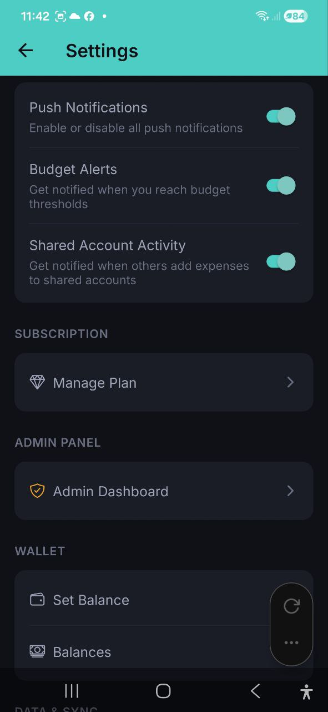

# Parametres

> Personnalisez votre profil, l'apparence, les notifications et la synchronisation des donnees. Changez votre langue, devise, theme et gerez les preferences de votre compte.

## Apercu

Accedez aux Parametres en appuyant sur l'**icone d'engrenage** dans le coin superieur droit de n'importe quel ecran.

Les parametres sont organises en categories. Appuyez sur une categorie pour ouvrir son ecran dedie :

| Categorie | Contenu |
|---|---|
| **Profil et compte** | Nom, e-mail, fuseau horaire, devise |
| **Gerer le plan** | Plan actuel, utilisation, options de mise a niveau |
| **Apparence et langue** | Theme, langue |
| **Preferences IA** | Style de reponse, selection du modele |
| **Widgets du tableau de bord** | Afficher ou masquer les widgets de l'ecran d'accueil |
| **Notifications et integrations** | Notifications push, bot Telegram |
| **Securite et chiffrement** | Configuration du chiffrement de bout en bout |
| **Portefeuille** | Soldes, dettes, solde initial |
| **Donnees et rapports** | Synchronisation, rapports par e-mail, sauvegarde et restauration |
| **A propos** | Version, aide, support, mentions legales |

## Profil et compte

- **Avatar** — affiche vos initiales sur un fond colore
- **Nom** — votre nom d'affichage. Appuyez sur l'icone de crayon pour modifier
- **E-mail** — l'e-mail de votre compte (affichage uniquement)
- **Fuseau horaire** — appuyez sur l'icone de crayon pour changer. Un selecteur avec recherche apparait avec plus de 90 fuseaux horaires (par ex. "Europe/Paris")

### Devise

Selectionnez votre devise par defaut en appuyant sur l'une des pastilles de devise :

**USD** | **EUR** | **PLN** | **GBP** | **UAH** | **RUB** | **BYN**

La devise selectionnee est mise en surbrillance. Cela definit la devise par defaut pour les nouvelles depenses, revenus et l'affichage du Tableau de bord.

## Apparence et langue

### Langue

Choisissez parmi 11 langues prises en charge :

| Code | Langue |
|---|---|
| EN | English |
| RU | Pyccкий |
| UA | Yкpaїнcькa |
| PL | Polski |
| ES | Espanol |
| FR | Francais |
| DE | Deutsch |
| BY | Беларуская |
| NL | Nederlands |
| PT | Português (Portugal) |
| BR | Português (Brasil) |

Appuyez sur une pastille de langue pour changer. L'interface se met a jour immediatement.

### Apparence

Choisissez votre theme :

- **Systeme** — suit le mode clair/sombre de votre appareil
- **Clair** — toujours utiliser le theme clair
- **Sombre** — toujours utiliser le theme sombre

**Couleur d'accent** — choisissez la couleur de mise en valeur de l'application, utilisee pour les boutons, les liens et l'onglet actif. Appuyez sur une couleur predefinie, ou sur **Personnalise** pour ouvrir le selecteur de couleurs et choisir n'importe quelle couleur. Votre couleur d'accent fonctionne a la fois en mode clair et sombre et est enregistree sur votre compte, elle vous suit donc sur tous vos appareils. Appuyez sur la couleur par defaut pour revenir a la couleur d'origine.

## Preferences IA

### Style de reponse de l'IA

Controlez la maniere dont l'IA communique avec vous dans toutes les fonctionnalites IA (Chat, Histoires, Analyses, Fat Finder, Objectifs) :

| Mode | Description |
|---|---|
| **Simple** | Langage courant, sans jargon — ideal pour les debutants |
| **Equilibre** | Melange de simple et de technique — le mode par defaut |
| **Expert** | Terminologie financiere, analyse detaillee — pour les professionnels |

Appuyez sur une pastille pour changer. La modification s'applique immediatement a tout nouveau contenu genere par l'IA.

> Voir [Mode de reponse de l'IA](./20-ai-response-mode.md) pour en savoir plus sur ce que chaque mode modifie.

### Modele d'IA

Choisissez le modele d'IA pour toutes les fonctionnalites IA (Chat, Scan de recu, Categorisation, Analyses, Histoires, Objectifs). Cela affecte directement la **qualite des reponses** et la **consommation du quota IA** :

| Modele | Vitesse | Cout | Ideal pour |
|---|---|---|---|
| ⚡ **Fast** | Le plus rapide | ×0.75 quota | Categorisation rapide, requetes simples |
| ⚖️ **Balanced** | Moyen | ×1 quota | Usage general — par defaut |
| ✨ **Quality** | Plus lent | ×1.5 quota | Analyses complexes, aperçus detailles |

> **Conseil :** Avec le plan Free (50 requetes IA/mois), passer en **Fast** donne ~66.7 requetes effectives. Passer en **Quality** donne ~33.3.

Appuyez sur une pastille pour changer. Le modele prend effet immediatement pour toutes les nouvelles requetes IA.

## Widgets du tableau de bord

Controlez quelles sections apparaissent sur votre [Tableau de bord](./02-dashboard.md). Appuyez sur le bouton bascule a cote de chaque widget pour l'afficher ou le masquer :

| Widget | Description |
|---|---|
| **Gamification** | Niveau, barre de progression XP et serie quotidienne |
| **Budget mensuel** | Budget restant avec barre de progression codee par couleur |
| **Revenus et depenses** | Carte combinee avec revenus et depenses mensuels |
| **Dettes et prets** | Recapitulatif de ce qu'on vous doit et de vos dettes |
| **Graphique benefice net** | Graphique lineaire sur 6 mois du benefice net |
| **Capital net** | Valeur nette totale sur tous les portefeuilles |
| **Fat Finder (IA)** | Audit mensuel des depenses avec opportunites d'economies |
| **Calendrier** | Grille mensuelle avec points revenus/depenses |
| **Objectifs** | Objectif d'epargne principal avec barre de progression |
| **Soldes du portefeuille** | Defilement horizontal des soldes par devise |

> **Conseil :** Vos preferences sont sauvegardees automatiquement et persistent entre les redemarrages.

Vous pouvez également **faire glisser la poignée** à côté d'un widget pour le réordonner sur le Tableau de bord, et appuyer sur **Rétablir l'ordre par défaut** pour restaurer la disposition d'origine.

## Notifications et integrations

### Notifications

Interrupteurs a bascule pour les preferences de notifications :

| Parametre | Description |
|---|---|
| **Notifications Push** | Interrupteur principal — activer ou desactiver toutes les notifications push |
| **Alertes Budget** | Etre averti lorsque vous atteignez les seuils de budget |
| **Activite Compte Partage** | Etre averti lorsque d'autres personnes ajoutent des depenses aux comptes partages |
| **Rappels de dettes** | Notification 3 jours avant l'échéance et en cas de retard |
| **Dépenses récurrentes** | Notification quand l'app enregistre automatiquement une dépense récurrente |
| **Renouvellements d'abonnements** | Notification 3 jours avant le renouvellement d'un abonnement suivi |
| **Alertes d'anomalies** | Notification pour les dépenses inhabituelles : doublons, hausses de prix ou pics de catégorie |
| **Rappel de suivi** | Notification si vous n'avez pas enregistré de dépenses depuis 3+ jours, plus un rappel le lendemain de votre inscription si vous n'avez encore rien ajouté |

### Bot Telegram

**Heures calmes :** activez-les pour retenir les notifications non urgentes la nuit (par défaut 22:00–08:00, dans votre fuseau horaire). Elles arrivent à la fin de la plage ; les alertes de sécurité arrivent toujours immédiatement.

Liez votre compte Telegram pour recevoir des notifications et gerer vos depenses via le bot Telegram. Voir [Bot Telegram](./22-telegram-bot.md) pour plus de details.

## Securite et chiffrement

Configurez le chiffrement de bout en bout (E2EE) pour proteger vos donnees financieres. Voir [Chiffrement](./15-encryption.md) pour plus de details.

## Categories

Acces via **Parametres → Données de référence → Categories**.

Visualisez et gerez toutes vos categories de depenses et de revenus en un seul endroit.

- **Toutes les categories listees** — les categories de depenses et de revenus sont affichees ensemble
- **Supprimer une categorie** — faites glisser vers la gauche sur une categorie ou appuyez sur l'icone de suppression
- **La suppression est bloquee** si la categorie a des depenses, des revenus ou des budgets associes — vous devez d'abord reassigner ou supprimer ces enregistrements
- **Les categories systeme** peuvent egalement etre supprimees si elles n'ont aucun enregistrement associe
- **Sous-catégories** — lors de la création ou de la modification d'une catégorie, choisissez une **Catégorie parente** pour la ranger sous une autre. Il n'y a que deux niveaux : une catégorie qui a déjà des sous-catégories ne peut pas devenir elle-même une sous-catégorie, et la catégorie parente doit être du même type (dépenses ou revenus) et du même compte. Les sélecteurs de catégorie affichent les sous-catégories regroupées sous leur parente. Une catégorie ayant des sous-catégories ne peut pas être supprimée tant qu'elles n'ont pas été déplacées ou supprimées.
- **Sous-catégories pour les revenus** — les catégories de revenus peuvent aussi avoir des sous-catégories. Lors de la création ou de la modification d'une catégorie de revenus, choisissez une **Catégorie parente** (catégories de revenus uniquement). Les sélecteurs de revenus (nouveau revenu, détail du revenu, voix) affichent les sous-catégories regroupées sous leur catégorie parente.
- **Glisser-déposer pour organiser** — appuyez longuement sur une catégorie (sur le web de bureau, appuyez et faites glisser) et déposez-la sur une catégorie principale pour en faire une sous-catégorie. Pour ramener une sous-catégorie au niveau principal, déposez-la sur la ligne entre deux catégories principales. L'ordre de la liste ne change pas. Un message explique pourquoi un dépôt est refusé : une catégorie qui a déjà des sous-catégories ne peut pas devenir une sous-catégorie, rien ne peut être déposé sur une sous-catégorie, les catégories de dépenses et de revenus ne se mélangent pas, et la catégorie de consigne reste en dehors de la hiérarchie. Le glisser-déposer nécessite une connexion internet (hors ligne, l'appui long affiche un message), les lecteurs ne peuvent pas glisser, et il n'y a pas de défilement automatique aux bords de l'écran : faites glisser dans la liste visible.
- **Les catégories standard suivent la langue de l'application** — une catégorie créée par l'application (comme Courses ou Consigne) s'affiche dans la langue que vous utilisez actuellement : changer de langue modifie donc son nom à l'écran sans créer de doublon. Si vous renommez vous-même une catégorie standard, votre nom est conservé dans toutes les langues. Les catégories que vous avez créées affichent toujours exactement ce que vous avez saisi.

> **Note :** La suppression d'une categorie est definitive et ne peut pas etre annulee.

## Véhicules

Accès via **Paramètres → Données de référence → Véhicules**. Les véhicules appartiennent au compte dans lequel vous êtes — l'écran l'indique, et chaque compte a sa propre liste. Créé dans le mauvais compte ? Ouvrez-le et touchez **Déplacer vers un autre compte** — possible tant qu'il n'a aucun plein.

Voyez ce que votre voiture coûte en carburant. Ajoutez un véhicule avec son nom et son carburant (essence, diesel, GPL, électrique, hybride ou autre). Chaque véhicule affiche la consommation aux 100 km, le coût du carburant aux 100 km et au km dans votre devise d'affichage, le nombre de pleins et la distance parcourue. Touchez **Afficher les pleins** pour la liste.

Pour saisir un plein, ouvrez une dépense de carburant : si le compte a un véhicule, la dépense affiche une section **Plein**. Touchez **Marquer comme plein** et indiquez la quantité (litres, ou kWh pour une voiture électrique), le compteur et si le réservoir a été rempli à ras bord. La consommation se mesure entre deux pleins complets : les chiffres apparaissent après deux pleins complets ; un plein partiel est compté dans le suivant. Pas de litres ni de compteur sous la main ? Laissez les deux vides : l'achat compte comme carburant dans le coût total, mais pas dans la consommation.

Les autres frais de voiture comptent aussi. Sur n'importe quelle dépense, la section **Voiture** permet de choisir le véhicule et le type : carburant, entretien, assurance, stationnement, taxes et frais ou autre (litres et compteur ne sont demandés que pour le carburant). Dans la fiche du véhicule, **Catégories de ce véhicule** l'automatise : choisissez un type, touchez les catégories (par exemple « Assurance auto » comme assurance), et leurs dépenses comptent pour la voiture — les anciennes dès l'enregistrement, les nouvelles à leur arrivée. La carte affiche alors les 12 derniers mois : le total, la moyenne mensuelle, chaque type et tous les frais par km. Les véhicules nécessitent une connexion internet. Supprimer un véhicule conserve les dépenses ; seuls le véhicule et ses statistiques disparaissent. Plusieurs à la fois : sur l'écran Transactions, recherchez (par exemple « Benzyna » ou « Parking »), sélectionnez les dépenses et choisissez **Attribuer au véhicule**, puis le véhicule et le type. Les pleins qui ont déjà des litres ne changent pas.

**Échéances.** Dans la fiche du véhicule, indiquez le prochain renouvellement de l'assurance, le prochain contrôle technique, le prochain entretien et le kilométrage du prochain entretien (tout est facultatif ; la croix efface une date). Un rappel arrive 14 et 2 jours avant chaque date, et une fois quand le compteur d'un plein arrive à moins de 500 km de l'entretien. Les échéances dans les 30 jours ou déjà passées s'affichent en pastilles sur la carte du véhicule et sur son écran, dont la carte **Échéances** liste toutes les dates. Quand vous marquez une dépense comme assurance ou entretien, l'application propose de repousser cette échéance d'un an ; rien ne change sans votre confirmation.

## Factures d'énergie

Voyez si une facture d'énergie a augmenté parce que vous avez consommé davantage ou parce que le prix a monté. Accès via **Paramètres → Données de référence → Factures d'énergie**.

**Ajouter un relevé.** Ouvrez une dépense d'énergie — électricité, gaz, eau ou chauffage. Sous les détails, touchez **Ajouter la consommation (kWh, m³, GJ)**, choisissez le type, saisissez la consommation indiquée sur la facture et son unité, et éventuellement un **Logement** (par exemple « Appartement » ou « Maison de campagne ») si vous payez des factures pour plusieurs endroits. L'application calcule le prix unitaire à partir du montant de la dépense. Pour modifier ou supprimer un relevé, rouvrez la dépense. Une dépense qui vient d'être ajoutée doit d'abord être synchronisée ; si ce n'est pas encore le cas, l'application vous demande de réessayer dans un instant. Les lecteurs d'un compte partagé voient les relevés mais ne peuvent pas en ajouter.

**Ce que montre l'écran.** Pour chaque type : le prix unitaire mois par mois, et la consommation. Lorsque le prix unitaire du dernier mois dépasse de plus de 10 % la moyenne des trois mois précédents, une note le signale. Dès qu'un type a un an de relevés, chaque mois est comparé au même mois de l'année précédente — le prix comme la consommation. Avec plusieurs logements, choisissez-en un en haut ou affichez-les tous ensemble. Les coûts sont affichés dans votre devise d'affichage ; une facture dans une devise dont le taux de change est inconnu est exclue du coût, et l'écran le signale. Les dépenses prévues ne sont pas comptées.

## Donnees et rapports

### Donnees et synchronisation

- **Derniere synchronisation** — indique quand vos donnees ont ete synchronisees pour la derniere fois avec le serveur (par ex. "il y a 5 min" ou "Jamais")
- **Synchroniser maintenant** — appuyez pour declencher manuellement une synchronisation des donnees
- **En attente de synchronisation** — si des modifications faites hors ligne ne sont pas envoyées depuis un moment, une pastille indique combien attendent. Appuyez dessus pour les voir et synchroniser maintenant. Elle disparaît une fois tout sauvegardé.

> **Note :** L'application fonctionne hors ligne. Vos donnees sont enregistrees sur votre appareil et se synchronisent automatiquement lorsque vous etes de nouveau en ligne. Utilisez **Synchroniser maintenant** pour forcer une synchronisation immediate.

### Rapports et email

Gerez vos preferences de rapports et d'emails :

- **Resume hebdomadaire par email** (Business) — activer/desactiver, choisir le jour de la semaine
- **Resume mensuel par email** (Pro+) — activer/desactiver
- **Generer un rapport** — ouvre l'ecran [Export et rapports](./16-export-reports.md)
- **Exporter la sauvegarde** — cree une sauvegarde JSON complete des donnees de votre compte
- **Restaurer la sauvegarde** — importer un fichier de sauvegarde precedemment exporte

### Écrire au développeur

Réglages → **Écrire au développeur**. Posez une question, signalez un bug ou proposez une idée directement au développeur.

Vous pouvez aussi l'ouvrir depuis l'écran **Aide**, via la carte **Écrire au développeur**.

- Écrivez dans **n'importe quelle langue** : le développeur lit chaque message dans sa propre langue.
- Les réponses arrivent ici et en notification push, **traduites dans votre langue**. Le texte original est à un appui. Si vous n’avez pas ouvert une réponse, elle vous parvient aussi par e-mail (un e-mail par lot de réponses non lues, avec un lien de désabonnement).
- L'interrupteur **Traduction automatique** détermine si les réponses sont traduites automatiquement.
- Le développeur répond généralement en environ un jour. Vous pouvez envoyer jusqu'à **10 messages par jour**.
- Ne collez pas de mots de passe, de numéros de carte ni d'autres données privées.

## A propos

- **Version** — numero de version actuel de l'application
- **Aide** — ouvre le centre d'aide integre ; utilisez la barre de recherche en haut pour acceder directement a un article sans faire defiler toute la liste
- **Support** — envoyer un e-mail a l'equipe de support
- **Politique de confidentialite** — consulter la politique de confidentialite
- **Conditions d'utilisation** — consulter les conditions d'utilisation

## Se deconnecter

Sur l'ecran principal des Parametres, appuyez sur **Se deconnecter** en bas. Une boite de dialogue de confirmation apparaitra — confirmez pour vous deconnecter de votre compte.

## FAQ

- **Q : J'ai change de langue mais certains textes sont encore dans l'ancienne langue. Que faire ?**
  **R :** Le changement de langue est instantane pour tous les elements de l'interface. Si vous remarquez du texte non traduit, essayez de redemarrer l'application.

- **Q : Comment changer mon e-mail ?**
  **R :** Le changement d'e-mail n'est pas pris en charge dans l'application actuellement. Contactez le support pour obtenir de l'aide.

- **Q : Qu'arrive-t-il a mes donnees lorsque je me deconnecte ?**
  **R :** Vos donnees restent stockees sur le serveur. Lorsque vous vous reconnecterez, tout sera restaure. Les donnees locales sur l'appareil peuvent etre effacees.

---

*Voir aussi : [Comptes](./09-accounts.md) | [Abonnement](./12-subscription.md) | [Export et rapports](./16-export-reports.md) | [Mode de reponse de l'IA](./20-ai-response-mode.md) | [Chat IA](./07-ai-chat.md)*
