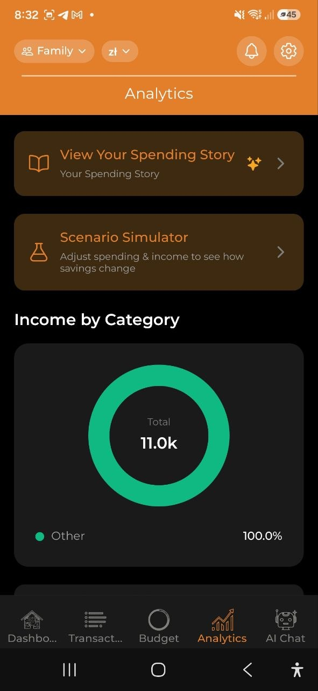

# Analityka

> Wizualizuj wzorce wydatkow za pomoca interaktywnych wykresow. Filtruj wedlug okresu i waluty, zaglebaj sie w szczegoly i korzystaj z wniosków opartych na AI, aby lepiej zrozumiec swoje finanse.

## Przeglad

Zakladka **Analityka** zapewnia kompleksowy widok Twoich wydatkow poprzez wykresy, wnioski i eksploracje danych. Wszystkie dane bazuja na wydatkach z wybranego konta.

## Zakres czasowy i filtry

U gory ekranu Analityki:

- **Przelacznik zakresu czasowego**: **Tydzien** | **Miesiac** | **Rok**
- **Filtr waluty**: **Wszystkie** waluty lub wybierz konkretna (USD, EUR, PLN itd.)

Wybrany zakres wplywa na wszystkie wykresy i wnioski ponizej.

## Karty podsumowania

- **Lacznie wydano** — calkowite wydatki za wybrany okres
  - **vs. poprzedni okres** — "wiecej/mniej niz poprzedni tydzien/miesiac/rok" z procentem
  - **vs. srednia 3 miesiecy** — np. "18% powyzej sredniej 3 miesiecy" (zielony = ponizej, czerwony = powyzej), pojawia sie po co najmniej 1 pelnym poprzednim miesiacu
- **Srednio dziennie** — srednie dzienne wydatki

## Karuzela wnioskow AI

Poziomo przewijana karuzela wnioskow generowanych przez AI (wymaga planu Pro):

- **Anomalie wydatkow** — wykryto nietypowe wydatki (np. "78% wiecej niz zwykle na Transport")
- **Prognozy budzetowe** — kiedy prognozowane jest wyczerpanie budzetu
- **Mozliwosci oszczednosci** — sugestie redukcji wydatkow
- **Porownania kategorii** — jak Twoje wydatki rokladaja sie miedzy kategoriami
- **Zmiany trendow** — znaczace zmiany we wzorcach wydatkow

Kazda karta wnioskow ma poziom waznosci: krytyczny (czerwony), ostrzezenie (zolty) lub informacyjny (niebieski).

> **Uwaga:** Uzytkownicy darmowego planu widza zachete do ulepszenia: "Ulepsz do Pro, aby uzyskac wnioski AI."

## Wykresy

### Przychody wedlug kategorii (wykres pierścieniowy)

- Pokazuje Twoje przychody podzielone wedlug kategorii dla wybranego okresu
- Wyswietla sie tylko wtedy, gdy masz wpisy przychodow z kategoriami (np. Wynagrodzenie, Freelance, Dywidendy, Najem)
- Kodowany kolorami w palecie zielono-morskiej, odrozniajac sie od wykresow wydatkow
- Przychody bez kategorii sa grupowane jako „Inne"
- Pojawia sie powyzej wykresu trendu wydatkow
- Kategorie przychodów działają tak samo: kategorie główne pokazują sumę swoich podkategorii, a dotknięcie otwiera widok szczegółowy.

### Trend wydatkow (wykres slupkowy)

- Pokazuje dzienne lub miesieczne wydatki w wybranym okresie
- Interaktywny: dotknij dowolny slupek, aby zaglebic sie w dany segment czasowy

### Wydatki wg kategorii (wykres kolowy)

- Podzial na kategorie z procentami
- Kodowany kolorami wedlug kategorii
- Dotknij fragmentu kategorii głównej (oznaczonej ›), aby zobaczyć jej podkategorie; fragment bez podkategorii zostaje po dotknięciu tylko wyróżniony
- **Podkategorie są sumowane** — wykres pokazuje tylko kategorie główne, a kwota kategorii głównej obejmuje jej podkategorie. Kategorie główne z podkategoriami są oznaczone ›. Dotknij jednej z nich (fragmentu wykresu lub jej wiersza), aby przerysować wykres dla tej kategorii: jej podkategorie oraz „<Kategoria> (bez podkategorii)” dla wydatków zapisanych bezpośrednio na kategorii głównej. Dotknij ścieżki „Wszystkie kategorie › <Kategoria>”, aby wrócić. Widok szczegółowy resetuje się za każdym razem, gdy dane analiz są przeliczane: po dodaniu lub edycji transakcji, synchronizacji, zmianie języka albo zmianie okresu, konta lub waluty. Wydatki na usuniętej podkategorii pozostają osobnym fragmentem najwyższego poziomu, ponieważ aplikacja nie przechowuje usuniętych kategorii na urządzeniu. Znaczniki „vs średnia” dla kategorii głównej używają skumulowanej kwoty. To samo działa na kartach analiz w wersji webowej na komputer.

### Budzet vs Rzeczywistosc (grupowany wykres slupkowy)

- Porownanie obok siebie limitow budzetowych i rzeczywistych wydatkow
- Pokazuje **W normie** lub **Przekroczony** dla kazdej kategorii
- Pojawia sie tylko, jezeli masz aktywne budzety

### Wydatki wg dnia tygodnia (wykres tygodniowy)

- Analiza wzorcow pokazujaca, w ktore dni wydajesz najwiecej
- Wnioski: "Najwiecej wydajesz w soboty"

### Wedlug sprzedawcow

- Glowni sprzedawcy, u ktorych wydawales w wybranym okresie
- Pokazuje do 8 pojedynczych sprzedawcow; reszta jest grupowana jako "Inne"
- Pojawia sie tylko gdy co najmniej jeden wydatek ma przypisanego sprzedawce

Jeśli ten sam sklep pojawia się pod kilkoma nazwami, otwórz **Ustawienia → Sprzedawcy**, aby je uporządkować: kliknij **Wybierz**, zaznacz warianty i **Scal** je w jedną nazwę. Aplikacja sugeruje też prawdopodobne grupy (na przykład kilka wpisów *Biedronka*), które możesz scalić jednym dotknięciem — dzięki temu będą liczone jako jeden sprzedawca na tych wykresach.

### Wedlug tagow / Wedlug projektow

- **Podzial tagow** — wydatki pogrupowane wedlug Twoich niestandardowych tagow
- **Porownanie projektow** — wydatki pogrupowane wedlug projektow
- Pomaga sledzic wydatki tematyczne (np. wszystkie wydatki #kawa lub koszty projektu "Wakacje")

## Drilldown (zaglebienie)

Dotknij dowolny element wykresu, aby zbadac glebiej:

1. Widok **Rok** — dotknij slupek miesiaca, aby przyblizye ten miesiac
2. Widok **Miesiac** — dotknij tydzien, aby przyblizye ten tydzien
3. Widok **Tydzien** — dotknij dzien, aby zobaczyc transakcje dzienne
4. Widok **Dzien** — zobacz poszczegolne transakcje

Uzyj przycisku **Wroc**, aby nawigowac w gore przez poziomy.

## Szybki przeglad

Ponizej wykresow znajdziesz tekstowe szybkie wnioski:

- **Glowna kategoria** — Twoja najwyzsza kategoria wydatkow w tym okresie
- **Dzien najwiekszych wydatkow** — dzien z najwyzszymi wydatkami
- **Dzienna wskazowka budzetowa** — zalecane dzienne wydatki, aby utrzymac sie w budzecie
- **Oszczednosci z paragonow** — laczna kwota zaoszczedzona na rabatach. Stuknij, aby zobaczyc, ktore sklepy dawaly Ci najwieksze rabaty i z jakich paragonow one pochodza.
- **Zaplacona kaucja** — laczna kwota kaucji za opakowania zwrotne z zeskanowanych paragonow. Stuknij, aby zobaczyc taki sam podzial wedlug sklepu/paragonu. To kwota zaplacona przy kasie, a nie zwrot — zwrocone butelki i puszki nie sa sledzone.

Obie pozycje pojawiaja sie tylko wtedy, gdy w danym okresie zarejestrowano rabat lub kaucje, i tylko gdy Twoje konto nie jest w pelni zaszyfrowane (w przeciwnym razie aplikacja nie moze odczytac kwot, aby je rozbic na szczegoly).

## Najczesciej kupowane

Tabela pokazujaca najczesciej kupowane pozycje z paragonow:
- Artykul
- Lacznie wydano
- Liczba zakupow

## Eksport

Dotknij **Eksportuj raport**, aby otworzyc ekran Eksport i raporty, gdzie mozesz generowac raporty PDF, Excel lub CSV, przegladac podsumowania miesieczne i zarzadzac kopiami zapasowymi danych. Zobacz [Eksport i raporty](./16-export-reports.md) po wiecej szczególów.

## FAQ

- **P: Dlaczego nie widze zadnych wykresow?**
  **O:** Wykresy pojawiaja sie po wprowadzeniu danych o wydatkach. Najpierw dodaj kilka wydatkow, a nastepnie sprawdz Analityke.

- **P: Jak generowane sa wnioski AI?**
  **O:** Wnioski sa generowane przez analize Twoich wzorcow wydatkow, porownanie z danymi historycznymi i identyfikacje anomalii. Wymaga to subskrypcji Pro lub Business.

---

*Zobacz takze: [Budzety](./05-budgets.md) | [Historia wydatkow](./08-spending-story.md) | [Eksport i raporty](./16-export-reports.md)*
