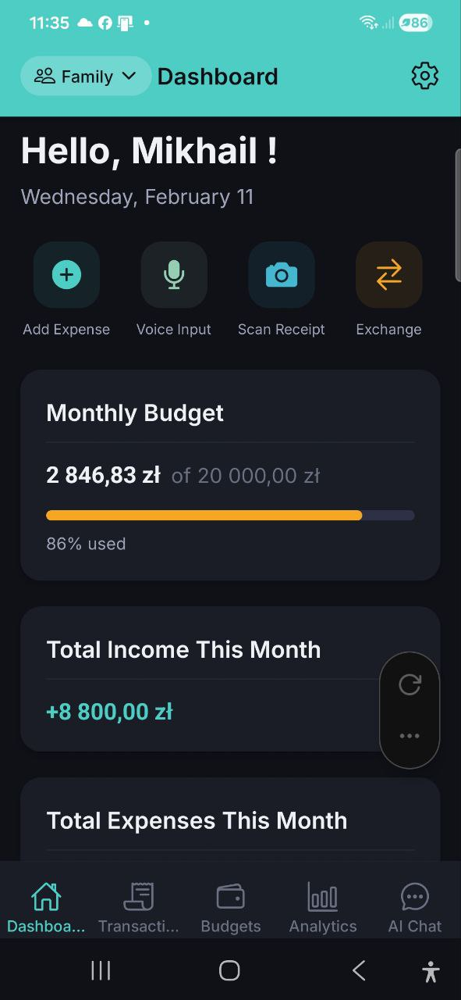
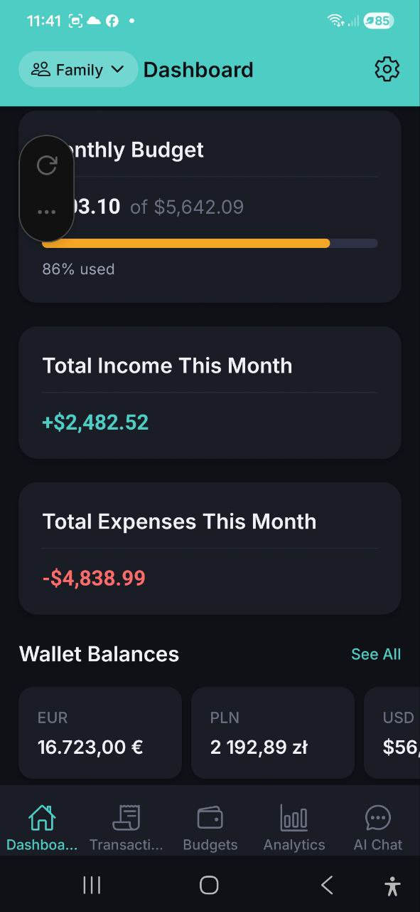

# Painel

> O seu centro de controlo financeiro. Veja num relance o estado do orçamento, as receitas, as despesas e os saldos da carteira, com ações rápidas para adicionar despesas com um toque. Pode mostrar ou ocultar cada secção em [Definições](./11-settings.md) → Widgets do painel.

## Visão geral

O Painel é o primeiro ecrã que aparece depois de iniciar sessão. Mostra a conta atual e os principais indicadores financeiros do mês em curso.

## Seletor de contas

No canto superior esquerdo, toque no nome da conta (por exemplo, **Família**) para abrir a lista **Mudar de conta**. Pode alternar entre as contas Pessoal, Partilhada e Empresa. Todos os dados do Painel são atualizados para refletir a conta selecionada.

Ao lado do nome da conta há um **botão de moeda** separado (por exemplo, `zł`) — toque nele para mudar de imediato a moeda de apresentação.

## Ações rápidas

As ações rápidas por baixo do cabeçalho formam uma grelha de atalhos de um toque para as tarefas mais comuns. Quando há mais ações do que cabem numa linha, passam para a linha seguinte, para que todas fiquem visíveis.

Ações disponíveis:

| Ação | O que faz |
|---|---|
| **Adicionar despesa** | Abre o formulário de despesa manual |
| **Digitalizar talão** | Abre a câmara para fotografar um talão e extrair os dados com IA |
| **Despesa por voz** | Diga a despesa de forma natural |
| **Receita por voz** | Diga a receita de forma natural (oculto por predefinição) |
| **Digitalizar fatura** | Fotografe uma fatura para registar uma receita (oculto por predefinição) |
| **Câmbio** | Abre o formulário de câmbio de moeda |
| **Conversor** | Abre o conversor de moedas |
| **Transferências** | Abre o formulário de transferência entre carteiras |

Pode personalizar esta faixa: vá a **Definições → Widgets do painel**, abra a secção **Ações rápidas**, ative ou desative qualquer ação e arraste as pegas para as reordenar. **Receita por voz** e **Digitalizar fatura** estão ocultas por predefinição — ative-as aí se registar receitas por voz ou digitalizando faturas.

## Pontuação de saúde financeira

O widget **Pontuação de saúde financeira** mostra uma única pontuação de 0 a 100 que resume a saúde financeira global do mês em curso:

- **Verde (70–100)** — as finanças estão em ótima forma
- **Amarelo (40–69)** — algumas áreas precisam de atenção
- **Vermelho (0–39)** — foram detetados problemas significativos

O indicador circular no canto superior direito do cartão enche-se na proporção da pontuação. Toque no cartão para abrir o detalhe com quatro componentes:

| Componente | Pontos máx. | Descrição |
|---|---|---|
| Cumprimento do orçamento | 25 | % dos orçamentos ativos que não ultrapassam o limite |
| Taxa de poupança | 25 | Converte a % de poupança mensal de forma linear (0% → 0 pts, 20% ou mais → 25 pts) |
| Progresso dos objetivos | 25 | % dos objetivos de poupança ativos em linha com o prazo |
| Saúde das dívidas | 25 | Desconto proporcional por dívidas em atraso |

> **«Ainda não há dados suficientes»** aparece quando menos de dois componentes têm dados (por exemplo, numa conta nova, ainda sem orçamentos, objetivos, dívidas ou receitas).

A pontuação é calculada inteiramente no dispositivo — não precisa de ligação à Internet nem de pedidos de IA.

## Widget de gamificação

Por baixo das ações rápidas, um cartão compacto mostra o seu progresso na gamificação:

- **Nível** — o nível atual, com uma barra de progresso de XP até ao nível seguinte
- **Sequência** — o número de dias seguidos de registo, com um emoji de fogo ou de floco de neve

Toque neste cartão para abrir o ecrã completo de **Conquistas**, com todas as medalhas, os detalhes da sequência e os filtros por categoria.

> Consulte [Conquistas e gamificação](./13-gamification.md) para saber como funcionam o XP, os níveis e as conquistas.

## Cartão do orçamento mensal

- Mostra os gastos atuais face ao orçamento mensal (por exemplo, **2 846,83 zl de 20 000,00 zl**)
- Barra de progresso por cores: verde (sob controlo), amarelo (a aproximar-se do limite), vermelho/laranja (perto ou acima do orçamento)
- Mostra a **percentagem usada** (por exemplo, 86% usado)
- Toque no cartão para ir para o separador **Orçamento** e ver os detalhes

> **Nota:** Se não tiver um orçamento mensal definido, aparece uma sugestão para criar um.

## Receitas e despesas

Um cartão combinado mostra os totais do mês lado a lado:

- **Receitas** (à esquerda, a verde) — o total de receitas do mês em curso (por exemplo, **+$2,482.52**). Toque para ir para o separador **Transações** (vista de receitas)
- **Despesas** (à direita) — o total de despesas do mês em curso (por exemplo, **-$4,838.99**). Toque para ir para o separador **Transações** (vista de despesas)

## Lucro líquido

Por baixo dos cartões de receitas e despesas, o widget **Lucro líquido** mostra quanto dinheiro poupou ou perdeu realmente este mês e acompanha a tendência dos últimos 6 meses num gráfico de linhas:

- **Lucro líquido do mês em curso** — apresentado por cima do gráfico, a verde (positivo) ou a vermelho (negativo)
- **Tendência de 6 meses** — um gráfico de linhas com o lucro líquido mensal (receitas − despesas) dos últimos 6 meses
- Toque num ponto do gráfico para ver o valor exato desse mês

> **Fórmula:** Lucro líquido = Total de receitas − Total de despesas (ambos convertidos para a sua moeda base)

## Património líquido

O widget **Património líquido** mostra o seu património total em todas as moedas da carteira, convertido para a moeda base:

- **Património líquido total** — a soma de todos os saldos da carteira convertidos para a moeda das definições, a verde (positivo) ou a vermelho (negativo)
- **Detalhe por moeda** — o saldo atual de cada moeda, listado por baixo do total

> **Nota:** O Património líquido só aparece depois de definir os saldos iniciais da carteira. Consulte [Carteira e câmbio](./10-wallet-and-exchange.md) para os configurar.

## Cartão da Auditoria de despesas

Por baixo da secção de dívidas, o cartão **Auditoria de despesas** mostra um resumo da auditoria mensal das suas despesas:

- **Poupança potencial total** — quanto poderia poupar por mês (uma estimativa)
- **3 principais conclusões** — uma lista rápida com pontos de gravidade e o valor de poupança de cada uma
- **Ver relatório completo** — toque para abrir o ecrã detalhado da Auditoria de despesas

Este cartão requer uma **subscrição Pro ou Business**. Quem está no plano Free vê uma sugestão de upgrade.

> Consulte [Auditoria de despesas](./19-fat-finder.md) para o guia completo da funcionalidade.

## Calendário

O widget **Calendário** mostra uma grelha mensal com pontos coloridos nos dias com transações:

- **Ponto verde** — receita registada nesse dia
- **Ponto vermelho** — despesa registada nesse dia
- **Hoje** aparece destacado com um círculo laranja
- **Navegação entre meses** — use as setas esquerda/direita para mudar de mês

Por baixo da grelha, uma linha de resumo mostra:

- **Receitas** — o total de receitas do mês selecionado (convertido para a moeda base)
- **Despesas** — o total de despesas do mês selecionado
- **Lucro líquido** — receitas menos despesas, a verde se for positivo, a vermelho se for negativo

Toque em **Toque para ver detalhes** para abrir o ecrã completo do Calendário, com três separadores:

| Separador | Conteúdo |
|---|---|
| **Categorias** | Receitas e despesas por categoria — cada linha mostra o ícone, o nome, a percentagem e o valor da categoria. O lucro líquido aparece no fim |
| **Carteiras** | Saldo atual de cada carteira de moeda, com a percentagem do total |
| **Transações** | Lista cronológica de todas as transações do mês. Toque num dia do calendário para filtrar por esse dia; toque de novo para anular a seleção |

> **Dica:** Todos os valores do Calendário são convertidos automaticamente para a sua moeda base, para ver totais corretos mesmo com várias moedas.

## Saldos da carteira

- Cartões com deslocamento horizontal que mostram o saldo em cada moeda (por exemplo, **EUR 16,723.00**, **PLN 2 192,89**, **USD $56...**)
- Toque em **Ver tudo** para abrir a vista completa da Carteira, com o detalhe de cada moeda
- Se ainda não tiver saldos definidos, aparece uma sugestão para adicionar o saldo inicial

## Puxar para atualizar

Puxe para baixo em qualquer ponto do Painel para atualizar todos os dados e sincronizar com o servidor.

## Perguntas frequentes

- **P: Porque é que o Painel mostra $0 em tudo?**
  **R:** Ainda não adicionou despesas nem receitas. Use os botões de ações rápidas para adicionar a primeira transação.

- **P: Posso personalizar o que aparece no Painel?**
  **R:** Sim. Vá a **Definições → Widgets do painel** e ative ou desative cada secção. As preferências ficam guardadas e mantêm-se depois de reiniciar a aplicação. Também pode arrastar os widgets para os reordenar. A faixa de ações rápidas personaliza-se da mesma forma — abra a secção **Ações rápidas** em Definições → Widgets do painel para mostrar, ocultar ou reordenar os botões.

---

*Ver também: [Despesas e receitas](./03-expenses-and-income.md) | [Carteira e câmbio](./10-wallet-and-exchange.md) | [Auditoria de despesas](./19-fat-finder.md) | [Análise](./06-analytics.md)*
