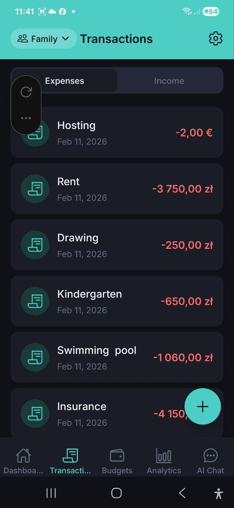
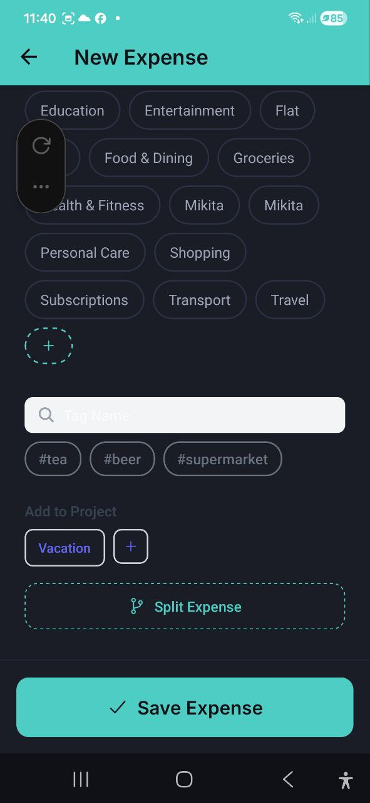

# Despesas e receitas

> Veja, adicione e faça a gestão de todas as suas transações. Alterne entre os separadores Despesas e Receitas, com suporte para várias moedas, categorias, etiquetas, projetos e divisão de despesas.

## Lista de transações

O ecrã **Transações** tem dois separadores no topo:
- **Despesas** — todas as suas despesas, ordenadas por data (as mais recentes primeiro)
- **Receitas** — todas as suas receitas

Cada transação mostra:
- Ícone da categoria
- Descrição (por exemplo, «Alojamento web», «Renda», «Jardim de infância»)
- Data
- Valor com a moeda, por cores: vermelho para despesas (por exemplo, **-3 750,00 zl**), verde para receitas

Toque em qualquer transação para ver todos os detalhes.

### Ações rápidas (toque longo)

Mantenha premida qualquer transação da lista para abrir um menu de ações rápidas:
- **Editar** — abre a transação em modo de edição
- **Duplicar** — cria uma nova transação preenchida com os mesmos dados
- **Eliminar** — remove a transação (com confirmação)

> **Nota:** Duplicar e Eliminar só estão disponíveis para proprietários e editores da conta.

### Ações em massa

Nas despesas, o menu de toque longo inclui também **Selecionar vários**. Toque nessa opção para ativar o modo de seleção múltipla:
- Toque nas linhas para assinalar as que pretende, ou use **Selecionar tudo** para assinalar todas
- A barra inferior permite agir sobre todas as despesas selecionadas de uma vez: **Definir categoria**, **Adicionar etiqueta** ou **Eliminar**
- Toque em **Cancelar** para sair do modo de seleção múltipla sem fazer alterações

Use o botão flutuante **+** (canto inferior direito) para adicionar uma nova transação.

## Adicionar uma nova despesa (manual)

### Passo a passo

1. Toque no botão **+** no ecrã Transações, ou em **Adicionar despesa** no Painel
2. Se usar o botão **+**, escolha **Introdução manual** no menu
3. Toque no símbolo da moeda para mudar de moeda (USD, EUR, PLN, GBP, UAH, RUB, BYN)
4. Introduza o **montante**
5. Introduza uma **Descrição** (por exemplo, «Em que foi esta despesa?»)
6. Toque na **Data** — vem preenchida com o dia de hoje; toque nela para registar a despesa num dia anterior
7. Selecione uma **Categoria** nos botões:
   - Alimentação e restaurantes, Supermercado, Transportes, Compras, Entretenimento, Saúde e fitness, Contas e serviços, Educação, Viagens, Café e bebidas, Subscrições, Vestuário, Cuidados pessoais
   - Toque no botão **+** para criar uma categoria personalizada
8. Pesquise e selecione **Etiquetas** (por exemplo, #chá, #cerveja, #supermercado) — opcional
9. Selecione **Adicionar ao projeto** (por exemplo, «Férias») — opcional
10. Toque em **Dividir despesa** para repartir a despesa por várias categorias — opcional
11. Toque em **Guardar despesa**

### Categorias

A aplicação inclui 14 categorias de despesa predefinidas. Também pode criar categorias personalizadas tocando no botão **+** no seletor de categorias. Cada categoria tem uma cor própria, para ser fácil de identificar nos gráficos e nas listas.

Toque no filtro de categoria por cima da lista de transações para filtrar por categoria. Funciona tanto no separador Despesas como no separador Receitas:

- Escolha uma categoria para ver apenas essas transações
- Escolha **Sem categoria** para ver tudo o que ainda está por classificar
- Escolha **Todas** para limpar o filtro

O filtro de categoria combina-se com o período indicado por cima, por isso, para encontrar entradas mais antigas que ainda não têm categoria, defina primeiro o período como **Tudo**.

### Sugerir categorias para despesas sem categoria

Quando a conta tem despesas sem categoria — algo comum depois de digitalizar vários talões — aparece uma faixa por cima da lista de transações: **Despesas sem categoria: N**, com o botão **Sugerir categorias**.

Toque nele para abrir **Classificar despesas**. A aplicação analisa as despesas sem categoria (verá **A analisar despesas…**) e agrupa-as:

- ✚ **Nova categoria** — só é criada se aplicar as sugestões
- ● **Categoria existente** — uma categoria que já tem
- **Não foi possível determinar** — tudo aquilo em que o assistente não teve confiança suficiente; escolha uma categoria à mão ou deixe como está

Em cada grupo, pode:
- Tocar no nome do grupo para mudar o nome de uma nova categoria antes de ser criada
- Tocar em **▾** junto a um grupo para mudar o destino de todo o grupo — para outra categoria existente, outro nome de nova categoria ou **+ Criar nova categoria**
- Tocar em **Escolher** (ou **▾**) junto a uma despesa para mover apenas essa
- Desmarcar um grupo para deixar essas despesas como estão

Nada é criado nem alterado até tocar em **Aplicar (N)** — que aparece como **Aplicar (N) · novas categorias: K** quando o plano inclui novas categorias. No fim, verá **Classificadas: N · novas categorias: K**.

Algumas coisas a saber:
- As sugestões com IA estão limitadas a algumas passagens por conta e por dia. Quando as esgotar, uma nota explica que, no resto do dia, só são mostradas sugestões baseadas em regras — as sugestões que vêm de um comerciante que já ensinou à aplicação (por ter mudado a categoria dele antes) continuam sempre a funcionar, sem limite diário.
- As despesas encriptadas não podem ser lidas pelo servidor para esta funcionalidade e são ignoradas; verá quantas são, se houver alguma.
- Se não houver mais nada a sugerir, verá **Nada a sugerir de momento.**
- Se o carregamento falhar, toque em **Tentar novamente**.
- Numa conta partilhada, os leitores não veem esta faixa — classificar é uma alteração que só os editores e o proprietário podem fazer.

No ecrã de transações para computador (web), a mesma revisão abre numa janela de diálogo.

A mesma revisão está disponível no separador Receitas — toque aí em **Sugerir categorias** para as receitas sem categoria.

### Etiquetas

As etiquetas ajudam a organizar as despesas com rótulos personalizados:
- Pesquise etiquetas existentes no campo de pesquisa
- Escolha entre as etiquetas recentes ou populares
- A IA pode sugerir etiquetas relevantes com base na descrição
- As etiquetas aparecem como botões (por exemplo, **#chá**, **#cerveja**, **#supermercado**)

### Projetos

Associe despesas a projetos para as acompanhar em conjunto:
- Selecione um projeto existente (por exemplo, **Férias**)
- Toque em **+** para criar um novo projeto
- Veja os totais gastos por projeto na secção Projetos
- Mude ou remova o projeto mais tarde — abra a despesa, toque em **Editar** e escolha outro projeto ou toque em **Limpar**

### Comerciante

Registe onde gastou — o comerciante (loja ou empresa):
- Preenchido automaticamente quando digitaliza um talão ou importa transações do banco ou da Wise
- Adicione-o ou edite-o manualmente em qualquer despesa; comece a escrever para escolher entre os comerciantes que já usou
- Aparece na despesa e na lista; toque no filtro de comerciante no separador Despesas para ver todos os gastos num comerciante
- O filtro de comerciante permite escolher **vários comerciantes ao mesmo tempo** (toque de novo para remover um), e o separador Despesas mostra o **total do que está filtrado**, convertido para a moeda principal
- Faça a gestão dos comerciantes em **Definições → Comerciantes**: mudar o nome, juntar duplicados num só ou remover um comerciante
- Quando digitaliza um talão ou usa a voz, o comerciante é associado aos que já existem, para não criar duplicados

### Dividir despesa

Reparta uma única despesa por várias categorias:
1. Toque em **Dividir despesa** no formulário da despesa
2. Adicione categorias com valores ou percentagens
3. O total tem de ser igual ao valor original da despesa
4. Toque em **Confirmar divisão**

> **Dica:** Use **Sugerir divisão** para que a IA recomende como repartir a despesa.

### Despesas recorrentes

Transforme qualquer despesa numa série que se regista sozinha — no formulário de criação ou, mais tarde, numa despesa já guardada:

1. Toque em **Repetir**
2. Escolha a frequência: **Semanal**, **Mensal** ou **Anual**
3. Guarde — a aplicação regista automaticamente uma nova cópia desta despesa em cada período, no dia em que vence

> **Dica:** Não tem de decidir isto quando regista a despesa pela primeira vez. Abra qualquer despesa que ainda não faça parte de uma série, toque em **Editar**, ative **Repetir**, escolha o período e guarde — é o mesmo interruptor do formulário de criação.

Uma despesa que já faz parte de uma série mostra, no ecrã de detalhes, a faixa **Faz parte de uma série recorrente** em vez do interruptor, com o período (por exemplo, «Repete-se mensalmente»). Toque em **Parar recorrência** para terminar a série — as cópias anteriores mantêm-se, só deixa de haver registo automático no futuro.

### Formas mais rápidas de adicionar despesas

Escrever cada despesa à mão é a forma mais lenta. Depois de adicionar cerca de dez despesas à mão, a aplicação mostra uma única vez uma sugestão com opções mais rápidas — cada uma abre o seu próprio ecrã:

- **Digitalizar um talão** — tire uma fotografia; o valor, a loja e os artigos são preenchidos
- **Dizer em voz alta** — diga a despesa e ela é escrita por si
- **Telegram ou WhatsApp** — envie ao bot uma mensagem, uma mensagem de voz ou uma fotografia do talão
- **Importar um extrato bancário** — traga muitas transações de uma só vez a partir de um ficheiro
- **Notificações do banco** (Android) — os alertas de pagamento da aplicação do banco passam a ser despesas

A sugestão aparece apenas uma vez, e nem sequer aparece se já usar uma destas formas. Toque em **Agora não** para a fechar; todas as opções continuam disponíveis no sítio habitual da aplicação.

## Adicionar receitas

### Passo a passo

1. Vá ao separador **Transações** e mude para o separador **Receitas**
2. Toque no botão **+**
3. Toque no símbolo da moeda para escolher a moeda
4. Introduza o **montante**
5. Introduza uma **Descrição** (por exemplo, «De onde veio esta receita?»)
6. Toque na **Data** — vem preenchida com o dia de hoje; toque nela para registar a receita num dia anterior
7. Selecione uma **Categoria**: Salário, Freelance, Investimentos, Presentes ou Outras receitas
8. Adicione **Notas**, se quiser
9. Toque em **Guardar receita**

## Detalhes da despesa

Toque em qualquer despesa para ver todos os detalhes:

- **Descrição** e valor com a moeda
- **Data** da despesa
- **Categoria** com indicador de cor
- **Notas** (se existirem)
- **Adicionado por** — aparece nas contas partilhadas; mostra o nome do membro da conta que criou este registo
- **Estado da sincronização** — pendente, sincronizado, conflito ou erro
- **Origem** — Introdução manual, Entrada por voz, Leitura de talão, Importado ou Captado automaticamente (as linhas vindas de notificações ou de importações do banco ficam assinaladas, para as distinguir) · **Grupo partilhado** assinala a sua parte de uma despesa de grupo (ver Grupos partilhados), e **Associado ao grupo** um pagamento que fica fora dos totais porque é contada a sua parte
- **Artigos do talão** — os artigos individuais (nos talões digitalizados, ou extraídos mais tarde com **Extrair artigos**)
- **Imagem do talão** — ver, partilhar, guardar na galeria, substituir ou eliminar a fotografia do talão. Os talões em PDF mostram uma pré-visualização do documento que se abre com um toque. Se ainda não houver talão anexado, toque em **Anexar talão** para adicionar um — escolha **Tirar fotografia**, **Escolher da galeria** ou **Escolher PDF**. Funciona em qualquer despesa, incluindo as adicionadas manualmente. Se o talão foi anexado depois de a despesa ser criada, toque em **Extrair artigos** no cartão do talão para voltar a ler o talão com IA e trazer os artigos para a despesa (com confirmação se já houver artigos; cada execução usa um pedido de IA)

### Ações nos detalhes da despesa:
- **Editar** — altera a despesa, incluindo a **moeda** (toque no botão de moeda ao lado do valor; o valor não é convertido, só muda a moeda indicada); se a despesa ainda não fizer parte de uma série recorrente, também pode ativar aqui **Repetir** para iniciar uma
- **Copiar** — cria um duplicado
- **Eliminar** — remove a despesa (com confirmação)

## Detalhes da receita

Toque em qualquer receita para ver os detalhes:
- Descrição, data, categoria, notas
- **Adicionado por** — nas contas partilhadas, mostra quem criou esta receita
- **Editar** — altera a receita, incluindo a **moeda** (toque no botão de moeda ao lado do valor; o valor não é convertido, só muda a moeda indicada) — ou elimina o registo

## Perguntas frequentes

- **P: Posso adicionar despesas em moedas diferentes?**
  **R:** Sim! Toque no símbolo da moeda no formulário da despesa para alternar entre USD, EUR, PLN, GBP, UAH, RUB e BYN. Também pode mudar a moeda de uma despesa já guardada — toque em **Editar** e depois no botão de moeda ao lado do valor. Isto só muda a moeda indicada, não converte o valor.

- **P: Posso mudar a moeda de uma receita depois de a guardar?**
  **R:** Sim — abra a receita, toque em **Editar**, toque no botão de moeda ao lado do valor e escolha uma nova moeda. Tal como nas despesas, isto só muda a moeda indicada; não converte o valor.

- **P: Como edito uma despesa existente?**
  **R:** Toque na despesa na lista para abrir os detalhes e depois toque em **Editar**.

- **P: Qual é a diferença entre categorias e etiquetas?**
  **R:** Cada despesa tem uma única categoria (por exemplo, «Alimentação e restaurantes»), mas pode ter várias etiquetas (por exemplo, #almoço, #trabalho). As categorias são usadas nos orçamentos e nos gráficos; as etiquetas dão mais flexibilidade para filtrar.

- **P: Porque é que o separador Transações abre de imediato, mesmo sem Internet?**
  **R:** A aplicação guarda as transações localmente no dispositivo. Quando abre o separador, a lista aparece logo a partir desta cópia local, e as alterações novas do servidor são carregadas em segundo plano. Se a lista estiver vazia na primeira utilização, aparece um breve indicador de carregamento enquanto o dispositivo obtém os dados.

---

*Ver também: [Entrada por voz e digitalização de talões](./04-voice-and-receipt.md) | [Orçamentos](./05-budgets.md)*
