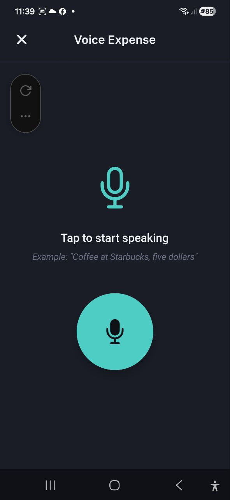
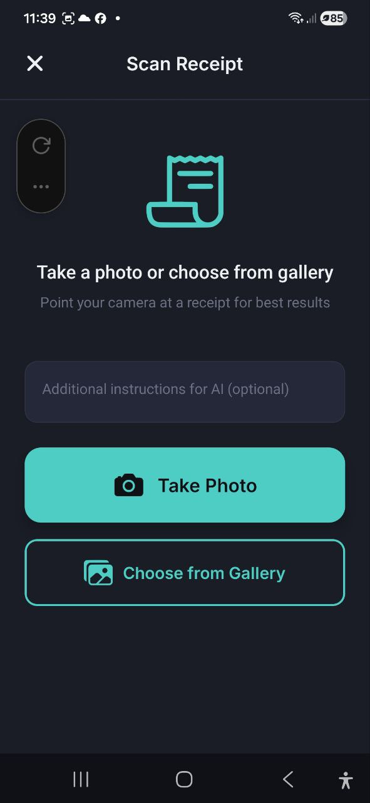

# Entrada por voz e digitalização de talões

> Deixe a IA trabalhar. Diga a despesa com naturalidade ou fotografe um talão — a aplicação extrai automaticamente o montante, a descrição, o comerciante e a categoria.

## Despesa por voz

### Como funciona

1. Toque em **Entrada por voz** nas ações rápidas do Painel, ou toque em **+** no ecrã Transações e escolha **Entrada por voz**
2. Aparece um grande ícone de microfone com o texto **«Toque para começar a falar»**
3. Toque no botão do microfone para começar a gravar
4. Fale com naturalidade, por exemplo: *«Café no Starbucks, cinco dólares»*
5. Toque novamente para parar a gravação
6. A aplicação processa o que disse e extrai os dados da despesa

### Ecrã de confirmação

Depois do processamento, aparece uma confirmação com os dados reconhecidos:

- **Montante** — extraído do que disse (editável)
- **Descrição** — a que se refere a despesa (editável)
- **Comerciante** — onde gastou (editável)
- **Categoria** — atribuída automaticamente (editável)
- Indicador de **confiança** — Confiança elevada ou Confiança média

Reveja os dados, corrija o que for preciso e depois:
- Toque em **Guardar despesa** para confirmar e guardar
- Toque em **Tentar novamente** para gravar de novo

Depois de guardar, pode tocar em **Adicionar outra** para gravar uma nova despesa por voz.

### Dicas para melhores resultados

- Fale com clareza e diga tanto o artigo/descrição como o montante
- Indique o nome do comerciante, se for relevante (por exemplo, «Almoço no McDonald's, doze euros»)
- Indique a moeda se for diferente da sua moeda predefinida
- Mantenha a simplicidade — uma despesa por gravação

## Digitalizar talão

### Como funciona

1. Toque em **Digitalizar talão** nas ações rápidas do Painel, ou toque em **+** no ecrã Transações e escolha **Digitalizar talão**
2. Aparecem três opções:
   - **Tirar fotografia** — abre a câmara para fotografar o talão
   - **Escolher da galeria** — selecione uma fotografia existente
   - **Carregar PDF** — escolha um ficheiro PDF (faturas digitais, talões digitalizados até 10 MB)
3. Opcionalmente, escreva **Instruções adicionais para a IA** (por exemplo, «Dividir em partes iguais entre duas pessoas», «Ignorar a gorjeta»)
4. A aplicação analisa o talão e extrai os dados

### Ecrã de confirmação

Depois da análise da IA, verá:

- **Montante total** — extraído do talão (editável)
- **Descrição** — resumo gerado (editável)
- **Comerciante** — nome da loja/restaurante (editável)
- **Categoria** — atribuída automaticamente (editável)
- **Data** — retirada do talão (editável)
- **Artigos** — linhas individuais com quantidades e preços (se forem detetadas) — toque num artigo para o editar, eliminar ou acrescentar um que a digitalização não apanhou (veja **Editar artigos** abaixo)
- **Desconto** — valor do desconto (se constar do talão)
- Indicador de **confiança** — elevada ou média
- Opção **Guardar imagem do talão** — mantém a fotografia anexada à despesa

Reveja e corrija os dados e depois:
- Toque em **Guardar despesa** para confirmar
- Toque em **Digitalizar de novo** para tentar outra fotografia

### Ampliar o talão

Toque na pequena fotografia do talão no ecrã de confirmação — ou no talão no ecrã de detalhes de uma despesa — para o abrir em ecrã inteiro. No telemóvel, afaste dois dedos para ampliar (até 5×), toque duas vezes para ampliar nesse ponto e toque duas vezes de novo para ver o talão inteiro, e arraste com um dedo para se deslocar enquanto estiver ampliado. No navegador, use a roda do rato para ampliar onde está o ponteiro, arraste para se deslocar, faça duplo clique para ampliar ou reduzir, ou use os botões **+**, **−** e de ajuste no canto. O talão abre sempre a mostrar a página inteira. Os talões em PDF abrem como antes.

### Dicas para melhores resultados

- Fotografe com boa iluminação — evite sombras e reflexos
- Garanta que o talão inteiro está visível e plano
- Segure a câmara com firmeza para evitar fotografias tremidas
- Use **Instruções adicionais para a IA** para casos especiais (por exemplo, «Isto está em EUR», «Ignorar o primeiro artigo»)

### Editar artigos

A extração por IA nem sempre é perfeita — pode perder-se um algarismo de um preço, um desconto pode infiltrar-se num preço unitário ou a digitalização pode falhar uma linha inteira. Não é preciso digitalizar de novo nem eliminar a despesa inteira para corrigir:

- **Toque em qualquer artigo** da lista para editar o nome, a quantidade, o preço unitário ou o preço total. Toque em **Guardar** para aplicar a correção.
- **Toque no ícone do caixote do lixo** junto a um artigo para o remover — útil para uma linha duplicada ou inventada.
- **Toque em + Adicionar artigo** no fim da lista para acrescentar uma linha que a digitalização não apanhou.

Todos os artigos são listados — não há limite, por muitos que o talão tenha. Qualquer alteração atualiza de imediato a divisão por categoria e os totais, para que o que guarda corresponda sempre ao que está no ecrã. O total geral do talão, o desconto e o depósito mantêm-se como foram digitalizados; só as linhas individuais são editáveis.

### Divisão por categoria

Os talões de supermercado misturam muitas vezes vários tipos de artigos na mesma compra — alimentação, produtos para a casa, bebidas alcoólicas. Quando a aplicação reconhece mais do que um tipo de artigo num talão, divide automaticamente a despesa pelas categorias correspondentes, em vez de a pôr toda numa só.

- No ecrã de confirmação, aparece por cima da lista de artigos uma fila de botões de categoria, com o título **Dividir por categoria** (por exemplo, «Supermercado 180 · Casa 35 · Álcool 25»), que mostra como o total será repartido.
- Toque em **Alterar categorias** para abrir a lista de todos os artigos e ajustar a categoria de cada um. As alterações aplicam-se de imediato — e ficam memorizadas, para que o mesmo produto seja classificado corretamente da próxima vez que o digitalizar.
- Se os artigos não somarem um valor suficientemente próximo do total do talão, a aplicação recorre a uma única categoria em vez de adivinhar.
- Os depósitos de garrafas e latas são reconhecidos e mostrados na sua própria categoria, para que veja quanto dos seus gastos corresponde a depósitos de embalagens já pagos.
- Isto conta também para os orçamentos por categoria — um orçamento numa categoria que só aparece dentro de uma divisão de talão, como Álcool ou um orçamento de depósitos, passa finalmente a acompanhar os gastos corretamente, e um orçamento de Supermercado deixa de contar os produtos para a casa ou o depósito do mesmo talão.
- Por vezes nenhuma das suas categorias existentes serve para um grupo de artigos. Nesse caso, a aplicação sugere uma categoria nova, mostrada como um botão marcado com **+** (por exemplo, «+ Produtos de limpeza 10»). Nada é criado ainda — toque em **Alterar categorias** para passar esses artigos para uma das suas categorias existentes, ou deixe como sugerido. A nova categoria só é efetivamente criada quando guardar o talão.
- A aplicação já não inventa uma categoria que duplique uma que já tem — uma tradução, um sinónimo ou uma parte de uma categoria existente (por exemplo «Pão» ao lado de «Supermercado»). Esses artigos vão para a sua categoria existente ou para uma subcategoria dela; só é sugerida uma categoria nova para um tipo de gasto realmente novo, e a aplicação nunca cria subcategorias por si.

Funciona da mesma forma quer digitalize na aplicação, quer através dos bots de Telegram, WhatsApp ou Slack.

### Digitalizar uma pilha de talões

Tem uma semana de talões em papel por registar? Depois de guardar um, a mensagem de confirmação oferece duas opções em vez de simplesmente fechar o ecrã:

- **Digitalizar outro** — volta diretamente à câmara sem sair do ecrã, para despachar uma pilha inteira de seguida
- **Concluído** — termina e volta ao ponto de partida

Enquanto digitaliza, um pequeno contador mostra quantos talões guardou nesta sessão. A cada 15 talões, a aplicação deixa um lembrete simpático de que pode continuar ou fazer uma pausa — o seu progresso já está guardado em qualquer dos casos. O contador volta a zero quando sai do ecrã; serve apenas para dar uma noção do progresso durante uma sessão.

### Talão comprido em várias fotografias

Um talão demasiado comprido para caber numa fotografia legível pode ser fotografado por partes e lido como **um só** talão.

**Na aplicação**

1. No ecrã do talão, toque em **Talão comprido? Fotografe-o por partes**
2. Fotografe o talão de cima para baixo, com uma pequena sobreposição entre fotografias (a última linha de uma fotografia deve voltar a ver-se no topo da seguinte) — pode acrescentar até **4 partes**
3. Toque em **Ler talão**. Recebe um único cartão de confirmação com cada linha uma só vez; as linhas sobrepostas não são contadas duas vezes
4. Se os totais das linhas não corresponderem ao total do talão, a aplicação avisa e oferece **Repetir partes** em vez de guardar

Cada parte conta como uma digitalização de talão no seu limite mensal de IA, por isso um talão em três partes usa três digitalizações. Um PDF não pode ser combinado com fotografias. A despesa mantém todas as fotografias: abra o talão na despesa e toque numa parte para a ver.

**Nos bots de Telegram, WhatsApp e Slack**

Envie as fotografias uma a seguir à outra. A primeira fotografia é lida de imediato. Enquanto o cartão de confirmação ainda estiver aberto, envie a fotografia seguinte — o bot pergunta se é uma **Continuação** ou um **Talão novo**. Escolha **Continuação** e o cartão é refeito a partir de todas as fotografias em conjunto (as correções que escreveu no cartão antigo não são mantidas, por isso verifique o novo). As fotografias têm de ser JPEG, PNG ou WebP e não demasiado grandes; o bot avisa se alguma for recusada.

### Talões já digitalizados

A aplicação avisa antes de um talão acabar duas vezes nas suas despesas:

- **O mesmo ficheiro outra vez** — se escolher uma fotografia ou um PDF que já foi digitalizado e guardado, é-lhe perguntado *antes* de ser lido, por isso não se gasta nenhum pedido de IA. Escolha **Abrir** para ver a despesa guardada, **Digitalizar mesmo assim** para o ler de novo, ou **Cancelar**.
- **O mesmo talão, fotografia nova** — depois da leitura, se já existir uma despesa com a mesma loja, o mesmo montante e a mesma data (±1 dia), o ecrã de confirmação mostra um aviso amarelo com um botão **Abrir**. Pode guardar na mesma: pode ser mesmo uma segunda compra.
- **Já registado pelo banco** — se a despesa correspondente veio de uma notificação bancária ou de uma importação de extrato bancário, o aviso indica-o e oferece **Juntar numa só despesa**. Com a opção marcada, ao guardar mantém-se o talão (os artigos, a fotografia e a categoria) e substitui-se a entrada do banco, para que a compra seja contada uma só vez. A caixa começa desmarcada quando só o montante e a data coincidem — verifique antes de juntar.
- **Já adicionado à mão** — se registou esta compra antes — escrita, por voz ou numa mensagem ao bot (por exemplo, «Netto», enquanto o talão imprime «Netto nr 541») — o aviso indica-o e oferece a mesma opção **Juntar numa só despesa**. Esta caixa começa desmarcada, porque uma despesa introduzida à mão pode ser uma compra diferente — marque-a se for a mesma. O talão substitui a sua entrada; as notas, as etiquetas e o projeto são transferidos. Se a deixar, o par aparece mais tarde também nos alertas, com um botão para juntar.

Os bots de Telegram, WhatsApp e Slack dão os mesmos avisos, com um botão **Ler mesmo assim**. Quando a correspondência é uma entrada sua ou a cópia do banco, ao premir **Adicionar despesa** é perguntado se pretende juntar: **Juntar** mantém o talão e integra nele a outra entrada, **Manter ambos** guarda o talão separadamente.

### Partilhar a partir de outra aplicação (Android)

Recebeu um talão como captura de ecrã, uma confirmação da aplicação do banco ou um talão eletrónico em PDF? Não precisa de abrir o digitalizador:

1. Em qualquer aplicação (galeria, Gmail, o seu banco, a aplicação de uma loja), toque em **Partilhar**
2. Escolha **AI Budget**
3. A aplicação abre diretamente no ecrã de confirmação já preenchido — verifique e toque em **Guardar**

Pode partilhar **imagens e PDFs**, até **10 ficheiros de cada vez** (um PDF até 10 MB). Vários ficheiros dão origem a despesas separadas, uma após outra — o título mostra o progresso («Talão 2 de 5») e **Seguinte** passa ao ficheiro seguinte. Se um ficheiro não puder ser lido, escolha **Saltar** ou **Introduzir manualmente**. Ao fechar o ecrã, é-lhe perguntado antes de descartar os ficheiros ainda em espera. Cada ficheiro conta como uma digitalização de talão no seu limite de IA; se o limite se esgotar, os restantes ficheiros ficam para mais tarde.

**Textos de pagamento:** selecione um SMS do banco, um e-mail ou uma mensagem de chat, toque em **Partilhar** e escolha AI Budget. A aplicação lê o montante e o comerciante e abre o formulário de nova despesa já preenchido — verifique e guarde. Um texto que não pareça um pagamento (um anúncio, uma transação recusada) nunca é transformado numa despesa. Apenas Android.

A partilha funciona apenas no Android. No iPhone e na aplicação web, use **Digitalizar talão**.

### Reencaminhar talões eletrónicos por e-mail

Muitas lojas físicas e online enviam-lhe por e-mail um talão ou uma confirmação de encomenda. Em vez de o digitalizar, pode reencaminhá-lo para o seu endereço privado. Cada e-mail reencaminhado aparece na aplicação como uma despesa à sua espera. **Nada é guardado até o confirmar.**

> **Em implementação gradual.** Esta funcionalidade está a ser ativada aos poucos. Se vir **Talões por e-mail** em **Definições**, pode usá-la. Se ainda não a vir, ainda não chegou à sua conta.

#### Obter o seu endereço

1. Abra **Definições** → **Talões por e-mail**
2. Toque em **Criar o meu endereço**. Só os proprietários e editores da conta o podem fazer.
3. Em **O seu endereço privado**, toque em **Copiar**
4. Em **Adicionar talões a**, escolha a conta onde os talões confirmados são guardados. Só aparecem as contas que pode editar.

O endereço pertence-lhe a si, não à conta. Os membros de uma conta partilhada nunca veem os e-mails que reencaminha.

#### Configurar o reencaminhamento no Gmail

1. No Gmail, abra **Definições** → **Ver todas as definições** → **Encaminhamento e POP/IMAP** → **Adicionar um endereço de encaminhamento** e cole o seu endereço privado
2. O Gmail envia um código de confirmação para esse endereço. O código aparece na aplicação em **Definições** → **Talões por e-mail**, num cartão **Código de confirmação do Gmail**, com um botão **Copiar**. Introduza o código no Gmail. O código só é mostrado na aplicação, nunca numa notificação, e apenas durante cerca de 30 minutos. Se já tiver desaparecido, peça ao Gmail para o enviar de novo.
3. Crie um **filtro** (**Definições** → **Filtros e endereços bloqueados**) para o endereço do remetente da loja, ou para um assunto como «talão», «recibo» ou «encomenda», e escolha **Encaminhar para** o seu endereço

Não reencaminhe todo o seu correio. Use um filtro. Protege a sua privacidade, e mensagens sem relação não gastam o seu limite de IA.

#### Configurar o reencaminhamento no Outlook

1. No Outlook, abra **Definições** → **Correio** → **Regras** e adicione uma regra para as mensagens da loja ou com «talão» no assunto
2. Escolha a ação **Reencaminhar para** e introduza o seu endereço privado

Algumas contas Outlook.com e Microsoft 365 bloqueiam o reencaminhamento automático para endereços externos. Se for o caso da sua, reencaminhe cada talão à mão. Um reencaminhamento manual a partir do telemóvel funciona igualmente bem.

#### Confirmar um talão

Quando um talão reencaminhado é lido, recebe uma notificação. Verá também uma faixa no ecrã Transações, **Talões por e-mail por confirmar: N**. Pode sempre abrir a lista a partir de **Definições** → **Talões por e-mail** → **Abrir a caixa de talões por e-mail**.

- O separador **Por confirmar** lista os talões à sua espera. Toque num para abrir o habitual ecrã de confirmação de talão, verifique os dados e toque em **Guardar despesa**.
- Se o talão parecer uma despesa que já tem, vê o mesmo aviso de duplicado que para um talão digitalizado, incluindo **Juntar numa só despesa**.
- Toque em **Descartar** para eliminar um talão sem o guardar.
- O separador **Tratados** mostra o que foi ignorado: um talão que já tem, um e-mail sem nenhum talão, um que não pôde ser lido, ou um que ficou por ler porque o seu limite de IA foi atingido. Quando se aplica, toque em **Tentar novamente**.

Cada talão eletrónico lido conta como uma digitalização de talão no seu limite de IA. Os duplicados e os e-mails sem talão são ignorados sem o gastar. Se uma loja só enviar um link para o talão, reencaminhe antes o PDF, porque os links nunca são abertos. Uma fotografia do talão pode ficar guardada com a despesa. Um PDF ou um e-mail simples não é anexado. A lista precisa de ligação à internet.

#### Se o seu endereço for divulgado

Toque em **Mudar endereço**. O endereço antigo deixa de funcionar de imediato, e o correio enviado para ele é rejeitado. Depois, atualize a regra de reencaminhamento na sua caixa de correio para o novo endereço. O Gmail volta a pedir um código de confirmação. Para deixar de receber talões eletrónicos de vez, toque em **Desativar endereço**.

#### Privacidade e conservação

- O nosso servidor lê um e-mail reencaminhado enquanto o processa, tal como qualquer talão que digitalize.
- Só o talão em si é guardado, nunca o e-mail inteiro. Os links no e-mail nunca são abertas e as imagens nunca são carregadas.
- O talão guardado é eliminado assim que o confirmar ou descartar.
- Os itens que não confirmar são eliminados automaticamente após 30 dias.
- Os talões por e-mail **não estão disponíveis** para contas com **Nível 2 — Encriptação total**. Com a encriptação de Nível 1 funcionam, mas os itens não confirmados são eliminados após 7 dias. Veja [Encriptação](./15-encryption.md).

## Receita por voz

Registe pagamentos recebidos por voz — o mesmo fluxo da despesa por voz, otimizado para receitas.

### Como funciona

1. Toque em **Receita por voz** nas ações rápidas do Painel, ou toque no ícone do microfone no rodapé do formulário **Adicionar receita**
2. Toque no botão (verde) do microfone para começar a gravar
3. Fale com naturalidade, por exemplo: *«Recebi 500 do cliente, honorários de consultoria»*
4. Toque novamente para parar a gravação
5. A aplicação extrai o montante, a descrição e a **categoria de receita** que melhor corresponde

### Ecrã de confirmação

- **Montante** — extraído do que disse (editável)
- **Descrição** — a que se refere o pagamento (editável)
- **Categoria** — categoria de receita atribuída automaticamente (editável)
- **Moeda** — detetada ou, por omissão, a sua moeda base

Toque em **Guardar receita** para confirmar, ou em **Tentar novamente** para gravar de novo.

### Dicas para melhores resultados

- Diga o montante e uma breve descrição
- Indique a moeda se for diferente da sua moeda predefinida

---

## Digitalizar fatura

Fotografe ou carregue uma fatura ou um comprovativo de pagamento para registar a receita automaticamente.

### Como funciona

1. Toque em **Digitalizar fatura** nas ações rápidas do Painel, ou toque no ícone de documento no rodapé do formulário **Adicionar receita**
2. Escolha **Tirar fotografia**, **Escolher da galeria** ou **Carregar PDF**
3. Opcionalmente, escreva instruções adicionais para a IA
4. A aplicação extrai o montante total, a data e a categoria

### Ecrã de confirmação

- **Montante total** — extraído do documento
- **Descrição** — resumo gerado
- **Categoria** — categoria de receita atribuída automaticamente
- **Data** — retirada do documento

Reveja os dados, toque em ✓ para guardar ou no ícone do lápis para abrir o formulário completo **Adicionar receita** com os dados já preenchidos.

> **Nota:** O OCR de faturas extrai apenas o total e a data. As linhas das faturas são ignoradas de propósito, para evitar contagens a dobrar em documentos de faturação com várias linhas.

---

## Perguntas frequentes

- **P: Que idiomas suporta a entrada por voz?**
  **R:** A entrada por voz funciona melhor no idioma definido na aplicação. Suporta todos os idiomas da aplicação.

- **P: Posso digitalizar talões em qualquer idioma?**
  **R:** Sim, a IA consegue processar talões na maioria dos idiomas e extrai os montantes e os artigos independentemente do idioma do talão.

- **P: Que ficheiros PDF são suportados?**
  **R:** São suportados tanto PDFs digitais (por exemplo, faturas da Amazon ou do PayPal) como talões digitalizados em PDF. O tamanho máximo do ficheiro é 10 MB. Os PDFs digitais com texto selecionável são processados mais depressa e com mais precisão. Para melhores resultados com PDFs digitalizados, garanta que a digitalização é nítida e com bom contraste.

- **P: Porque é que o montante ficou errado depois da digitalização?**
  **R:** A extração por IA nem sempre é perfeita. Reveja sempre o ecrã de confirmação e corrija os erros antes de guardar. Talões desfocados ou danificados podem dar resultados menos precisos. Se uma linha concreta estiver errada, toque nela para a editar diretamente — veja **Editar artigos** acima.

- **P: A entrada por voz e a digitalização de talões gastam os meus pedidos de IA?**
  **R:** Sim, cada entrada por voz ou digitalização de talão usa um pedido de IA da sua quota mensal.

- **P: Porque é que um talão ficou dividido por várias categorias nos meus gráficos?**
  **R:** Quando um talão mistura claramente tipos diferentes de artigos (por exemplo, mercearia e bebidas alcoólicas), a aplicação divide-o automaticamente pelas categorias correspondentes nos seus gráficos de gastos — e também nos seus orçamentos por categoria. Toque em **Alterar categorias** no ecrã de confirmação do talão para o ajustar — as correções ficam memorizadas para a próxima vez.

---

*Ver também: [Despesas e receitas](./03-expenses-and-income.md) | [Chat IA](./07-ai-chat.md)*

## Talões de bomba de gasolina

Se o talão for de um posto de combustível e indicar os litros e o preço por litro, o ecrã de confirmação oferece **Adicionar ao registo de combustível** para o seu veículo. Introduza o conta-quilómetros e o abastecimento fica registado com a despesa; deixe vazio para guardar só a despesa. Se os números do talão não batem certo, nada é preenchido.
