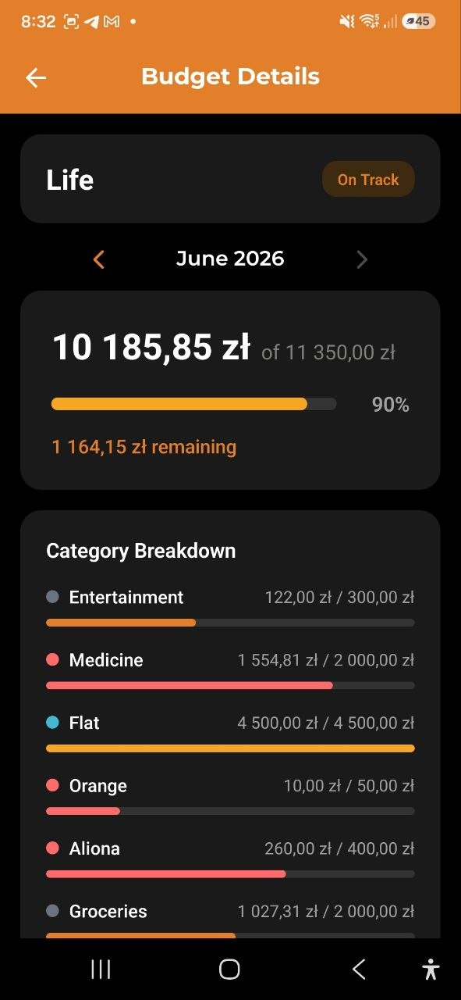

# Orçamentos

> Defina limites de gastos e acompanhe o seu progresso em tempo real. Crie orçamentos para categorias específicas ou distribua o orçamento por várias categorias, com períodos personalizáveis e limiares de alerta automáticos.

## Visão geral

Os orçamentos ajudam a controlar os gastos, definindo limites para períodos de tempo específicos. A aplicação compara as suas despesas com esses limites e avisa quando se está a aproximar do orçamento ou o ultrapassa.

## Lista de orçamentos

O separador **Orçamento** mostra todos os seus orçamentos ativos:

- **Nome do orçamento** e período (Diário, Semanal, Mensal, Anual, Personalizado)
- **Barra de progresso** — indicador visual dos gastos face ao limite
- **Montante gasto** em relação ao orçamento total (por exemplo, «2 846 zl de 20 000 zl»)
- **Indicador de estado**:
  - **Dentro do previsto** (verde) — os gastos estão dentro do limite
  - **Acima do orçamento** (vermelho) — os gastos ultrapassaram o limite
- Montante **restante** ou excedido

> **Nota:** Se ainda não tiver orçamentos, verá a mensagem: «Crie um orçamento para começar a controlar os seus limites de gastos.»

## Criar um orçamento

### Passo a passo

1. Toque em **Criar orçamento** no separador Orçamento (ou no botão **+**)
2. Escreva o **Nome do orçamento** (por exemplo, «Supermercado mensal») — é opcional: se o deixar em branco, o orçamento fica com o nome da sua categoria ou do seu período («Orçamento mensal»)
3. Escolha a **Moeda**
4. Escolha o **Tipo de orçamento**:
   - **Geral** — define um único montante total, opcionalmente associado a uma categoria
   - **Por categoria** — distribui o orçamento por várias categorias, cada uma com o seu próprio limite
5. Introduza o **Montante** (modo Geral) ou adicione categorias com montantes (modo Por categoria)
6. Escolha um **Período**:
   - **Diário** — reinicia todos os dias
   - **Semanal** — reinicia todas as semanas
   - **Mensal** — reinicia todos os meses
   - **Anual** — reinicia todos os anos
7. Defina o limiar **Alertar aos** (predefinição: 80%) — recebe uma notificação quando os gastos atingem essa percentagem
8. Toque em **Criar orçamento**

### Modo Por categoria

No modo **Por categoria**, pode atribuir um limite de gastos a cada categoria de despesa:

- Toque em **Adicionar categoria** para escolher uma categoria da lista
- Introduza o montante de cada categoria
- O orçamento total é igual à soma dos montantes de todas as categorias
- Pode adicionar quantas categorias precisar

## Talões digitalizados e orçamentos por categoria

Quando um talão digitalizado é dividido automaticamente por categorias — mercearia, produtos para a casa, depósito de garrafas —, a parte de cada categoria conta agora para o orçamento dessa categoria, na proporção da divisão. Um orçamento numa categoria que só aparece dentro de uma divisão de talão, como Álcool ou um orçamento de depósitos, passa finalmente a acompanhar os gastos em vez de mostrar sempre zero — e um orçamento de Supermercado deixa de contar os produtos para a casa ou o depósito do mesmo talão.

Isto aplica-se também aos talões que já digitalizou, não só aos novos — os totais dos orçamentos, incluindo o Histórico de gastos, são atualizados automaticamente. Não é preciso digitalizar nada de novo.

## Detalhes do orçamento

Toque em qualquer orçamento para ver todos os detalhes:

- **Visualização do progresso** — barra com o gasto face ao limite
- **Estado** — Dentro do previsto ou Acima do orçamento
- **Repartição por categoria** — nos orçamentos com várias categorias, veja o progresso de cada categoria:
  - Ponto colorido + nome da categoria
  - Montantes gastos / atribuídos
  - Barra de progresso por categoria (verde/amarelo/vermelho conforme a utilização)
- **Subcategorias** — se uma categoria que atribuiu tiver subcategorias (por exemplo, Supermercado com Pão e Queijo), a linha dessa categoria soma o grupo inteiro e mostra por baixo a repartição por subcategoria, além de uma linha **Sem subcategoria** para os gastos classificados diretamente na categoria principal. Os gastos numa subcategoria que também tenha um montante atribuído próprio contam nas duas linhas, mas o total geral do orçamento conta cada despesa só uma vez. A estrutura de categorias atual é usada também para os períodos anteriores, por isso mover uma categoria altera os valores anteriores.
- **Período** — o intervalo de tempo do orçamento
- **Limiar de alerta** — o ponto em que é enviada a notificação (por exemplo, 80%)
- **Dias restantes** — quantos dias faltam no período atual
- **Total previsto** — estimativa do gasto total no fim do período, com base no ritmo atual
- **Ativo/Inativo** — o estado atual do orçamento

### Ações:
- **Editar** (ícone do lápis) — alterar o nome, o montante, as categorias, o período ou o limiar de alerta
- **Eliminar** — remover o orçamento (com confirmação)

## Histórico de gastos

O cartão **Histórico** mostra como se saiu face a este orçamento nos últimos 6 períodos. Está disponível para todos os tipos de período, exceto Personalizado.

- **Gráfico de barras** — cada grupo mostra duas barras: o gasto real (colorido) e o limite do orçamento (cinzento) nesse período.
  - Barra verde — gasto dentro do limite
  - Barra vermelha — limite ultrapassado
- **Resumo de cumprimento** — por exemplo, «Acima do orçamento em 3 de 6 períodos» ou «Poupança média: $42»
- **Excesso médio** — se ultrapassou o limite em alguns períodos, mostra o valor médio em que o excedeu

> **Dica:** Use o cartão de histórico para detetar padrões repetidos de gastos excessivos. Se vir 3–4 barras vermelhas seguidas, pondere aumentar o limite ou ajustar os seus hábitos nessa categoria.

## Mês financeiro (início de período personalizado)

Por predefinição, os orçamentos mensais seguem o mês civil. Se a sua receita chega a meio do mês, o Proprietário da conta pode mudar o dia de início — por exemplo, o dia 10 faz com que o período de um orçamento mensal vá do dia 10 ao dia 9 do mês seguinte. Defina-o em **Definições da conta → Mês financeiro** (veja [Contas](./09-accounts.md)). A alteração aplica-se retroativamente aos períodos e ao histórico anteriores, sem alterar nenhum dado de despesas ou receitas.

## Editar um orçamento

Toque no **ícone do lápis** no ecrã de detalhes do orçamento para passar ao modo de edição:

- Altere o nome, a moeda, o período ou o limiar de alerta do orçamento
- Alterne entre os modos **Geral** e **Por categoria**
- No modo Por categoria: adicione, remova ou altere os montantes das categorias
- Toque em **Guardar** para aplicar as alterações, ou em **Cancelar** para as descartar

## Alertas de orçamento

A aplicação monitoriza automaticamente os seus orçamentos e envia notificações:

- **Alerta de limiar** — quando os gastos atingem a percentagem de alerta definida (por exemplo, 80%)
- **Alerta de orçamento ultrapassado** — quando os gastos excedem 100%
- A cor da barra de progresso muda de forma dinâmica:
  - Verde — menos de 80% utilizado
  - Amarelo/Laranja — 80–100% utilizado
  - Vermelho — mais de 100% utilizado

> **Dica:** O cartão Orçamento mensal no Painel mostra num relance o estado do seu orçamento principal.

## Perguntas frequentes

- **P: Posso ter vários orçamentos ao mesmo tempo?**
  **R:** Sim! Pode criar tantos orçamentos quantos precisar — para diferentes categorias, períodos ou para os gastos em geral.

- **P: Qual é a diferença entre os modos Geral e Por categoria?**
  **R:** O modo Geral define um único limite total (opcionalmente para uma só categoria). O modo Por categoria permite definir limites individuais para cada categoria — útil quando quer acompanhar separadamente a mercearia, os transportes e o lazer dentro de um mesmo orçamento.

- **P: O que acontece quando termina o período de um orçamento?**
  **R:** O orçamento reinicia automaticamente para o novo período. Os dados de gastos anteriores ficam guardados na Análise.

- **P: O orçamento acompanha despesas em todas as moedas?**
  **R:** Cada orçamento está associado a uma moeda. Só as despesas nessa moeda contam para o orçamento.

## Reduzir uma categoria numa percentagem

Ao escolher uma categoria ao criar um orçamento, pode escolher **menos 10 / 20 / 30%** do que no mês passado, a média de 3 meses ou o mesmo mês do ano passado. O valor é preenchido por si; depois é um orçamento normal.

---

*Ver também: [Painel](./02-dashboard.md) | [Análise](./06-analytics.md)*
