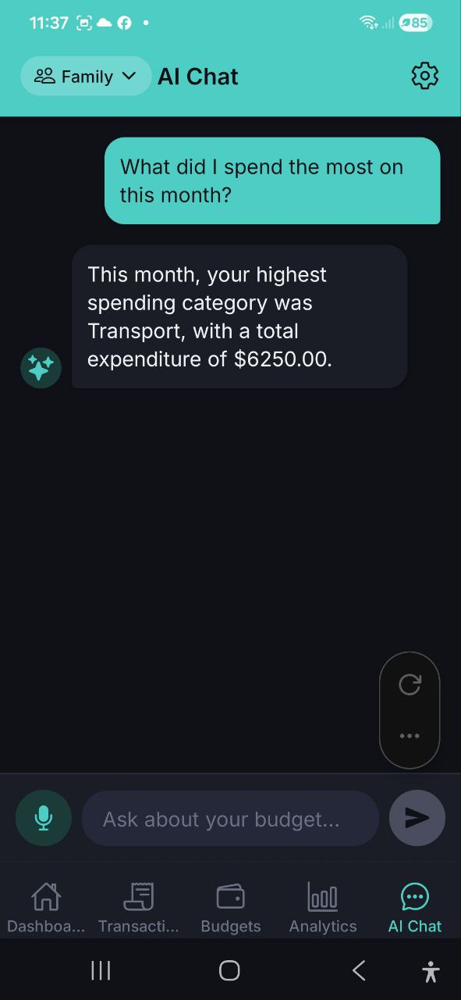

# Chat IA

> Faça perguntas sobre as suas finanças em linguagem natural. Obtenha análises de gastos, conselhos de orçamento e dicas de poupança personalizadas — com tecnologia de IA.

## Visão geral

O separador **Chat IA** é o seu assistente financeiro pessoal. Pode fazer perguntas em linguagem simples e obter respostas detalhadas com base nos seus dados reais de gastos.

## Como utilizar

1. Toque no separador **Chat IA** (o separador mais à direita na navegação inferior)
2. Escreva uma pergunta no campo de texto na parte inferior (texto de exemplo: «Pergunte sobre o seu orçamento...»)
3. Toque no botão de **enviar** (ícone de seta)
4. Leia a resposta da IA no balão do chat

O assistente de IA responde com uma análise baseada nos dados reais das transações da conta atual.

## Botões de ação rápida

Aparecem três botões predefinidos para as perguntas mais comuns:

| Botão | Pergunta enviada |
|---|---|
| **Maiores gastos** | «Em que é que gastei mais este mês?» |
| **Estado do orçamento** | «Estou dentro do orçamento?» |
| **Dicas de poupança** | «Dê-me dicas para poupar dinheiro» |

Toque num botão para enviar essa pergunta de imediato.

## Entrada por voz no chat

1. Toque no botão do **microfone** (à esquerda do campo de texto)
2. Diga a sua pergunta
3. O texto transcrito é processado e enviado

> **Nota:** enquanto a voz é transcrita, aparece o estado «A processar a voz...».

## Exemplos de perguntas

**Perguntas de análise:**
- «Em que é que gastei mais este mês?»
- «Quanto gastei em comida na semana passada?»
- «Estou dentro do orçamento?»
- «Compara os meus gastos deste mês com os do mês passado»
- «Quais são as minhas 3 principais categorias de despesas?»
- «Quanto gastei em transportes este ano?»
- «Dê-me dicas para poupar dinheiro»
- «A este ritmo, quando é que o meu orçamento mensal se esgota?»

**Comandos em linguagem natural:**
- «Adiciona uma despesa de 500₴ em supermercado»
- «Cria um orçamento de 10000₴ para lazer em março»
- «Adiciona uma receita de 50000₴ do salário»
- «Mostra as minhas despesas da semana passada»
- «Qual é o estado do meu orçamento?»
- «Mostra a distribuição por categorias deste mês»

## Perguntar sobre um produto específico

Pode perguntar quanto gastou num determinado produto, marca ou loja:

- «Quanto gastei em cerveja?»
- «Quanto em café este ano?»

O assistente procura **dentro dos talões digitalizados**, e não apenas no nome da despesa — por isso, um produto comprado numa grande ida ao supermercado também é contabilizado, e só é somado o preço desse artigo (não o talão inteiro). Percebe **qualquer idioma, nomes de marcas e erros de escrita** — por exemplo, «пиво», «beer» ou «cerveja» encontram as mesmas compras de cerveja. Se não indicar um período, a pesquisa abrange todo o histórico.

## Perguntar sobre o depósito de embalagens

Em muitos países, as lojas cobram um depósito à parte pelas garrafas, latas e grades retornáveis. Pode perguntar ao assistente quanto já pagou por isso:

- «Quanto paguei em depósitos de embalagens?»
- «Quanto de kaucja este mês?»

O assistente responde com o total, o número de talões de onde vem e as lojas onde pagou mais. Pergunte por palavras suas — o termo local funciona em todos os idiomas suportados pela aplicação (kaucja, Pfand, statiegeld, consigne, depósito, bottle deposit). Se não indicar um período, a resposta abrange todo o histórico.

O valor vem da linha de depósito impressa nos **talões digitalizados**, por isso também conta talões que a aplicação não conseguiu dividir por categorias. É o montante que já **pagou**, não um reembolso que ainda possa receber — a aplicação não regista as embalagens que devolveu. As despesas introduzidas manualmente não têm depósito e, numa conta totalmente encriptada, o assistente não consegue ler os montantes.

## Perguntar sobre descontos

Pode perguntar ao assistente quanto recebeu em descontos nas suas compras:

- «Quanto poupei em descontos este mês?»
- «Quanto de rabat este ano?»

O assistente responde com o total, o número de talões de onde vem e as lojas que lhe deram os maiores descontos. Pergunte por palavras suas — o termo local funciona em todos os idiomas suportados pela aplicação (rabat, Rabatt, korting, réduction, descuento, discount). Se não indicar um período, a resposta abrange todo o histórico.

O valor vem do desconto impresso nos **talões digitalizados**, por isso também conta talões que a aplicação não conseguiu dividir por categorias. As despesas introduzidas manualmente e as importações do banco/Wise não têm valor de desconto e, numa conta totalmente encriptada, o assistente não consegue ler os montantes.

## Histórico de conversas

Pode consultar e reabrir conversas anteriores com a IA a qualquer momento:

1. Toque no botão **Histórico** (ícone de relógio) no topo do separador do chat
2. Aparece uma lista das conversas anteriores, com o título e a data
3. Toque numa conversa para carregar as mensagens
4. Pode continuar a conversa escrevendo uma nova mensagem
5. Para começar do zero, toque no botão **Nova conversa** (canto superior esquerdo, visível quando uma conversa anterior está carregada)

> Depois do primeiro carregamento, o histórico de conversas também é guardado localmente para acesso offline.

### Gerir uma conversa

Cada conversa da lista tem o seu próprio menu **⋯**. No navegador, aparece
quando aponta para uma linha (ou quando essa linha é a conversa aberta); no telemóvel
está sempre visível, e um toque longo na linha abre o mesmo menu.

- **Mudar nome da conversa** dá à conversa um nome escolhido por si. Até o fazer,
  o título é a primeira coisa que escreveu nela, o que raramente é o nome
  que lhe daria. Mudar o nome não altera a posição da conversa na lista.
- **Fixar** mantém uma conversa no topo da lista, acima de uma linha divisória,
  por muito tempo que tenha passado desde a última utilização. Fixar é **só
  seu** — altera apenas a ordem que vê, não a dos outros, e pode fixar uma conversa
  partilhada iniciada por outra pessoa. Toque em **Desafixar** para a soltar.
- **Eliminar** remove definitivamente a conversa e as respetivas mensagens. Não é possível
  anular. Se a conversa for partilhada, a confirmação di-lo claramente,
  porque eliminá-la remove-a para todos os membros da conta, e não apenas para
  si.

Só pode mudar o nome e eliminar as conversas que iniciou. Numa conversa partilhada
iniciada por outra pessoa, o menu oferece apenas **Fixar** — a única coisa que
faz sentido aí, já que a ordem da sua própria lista só a si diz respeito.

## Conversas partilhadas

Se partilhar uma conta com outros membros, pode transformar uma conversa num **chat de grupo partilhado**, onde todos falam com a IA em conjunto.

- **Ativar ou desativar a partilha:** quem iniciou a conversa vê a opção no topo do chat. No navegador, é um par de botões, **Privada** e **Partilhada**, com a opção atual preenchida — assim vê que a outra existe e pode tocar nela. No telemóvel, o mesmo botão tem uma pequena seta de troca que indica que pode ser alterado. Qualquer membro pode partilhar uma conversa que tenha criado — não apenas o proprietário da conta. Não é possível alterar a partilha de uma conversa iniciada por outra pessoa (aí verá uma etiqueta «Partilhada» só de leitura). A opção só aparece quando a conta tem mais do que um membro.
- **Decidir antes de começar:** a opção também funciona numa conversa vazia.
  Escolha **Partilhada** antes de escrever o que quer que seja e a conversa fica partilhada
  desde a primeira mensagem, o que poupa a todos ler a primeira metade de uma conversa
  de que nunca ninguém lhes falou.
- **Todos veem a conversa:** numa conversa partilhada, as mensagens dos outros membros aparecem com o respetivo nome, e as novas mensagens surgem automaticamente enquanto tiver o chat aberto.
- **Dirigir-se a uma pessoa em vez da IA:** escreva **@** e escolha um membro para o mencionar. Quando menciona um membro, a IA fica em silêncio — a mensagem destina-se a essa pessoa, não ao assistente. Se não mencionar ninguém, a IA responde normalmente.
- **Notificações:** se mencionar um membro que não esteja a ver o chat nesse momento, essa pessoa recebe uma notificação push para não perder a mensagem. Isto respeita a definição de notificações «Atividade em contas partilhadas».

> As conversas privadas funcionam exatamente como antes — só o utilizador as vê, e a IA responde sempre.

## Funcionalidades do chat

- **Histórico de conversas** — as mensagens anteriores são mantidas durante a sessão e podem ser reabertas através do botão Histórico
- **Indicador de escrita** — mostra «A pensar...» enquanto a IA processa a pergunta
- **Tratamento de erros** — se algo correr mal, verá uma mensagem de erro com a opção de tentar novamente
- **Comandos em linguagem natural** — crie despesas, receitas, orçamentos e categorias e consulte dados em linguagem simples
- **Confirmação de ações** — ao criar registos financeiros, a IA mostra uma pré-visualização e pede confirmação antes de guardar
- **Deteção inteligente do idioma** — a IA responde automaticamente no seu idioma (inglês, russo, ucraniano, bielorrusso, alemão, espanhol, francês, polaco, português)
- **Reconhecimento de moedas** — suporta os símbolos: ₴ (UAH), $ (USD), € (EUR), zł (PLN), £ (GBP), ₽ (RUB)
- **Bot do Telegram** — utilize o mesmo Chat IA a partir do Telegram. Envie texto, voz ou fotografias de talões diretamente ao bot
- **Deteção automática da conta** — mencione o nome de uma conta na mensagem (por exemplo, «Mostra as despesas em Família») e a IA consulta essa conta automaticamente

## Limites de pedidos de IA

Cada mensagem que envia gasta um pedido de IA da sua quota mensal:

| Plano | Pedidos de IA por mês |
|---|---|
| **Free** | 5 |
| **Pro** | 200 |
| **Business** | Ilimitado |

Quando os pedidos se esgotarem, ser-lhe-á sugerido fazer upgrade do plano.

## Comandos em linguagem natural

Pode **executar ações reais** diretamente a partir do chat:

### Criar registos

1. Escreva um comando como: **«Adiciona uma despesa de 500₴ em supermercado»**
2. A IA mostra um **cartão de confirmação** com:
   - Montante e moeda
   - Categoria (detetada automaticamente ou predefinida)
   - Data (hoje, por predefinição)
3. Toque em **Confirmar** para criar a despesa, ou em **Cancelar** para a rejeitar
4. Após a confirmação, a despesa é guardada e verá uma mensagem de sucesso

**Comandos de criação suportados:**
- **Despesas:** «Adiciona uma despesa de 500₴ em supermercado», «Gastei 1200₴ em transportes ontem»
- **Receitas:** «Adiciona uma receita de 50000₴ do salário», «Recebi um bónus de 5000₴»
- **Orçamentos:** «Cria um orçamento de 10000₴ para lazer em março», «Define um orçamento mensal de 3000₴ para comida»
- **Categorias:** «Cria a categoria de despesa Comida», «Adiciona a categoria de receita Freelance»

### Comandos de dívidas e empréstimos

Faça a gestão das suas dívidas diretamente no chat — sem precisar de abrir o ecrã Dívidas:

- **«A Sara devolveu-me $80»** → regista um reembolso parcial da dívida da Sara (mostra primeiro a confirmação)
- **«Emprestei $200 ao João até sexta-feira»** → cria um novo registo de dinheiro emprestado por si
- **«Pedi emprestado 5000₴ à mãe»** → cria um novo registo de dinheiro que pediu emprestado
- **«Mostra as minhas dívidas»** → lista de imediato todas as dívidas ativas com os saldos em falta

> Se tiver várias dívidas com o mesmo nome de contacto, a IA pergunta a qual se refere.

### Comandos de objetivos de poupança

Atualize o progresso dos seus objetivos de poupança sem sair do chat:

- **«Poupei $200 para o fundo de férias»** → atualiza o saldo atual do objetivo Férias
- **«Adiciona 500₴ ao objetivo do carro»** → aumenta o saldo do objetivo Carro
- **«Define o meu fundo de emergência para $3000»** → define diretamente o montante atual

> A IA faz corresponder os nomes à lista dos seus objetivos ativos. Confirme a ação no cartão de pré-visualização antes de ser guardada.

### Consultar dados

Estes comandos são executados **de imediato** e mostram os resultados:

- **«Mostra as minhas despesas da semana passada»** → apresenta a lista de despesas com o total
- **«Qual é o estado do meu orçamento?»** → mostra todos os orçamentos com barras de progresso
- **«Mostra a distribuição por categorias deste mês»** → apresenta os gastos por categoria com percentagens
- **«Mostra as minhas dívidas»** → lista todas as dívidas ativas com os montantes em dívida

> Quer confirmar um número? Toque em qualquer despesa listada na resposta da IA (incluindo os talões recentes apresentados sob um total de depósitos ou de descontos) para abrir o ecrã de detalhe completo, com o talão incluído.

### Anular a última ação

Enganou-se logo depois de confirmar algo — montante errado, categoria errada, ou simplesmente mudou de ideias? Diga **«anular»**, **«anula isso»** ou **«cancela isso»** na mesma conversa.

1. Escreva **«anular»** (ou «cancela isso», «apaga o último» — qualquer formulação serve, em qualquer idioma)
2. A IA mostra um cartão de confirmação que descreve o que vai anular
3. Toque em **Confirmar** para reverter, ou em **Cancelar** para deixar como está

A anulação só chega à **última** ação que confirmou nessa conversa, e apenas até cerca de **15 minutos** depois de a confirmar — não recua várias mensagens até algo sobre o qual já possa ter construído. Funciona para uma despesa, receita ou dívida acabada de criar, um reembolso de dívida e uma atualização do saldo de um objetivo de poupança. Se já tiver editado esse registo desde que o criou, ou se tiver passado demasiado tempo, o assistente avisa e sugere que o edite manualmente.

## Perguntas frequentes

- **P: A IA tem acesso a todos os meus dados financeiros?**
  **R:** A IA pode aceder às despesas, receitas, orçamentos e categorias da conta selecionada. Não acede a outras contas nem a dados pessoais além das transações financeiras.

- **P: Posso usar o Chat IA offline?**
  **R:** Não, o Chat IA precisa de ligação à internet para processar as perguntas.

- **P: A IA deu uma resposta incorreta. O que devo fazer?**
  **R:** As respostas da IA baseiam-se nos seus dados, mas podem ocasionalmente ser imprecisas. Pode reformular a pergunta para obter melhores resultados, tocar em qualquer despesa listada para a comparar com o respetivo ecrã de detalhe e talão, ou verificar os dados no separador Análise.

- **P: Posso anular uma ação confirmada?**
  **R:** Sim — diga «anular» ou «cancela isso» na mesma conversa, logo depois de confirmar. Isto reverte a última ação que confirmou, até cerca de 15 minutos depois da confirmação. Consulte [Anular a última ação](#anular-a-última-ação) acima. Depois desse prazo, ou para algo mais antigo, elimine-a manualmente no separador Transações.

- **P: O que acontece se rejeitar uma ação?**
  **R:** Se tocar em «Cancelar» num cartão de confirmação, a ação é rejeitada e nada é guardado. A IA confirma a rejeição.

- **P: Posso usar o Chat IA a partir do Telegram?**
  **R:** Sim! Associe o seu Telegram nas Definições e converse diretamente com o bot de IA. Todas as funcionalidades funcionam da mesma forma — texto, voz, comandos e digitalização de talões. Consulte [Bot do Telegram](./22-telegram-bot.md) para mais detalhes.

- **P: Como é que a IA sabe sobre que conta estou a perguntar?**
  **R:** Se mencionar o nome de uma conta na mensagem (por exemplo, «despesas em Família»), a IA consulta automaticamente essa conta. Caso contrário, usa a sua conta predefinida atual.

---

*Ver também: [História dos gastos](./08-spending-story.md) | [Análise](./06-analytics.md)*
