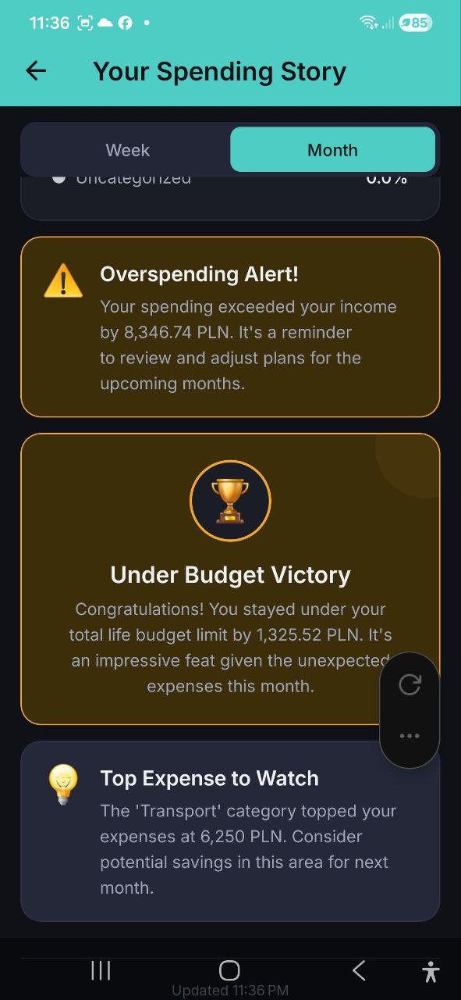

# História dos gastos

> Receba um relatório narrativo das suas finanças gerado por IA. Veja conquistas, alertas e conclusões apresentados como uma história visual cativante.

## Visão geral

A funcionalidade **História dos gastos** cria um relatório personalizado, em estilo narrativo, da sua atividade financeira. Destaca os acontecimentos principais, as conquistas e os pontos de preocupação num formato de cartões fácil de ler.

## Como aceder

- No separador **Análise**, toque no cartão **Ver a história dos seus gastos**
- A história é gerada automaticamente com base no período selecionado

## Seletor de período

No topo do ecrã da história dos gastos:

- **Semana** — história sobre as finanças da semana atual
- **Mês** — história sobre as finanças do mês atual

Toque para alternar entre as vistas. O conteúdo da história é atualizado em conformidade.

## Blocos da história

A IA gera vários tipos de blocos de conclusões:

### Alerta de gastos excessivos (aviso)
- Cartão amarelo com ícone de aviso
- Aparece quando os seus gastos ultrapassam as suas receitas
- Exemplo: *«Os seus gastos ultrapassaram as suas receitas em 8 346,74 PLN. É um lembrete para rever e ajustar os planos para os próximos meses.»*

### Vitória abaixo do orçamento (conquista)
- Cartão dourado com ícone de troféu
- Aparece quando ficou abaixo do limite de um orçamento
- Exemplo: *«Parabéns! Ficou 1 325,52 PLN abaixo do limite do seu orçamento total de vida. É um feito notável, tendo em conta as despesas inesperadas deste mês.»*

### Principal despesa a vigiar
- Cartão azul com ícone de lâmpada
- Destaca a categoria com mais gastos
- Exemplo: *«A categoria “Transportes” liderou as suas despesas, com 6 250 PLN. Considere possíveis poupanças nesta área no próximo mês.»*

### Outros elementos da história
- **Distribuição por categorias** com percentagens
- **Resumos narrativos** que descrevem o panorama financeiro geral
- **Comparações** com períodos anteriores
- **Gráficos e visualizações** integrados na história

## Moeda

A história é contada na sua **moeda de apresentação** — a escolhida no botão de moeda do ecrã inicial. As despesas, receitas e valores de orçamento registados noutras moedas são convertidos para ela à taxa de câmbio de hoje antes de a história ser escrita, para que os totais batam certo; a história indica quando os valores foram convertidos e são, por isso, aproximados. Um único pagamento elevado noutra moeda já não decide a moeda de toda a história. Mudar a moeda de apresentação volta a gerar a história na nova moeda.

## Ações

- **Gerar novamente** — toque para pedir uma história nova com dados atualizados
- **Partilhar história** — partilhe a história dos seus gastos com outras pessoas
- Indicação **Atualizado** — mostra quando a história foi gerada pela última vez

## Requisitos

- **Subscrição Pro ou Business** necessária — os utilizadores do plano Free veem um convite para fazer upgrade
- **Dados de transações suficientes** — a aplicação precisa de despesas suficientes para gerar conclusões relevantes. Se não houver dados suficientes, verá: «Ainda não há dados suficientes para gerar uma história»
- Cada geração da história gasta pedidos de IA da sua quota mensal

## Perguntas frequentes

- **P: Com que frequência devo consultar a história dos gastos?**
  **R:** A história é mais útil no fim de cada semana ou mês. Toque em **Gerar novamente** para obter a análise mais recente.

- **P: Posso partilhar a história dos gastos?**
  **R:** Sim, toque em **Partilhar história** para a partilhar através das opções de partilha do seu dispositivo.

---

*Ver também: [Análise](./06-analytics.md) | [Chat IA](./07-ai-chat.md)*
