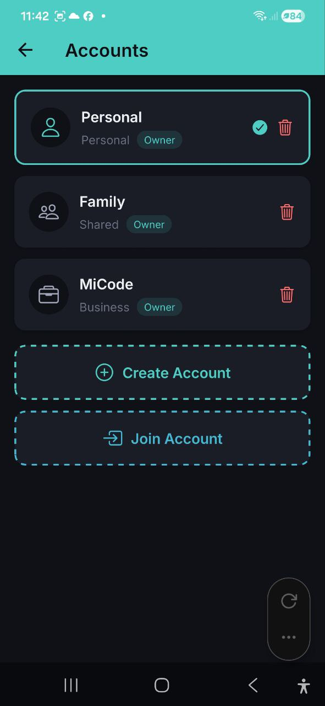
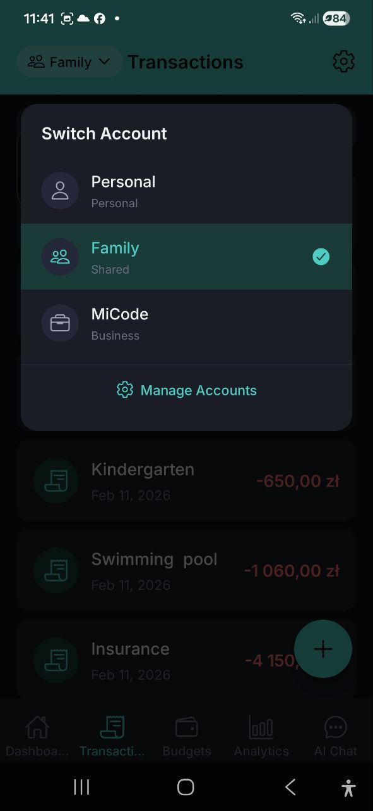
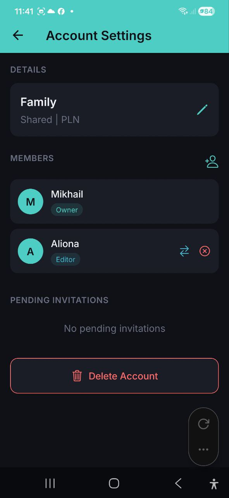

# Contas

> Organize as suas finanças em contas separadas. Use Pessoal para o acompanhamento individual, Partilhada para orçamentos familiares e Empresa para despesas da empresa. Convide membros com controlo de acesso por funções.

## Visão geral

A aplicação suporta várias contas para separar diferentes contextos financeiros. Cada conta tem as suas próprias despesas, receitas, orçamentos e carteira.

## Tipos de conta

| Tipo | Ícone | Finalidade |
|---|---|---|
| **Pessoal** | Ícone de pessoa | Acompanhamento individual de despesas |
| **Partilhada** | Ícone de pessoas | Orçamentos da família ou de um grupo (por exemplo, «Família») |
| **Empresa** | Ícone de pasta | Despesas de uma empresa ou equipa (por exemplo, «MiCode») |
| **Investimento** | Ícone de tendência ascendente | Acompanhar carteiras de investimento e ativos |
| **Viagem** | Ícone de avião | Conta partilhada temporária para um grupo de viagem — divida as despesas entre os membros e acerte contas sobre quem deve a quem ([Carteira de viagem em grupo](./35-group-trip-wallet.md)) |

Cada conta mostra o tipo e a sua função (Proprietário, Editor ou Leitor).

## Mudar de conta

1. Toque no **nome da conta** no canto superior esquerdo de qualquer ecrã (por exemplo, «Família»)
2. Abre-se o menu **Mudar de conta** com todas as suas contas
3. Toque na conta para a qual quer mudar
4. A conta ativa está assinalada com um visto verde
5. Todos os ecrãs passam a mostrar os dados da conta selecionada

Toque em **Gerir contas** na parte inferior do menu para ir para a lista completa de contas.

## Mudar a moeda de apresentação

Mude a moeda em que todos os seus totais são apresentados — a partir de qualquer ecrã, sem abrir as Definições.

No ecrã inicial, a forma mais rápida é o **botão de moeda** dedicado, ao lado do nome da conta — toque nele e escolha uma moeda. Nos outros ecrãs:

1. Toque no **nome da conta** no canto superior esquerdo de qualquer ecrã. O símbolo da moeda atual aparece ao lado do nome (por exemplo, `Pessoal · $`).
2. No menu que se abre, procure a secção **Moeda de apresentação** abaixo da lista de contas.
3. Toque na moeda pretendida (USD, EUR, PLN, GBP, UAH, RUB, BYN).
4. Todos os montantes da aplicação são convertidos de imediato para a moeda selecionada, às taxas de câmbio mais recentes.

> Esta é a sua moeda de apresentação pessoal e fica guardada para a próxima vez. Só altera a forma como os montantes são *apresentados* — as suas transações mantêm as moedas originais. Cada membro (incluindo os Leitores) pode escolher a sua própria moeda de apresentação.

## Criar uma conta

1. Abra a lista de contas (através de **Gerir contas** ou a partir das Definições)
2. Toque em **Criar conta**
3. Introduza um **Nome da conta** (por exemplo, «O meu orçamento»)
4. Selecione o **Tipo de conta**: Pessoal, Partilhada, Empresa, Investimento ou Viagem
5. Selecione a **Moeda** desta conta
6. Toque em **Criar conta**

> **Nota:** o plano Free permite 3 contas, o Pro até 5 e o Business contas ilimitadas.

## Aderir a uma conta

Se alguém lhe enviou um convite direto depois de pesquisar pelo seu nome, não precisa de código:

1. Recebe uma notificação push quando o convite chega
2. Toque nela (ou abra o sino dos **Alertas** e mude para o separador **Convites**)
3. Toque em **Aceitar** para aderir, ou em **Recusar** para o dispensar
4. Os convites aceites acrescentam de imediato a conta à sua lista de contas

Se, em vez disso, recebeu um código ou link de convite:

1. Toque em **Aderir a uma conta** na lista de contas
2. Introduza o **código de convite** que recebeu
3. Toque em **Aderir**
4. Verá uma mensagem de sucesso: «Aderiu à conta com sucesso!»
5. A conta passa a aparecer na sua lista de contas

## Definições da conta

Toque numa conta para abrir as respetivas definições:

### Detalhes
- **Nome** da conta (editável pelo Proprietário)
- **Tipo** e **moeda** da conta (só para consulta)
- **Mês financeiro** (só o Proprietário) — muda o que «este mês» significa para os seus orçamentos

### Mês financeiro

Por predefinição, os orçamentos seguem o mês civil (do dia 1 ao último dia). Se o seu salário ou a sua principal receita chega noutro dia — por exemplo, no dia 10 —, pode fazer com que os orçamentos sigam esse dia:

1. Abra as Definições da conta e toque na linha **Mês financeiro** (mostra «Mês civil (dia 1)» ou «O mês começa no dia N»)
2. Na folha que se abre, escolha **Mês civil (dia 1)** para repor, ou um dia de **1 a 31**
3. Toque em **Guardar**

> **Nota:** por agora, isto só afeta os **orçamentos** — a forma como os respetivos períodos são calculados e que gastos contam para cada um. A análise, os relatórios e outras vistas mensais continuam a usar o mês civil.
>
> A alteração do dia é retroativa: os períodos e o histórico de orçamentos anteriores são recalculados em conformidade, mas nenhum dado de despesas ou receitas é alterado.
>
> Se escolher um dia que não existe em todos os meses (por exemplo, 31), o período começa simplesmente no último dia dos meses mais curtos (por exemplo, a 28 ou 29 de fevereiro).

Visível apenas para o Proprietário da conta — os Editores e Leitores não veem esta linha nas Definições da conta. No entanto, depois de definida, a data de início continua a determinar os períodos e o histórico de orçamentos que todos os membros veem.

### Membros
- Lista de todos os membros da conta com as respetivas funções
- Cada membro mostra: avatar, nome e distintivo da função (Proprietário, Editor, Leitor)

### Convidar membros

1. Abra as Definições da conta
2. Toque no **ícone de convite** (ícone de pessoa com +, no canto superior direito da secção Membros)
3. Escolha o método de convite:
   - **Pesquisa** — se a pessoa já tiver a aplicação, procure-a pelo nome ou e-mail, selecione-a nos resultados, escolha a função e toque em **Enviar convite**. A pessoa recebe de imediato uma notificação push — não é preciso código.
   - **Por e-mail** — introduza o endereço de e-mail da pessoa, selecione a função (Editor ou Leitor) e toque em **Enviar convite**
   - **Por link** — é gerado um código que pode partilhar. Toque para copiar ou partilhar através de aplicações de mensagens

### Gerir membros (só o Proprietário)

- **Alterar função** — toque no ícone de alteração de função ao lado de um membro para lhe atribuir uma nova função
- **Remover membro** — toque no ícone de remoção para remover um membro (com confirmação)

### Convites pendentes

- Consulte os convites que ainda não foram aceites
- **Cancelar convite** — revogue um convite pendente

## Funções e permissões

| Permissão | Proprietário | Editor | Leitor |
|---|---|---|---|
| Ver despesas e receitas | Sim | Sim | Sim |
| Adicionar/editar despesas | Sim | Sim | Não |
| Adicionar/editar receitas | Sim | Sim | Não |
| Criar/editar orçamentos | Sim | Sim | Não |
| Gerir membros | Sim | Não | Não |
| Editar as definições da conta | Sim | Não | Não |
| Eliminar a conta | Sim | Não | Não |

### Descrição das funções
- **Proprietário** — controlo total sobre a conta, pode gerir membros e definições
- **Editor** — pode adicionar e editar despesas, receitas e orçamentos
- **Leitor** — só pode ver os dados (acesso só de leitura)

## Eliminar uma conta

1. Abra as Definições da conta
2. Desloque-se até ao fim e toque em **Eliminar conta**
3. Confirme a eliminação

> **Atenção:** eliminar uma conta remove definitivamente todos os dados dela (despesas, receitas, orçamentos). Esta ação não pode ser anulada.

## Sair de uma conta

Se for membro (e não Proprietário) de uma conta partilhada:
1. Abra as Definições da conta
2. Toque em **Sair da conta**
3. Confirme — deixará de fazer parte da conta

## Mudar de conta no Telegram

Ao usar o bot do Telegram, pode mudar de conta de duas formas:

1. **Manualmente** — envie `/account` e toque no botão da conta
2. **Automaticamente** — mencione o nome de uma conta na mensagem (por exemplo, «Mostra as despesas em Família») e a IA consulta essa conta para o pedido atual

A deteção automática não altera a sua conta predefinida — aplica-se apenas à mensagem atual. Use `/account` para mudar de forma permanente.

## Perguntas frequentes

- **P: Quantas contas posso ter?**
  **R:** Free: 3 contas, Pro: até 5, Business: ilimitadas.

- **P: Posso transferir a propriedade de uma conta?**
  **R:** De momento, quem cria a conta é sempre o Proprietário. Contacte o suporte para transferências de propriedade.

- **P: Numa conta partilhada, consigo ver quem adicionou uma despesa?**
  **R:** As despesas das contas partilhadas mostram o membro que as criou.

- **P: Posso usar contas diferentes no bot do Telegram?**
  **R:** Sim. Envie `/account` para mudar a sua conta predefinida, ou simplesmente mencione o nome da conta na mensagem para consultas pontuais. Consulte [Bot do Telegram](./22-telegram-bot.md) para mais detalhes.

---

*Ver também: [Definições](./11-settings.md) | [Planos de subscrição](./12-subscription.md)*
