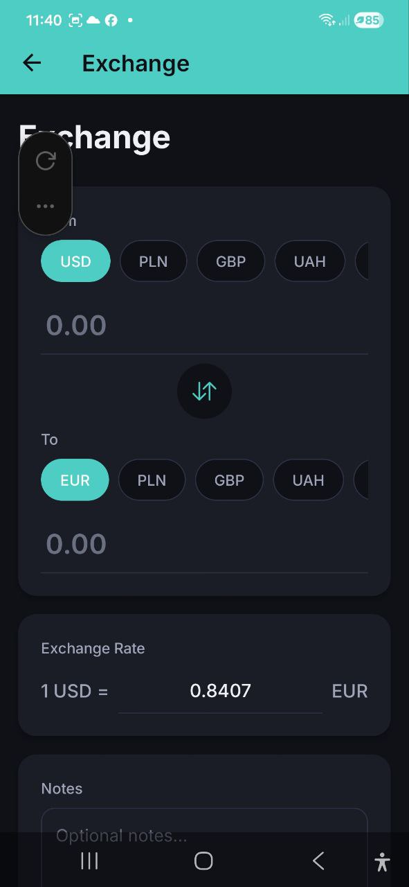

# Carteira e câmbio

> Acompanhe saldos em várias moedas e faça câmbios entre elas com taxas de câmbio em tempo real. A carteira atualiza-se automaticamente à medida que adiciona despesas e receitas.

## Visão geral

A funcionalidade Carteira permite acompanhar os seus saldos reais em cada moeda suportada. À medida que adiciona despesas e receitas, a carteira atualiza-se automaticamente para refletir a sua situação financeira atual.

## Saldos da carteira

Aceda à Carteira a partir de:
- **Painel** — toque em **Ver tudo** ao lado da secção Saldos da carteira
- **Painel** — toque no botão de ação rápida **Transferências** para aceder rapidamente às transferências
- **Definições** — vá a Carteira > **Saldos**

Para cada moeda, verá:

| Campo | Descrição |
|---|---|
| **Saldo atual** | O seu saldo em tempo real nesta moeda |
| **Saldo inicial** | O saldo de partida que definiu |
| **Receita total** | Soma de todas as receitas nesta moeda |
| **Total gasto** | Soma de todas as despesas nesta moeda |
| **Câmbio recebido** | Montante recebido através de câmbios de moeda |
| **Câmbio enviado** | Montante gasto em câmbios de moeda |
| **Transferências recebidas** | Montante recebido de outras contas |
| **Transferências enviadas** | Montante enviado para outras contas |

A fórmula: **Saldo atual = Saldo inicial + Receita total - Total gasto + Câmbio recebido - Câmbio enviado + Transferências recebidas - Transferências enviadas**

Uma moeda aparece sozinha na carteira assim que regista dinheiro nela — uma despesa, receita, câmbio ou transferência. Enquanto não definir um saldo inicial para ela, esse saldo é 0, pelo que o cartão mostra exatamente o resultado das suas transações. Se remover uma moeda da carteira, ela continua oculta mesmo que continue a registar transações nessa moeda — defina novamente um saldo para ela para trazer o cartão de volta.

## Saldo total

Se tiver saldos em várias moedas, a carteira apresenta um cartão **Saldo total** no topo. Este cartão converte todos os saldos para a moeda escolhida nas definições (configurada em **Definições** > **Moeda**) às taxas de câmbio mais recentes, dando-lhe uma visão única e combinada das suas finanças.

Pode mudar a moeda de apresentação aqui mesmo: toque num botão de moeda acima do total para recalcular de imediato o total e o gráfico Histórico do saldo nessa moeda. Esta mudança aplica-se apenas à visualização do ecrã Carteira — não altera a definição de moeda de toda a aplicação e volta à predefinição quando sai do ecrã.

## Histórico do saldo

No topo do ecrã Carteira, o cartão **Histórico do saldo** mostra, num gráfico de barras, como o seu saldo total variou em cada mês:

- As **barras verdes** indicam que o saldo cresceu nesse mês; as **barras vermelhas** indicam que diminuiu.
- Toque numa barra para ver a variação exata desse mês.
- Use o seletor **6M / 12M** para alternar entre os últimos 6 ou 12 meses.
- Os montantes seguem a moeda escolhida nos botões de moeda. Os meses anteriores são convertidos à taxa do seu último dia; o mês em curso e UAH, RUB e BYN (que as taxas de referência não incluem) usam as taxas mais recentes.
- Se tiver corrigido o saldo, essa correção é desenhada como uma parte cinzenta separada da barra (com legenda), para que veja quanto dinheiro ficou por registar. Toque na barra para ver em separado a variação registada e a correção.

## Definir o saldo inicial

Defina o saldo de partida de cada moeda:

1. Vá a **Definições** > **Carteira** > **Definir saldo**
2. Selecione a **Moeda** (USD, EUR, PLN, GBP, UAH, RUB ou BYN)
3. Introduza o **Montante** — o seu saldo real atual nessa moeda
4. Toque em **Guardar**

Verá uma confirmação: «Saldo definido com sucesso».

> **Dica:** defina os saldos iniciais quando começar a usar a aplicação, para que a carteira reflita as suas finanças com precisão desde o primeiro dia.

## Câmbio de moeda

Faça câmbios entre as carteiras das suas moedas:

### Passo a passo

1. Toque em **Câmbio** nas ações rápidas do Painel, ou vá a **Definições** > **Carteira**
2. Selecione a moeda **De** (por exemplo, USD) — toque num botão de moeda para a selecionar
3. Selecione a moeda **Para** (por exemplo, EUR) — toque num botão de moeda para a selecionar
4. Introduza o montante no campo «De» ou no campo «Para» — o outro é calculado automaticamente
5. A **Taxa de câmbio** é obtida automaticamente (por exemplo, «1 USD = 0,8407 EUR»)
6. Pode tocar no botão de **troca** (setas ao centro) para inverter as moedas
7. Opcionalmente, edite a taxa de câmbio manualmente se tiver obtido uma taxa diferente
8. Adicione **Notas** opcionais (por exemplo, «Câmbio no aeroporto» ou «Transferência bancária»)
9. Toque em **Cambiar** para concluir

### Funcionalidades

- **Taxas de câmbio em tempo real** — obtidas e apresentadas automaticamente
- **Botão de troca** — inverta rapidamente as moedas De e Para
- **Alteração manual da taxa** — edite a taxa se a sua taxa real for diferente
- **Campo de notas** — acrescente contexto ao câmbio
- **Câmbios recentes** — consulte o histórico de câmbios

### Alertas de taxa

Não precisa de estar sempre a verificar a taxa. No ecrã Câmbio, o cartão **Alertas de taxa** define um valor-alvo para o par selecionado e avisa quando a taxa em tempo real o atingir.

1. Selecione as moedas **De** e **Para** que lhe interessam
2. Toque no **+** do cartão **Alertas de taxa**
3. Introduza o valor-alvo — o campo apresenta-se como `1 <De> = ___ <Para>`
4. Escolha **acima de** ou **abaixo de**. A aplicação pré-seleciona a opção que corresponde ao número introduzido (acima de, se o valor-alvo for superior à taxa atual; abaixo de, se for inferior); toque na outra opção para a alterar
5. Toque em **Adicionar alerta**

A taxa é verificada nos nossos servidores uma vez por hora, por isso funciona com a aplicação fechada. Quando o valor-alvo é atingido, recebe uma notificação — *«1 EUR vale agora 4,3512 PLN. Toque para trocar.»* — e, ao tocar nela, abre-se o ecrã Câmbio com esse par já selecionado.

Cada alerta dispara **uma única vez** e depois para, para que uma taxa que oscila à volta do valor-alvo não envie notificações vezes sem conta. Crie um novo alerta se quiser continuar a acompanhar esse par.

O cartão mostra os alertas do par selecionado, pelo que mudar de moedas muda a lista — toque em **Mostrar tudo** no cartão, ou em **Alertas de taxa** no ecrã Carteira, para ver a lista completa.

É nesse ecrã que ficam todos os seus alertas: os que ainda estão em espera e os que já dispararam, com a taxa e a data em que dispararam. Como um alerta só dispara uma vez, esse histórico é o único registo na aplicação de que disparou — a própria notificação pode ser descartada. Pode criar aí um alerta para qualquer par sem passar pelo formulário de câmbio, eliminar qualquer alerta com o ícone do caixote do lixo e manter até 20 em espera ao mesmo tempo.

Os alertas de taxa são **pessoais**: valem para todas as suas contas, mais ninguém os vê, e um leitor pode defini-los como qualquer outra pessoa. Não há um interruptor próprio nas definições de notificações — eliminar o alerta é a forma de o desligar.

### Câmbios recentes

Abaixo do formulário de câmbio, encontra os 5 câmbios de moeda mais recentes, com:
- Moedas trocadas (De → Para)
- Montantes
- Taxa de câmbio usada
- Data
- Notas (se as tiver adicionado)

Toque em **Mostrar tudo** para abrir o ecrã completo Todos os câmbios.

### Histórico de câmbios

O ecrã **Todos os câmbios** apresenta a lista completa de todos os seus câmbios de moeda. Aceda a ele tocando em **Mostrar tudo** na secção Câmbios recentes.

Filtros disponíveis:
- **Moeda** — filtre por um par de moedas específico
- **Período** — escolha entre **Desde sempre**, **Este mês**, **Últimos 3 meses** ou **Este ano**

### Editar ou eliminar um câmbio

Toque num câmbio do histórico para abrir o ecrã de detalhe. A partir daí, pode:
- Tocar no ícone do **lápis** para editar os montantes, a taxa de câmbio ou as notas — e depois em **Guardar**
- Tocar no ícone do **caixote do lixo** para eliminar o câmbio (aparece um pedido de confirmação)

Os saldos da carteira são recalculados automaticamente após edições ou eliminações.

## Transferências entre contas

As transferências entre contas permitem mover dinheiro entre contas diferentes — por exemplo, da conta Empresa para a conta Pessoal. É diferente de um câmbio de moeda, que converte entre moedas dentro da mesma conta.

### Passo a passo

1. Vá a **Definições** > **Carteira** > **Transferência**
2. Selecione **Da conta** (a conta de origem) — cada botão de conta mostra o saldo atual
3. Selecione **Para a conta** (a conta de destino)
4. Escolha a **Moeda**
5. Introduza o **Montante** a transferir. **Disponível:**, abaixo do campo, mostra o saldo da conta de origem na moeda escolhida — toque em **Máx.** para o preencher na totalidade
6. Se as contas usarem moedas diferentes, aparece um campo **Taxa de câmbio** — ajuste-o se a sua taxa real for diferente
7. Escolha a **Data** — por predefinição é hoje, por isso toque nela para registar uma transferência feita anteriormente
8. Adicione **Notas** opcionais (por exemplo, «Poupança mensal» ou «Reembolso de despesas»)
9. Toque em **Transferir** para concluir

Se o montante for superior ao saldo que a aplicação conhece, verá um aviso — mas a transferência é guardada na mesma. Nunca é bloqueada, porque pode estar a introduzir uma transferência depois de a ter feito, ou o saldo inicial da conta pode nunca ter sido definido.

Um travessão (—) em vez de um saldo significa que a aplicação ainda não tem um valor para essa conta. Os saldos das contas que não são aquela em que está a trabalhar vêm do servidor, por isso podem faltar na primeira vez que abrir o formulário offline.

### Transferências frequentes

Se já tiver transferido dinheiro antes, aparece uma linha **Frequentes** no topo do formulário com os percursos que mais usa (por exemplo, *Pessoal → Poupança 2000 PLN*). Toque num deles e o formulário é preenchido — contas, moedas e o montante da última vez que usou esse percurso. Altere o que quiser antes de guardar.

Os percursos que envolvam uma conta a que já não tem acesso não são sugeridos.

### Transferências recentes

Abaixo do formulário de transferência, encontra as 5 transferências entre contas mais recentes, com:
- Contas de origem e de destino (De → Para)
- Montante e moeda
- Taxa de câmbio (se as moedas forem diferentes)
- Data
- Notas (se as tiver adicionado)

Toque em **Mostrar tudo** para abrir o ecrã completo Todas as transferências.

### Histórico de transferências

O ecrã **Todas as transferências** apresenta a lista completa de todas as suas transferências entre contas. Aceda a ele tocando em **Mostrar tudo** na secção Transferências recentes.

Filtros disponíveis:
- **Conta** — filtre por uma conta de origem ou de destino específica
- **Período** — escolha entre **Desde sempre**, **Este mês**, **Últimos 3 meses** ou **Este ano**

### Editar uma transferência

Abra uma transferência a partir de **Transferências recentes** ou do ecrã Todas as transferências e toque em **Editar**. Pode alterar:
- As duas contas — a de origem e a de destino
- Os montantes e a taxa de câmbio
- A data
- As notas e a opção **Contar como receita**

Mudar uma conta também muda esse lado da transferência para a moeda própria dessa conta. Se **Contar como receita** estiver ativado, o registo de receita correspondente também passa para a nova conta de destino.

Pode mover qualquer um dos lados para qualquer outra conta de que faça parte — incluindo uma alteração que deixe de fora da transferência a conta em que está a trabalhar. É precisamente assim que se corrige uma transferência que foi parar à conta errada: passa a aparecer no histórico das duas contas a que agora pertence e desaparece da conta que já não envolve.

Registar, editar e eliminar transferências funciona offline: a alteração fica no seu dispositivo e é enviada na próxima vez que o ecrã Carteira for aberto com ligação. Se o servidor recusar uma alteração — por exemplo, porque já não tem acesso a uma das contas escolhidas —, a aplicação avisa e a transferência fica exatamente como estava.

Numa conta partilhada, todos os membros veem as transferências que envolvem essa conta, independentemente de quem as registou; o saldo da conta sempre as contou de qualquer forma. Qualquer membro que pudesse ter feito a transferência — ou seja, que pertença às duas contas e não seja leitor do lado que paga — também a pode corrigir ou eliminar.

## Moedas suportadas

| Código | Moeda |
|---|---|
| USD | Dólar americano |
| EUR | Euro |
| PLN | Zlóti polaco |
| GBP | Libra esterlina |
| UAH | Hryvnia ucraniana |
| RUB | Rublo russo |
| BYN | Rublo bielorrusso |

## Perguntas frequentes

- **P: De onde vêm as taxas de câmbio?**
  **R:** As taxas de câmbio são obtidas de um serviço online e atualizadas regularmente. Representam taxas de mercado aproximadas.

- **P: Posso fazer um câmbio se não tiver saldo suficiente?**
  **R:** A aplicação avisa que o saldo é insuficiente, mas pode registar o câmbio na mesma, para manter os seus registos corretos.

- **P: Um câmbio de moeda conta como despesa?**
  **R:** Não. Os câmbios de moeda são separados das despesas — movem dinheiro entre as carteiras das moedas sem afetar os totais de despesas.

- **P: Qual é a diferença entre uma transferência e um câmbio?**
  **R:** Um câmbio converte entre moedas dentro da mesma conta. Uma transferência move dinheiro entre contas diferentes (por exemplo, de Empresa para Pessoal).

- **P: Uma transferência afeta o saldo da minha carteira?**
  **R:** Sim. A carteira da conta de origem diminui e a carteira da conta de destino aumenta nos montantes transferidos.

## Corrigir um saldo

Se a carteira deixou de corresponder ao dinheiro que realmente tem — pequenas compras que nunca registou —, não precisa de as procurar:

1. Vá a **Definições** > **Carteira** e toque em **Corrigir** no cartão da moeda
2. Escreva o **saldo real** — a aplicação mostra a diferença
3. Toque em **Guardar correção**

A diferença fica registada como um acerto de saldo. Não é uma despesa nem uma receita, por isso os orçamentos e a análise não são alterados. Se faltar dinheiro, a aplicação indica quanto ficou por registar este mês e propõe **Configurar lembretes de registo**.

> **Nota:** corrigir um saldo requer ligação à internet. Os leitores e as contas de viagem arquivadas não podem corrigir um saldo.

As moedas suportadas incluem também CZK, SEK, NOK, DKK, HUF, RON e CHF.

---

*Ver também: [Painel](./02-dashboard.md) | [Definições](./11-settings.md)*
