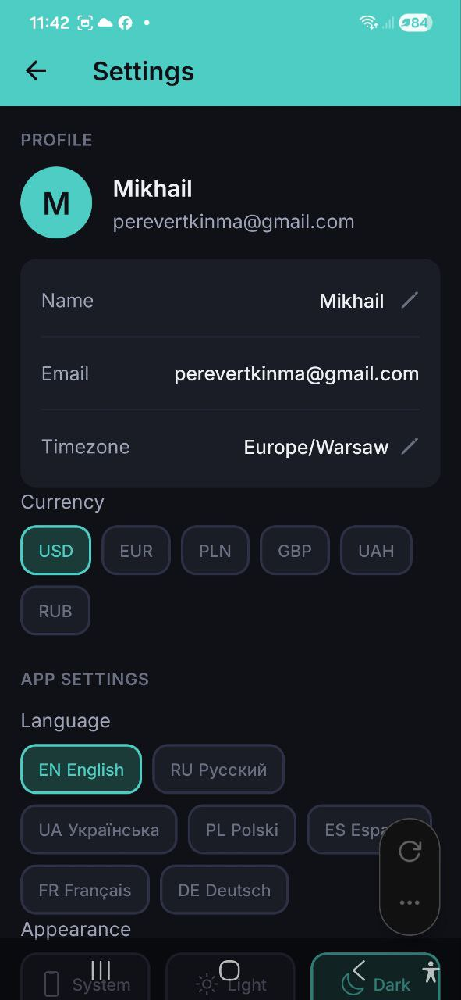

# Definições

> Personalize o perfil, o aspeto, os widgets do painel, as notificações e a sincronização de dados. Altere o idioma, a moeda e o tema, e faça a gestão das preferências da sua conta.

## Visão geral

Para abrir as Definições, toque no **ícone de roda dentada** no canto superior direito de qualquer ecrã.

As Definições estão organizadas por categorias. Toque numa categoria para abrir o respetivo ecrã:

| Categoria | O que contém |
|---|---|
| **Perfil e conta** | Nome, e-mail, fuso horário, moeda |
| **Gerir plano** | Plano atual, utilização, opções de upgrade |
| **Aspeto e idioma** | Tema, idioma |
| **Preferências de IA** | Estilo de resposta, escolha do modelo |
| **Widgets do Painel** | Mostrar ou ocultar os widgets do ecrã inicial |
| **Notificações e integrações** | Alertas push, bot do Telegram |
| **Segurança e encriptação** | Configuração da encriptação ponto a ponto |
| **Carteira** | Saldos, dívidas, saldo inicial |
| **Dados e relatórios** | Sincronização, relatórios por e-mail, cópia de segurança e restauro |
| **Sobre** | Versão, ajuda, apoio, informação legal |

## Perfil e conta

- **Avatar** — mostra as suas iniciais sobre um fundo colorido
- **Nome** — o nome apresentado. Toque no ícone de lápis para o editar
- **E-mail** — o e-mail da sua conta. Toque no ícone de lápis para iniciar a alteração do e-mail (consulte [Alterar o e-mail](#alterar-o-e-mail) abaixo)
- **Fuso horário** — toque no ícone de lápis para o alterar. Abre-se uma lista pesquisável com mais de 90 fusos horários (por exemplo, «Europe/Lisbon»)

### Moeda

Escolha a moeda predefinida tocando num dos botões de moeda:

**USD** | **EUR** | **PLN** | **GBP** | **UAH** | **RUB** | **BYN**

A moeda selecionada fica destacada. É a moeda predefinida para novas despesas, receitas e para os valores apresentados no Painel.

### Alterar o e-mail

Para alterar o e-mail da conta:

1. Abra **Definições → Perfil** e toque no ícone de lápis junto ao e-mail atual.
2. No ecrã **Alterar e-mail**, introduza o **novo endereço de e-mail** e a **palavra-passe atual**.
3. Toque em **Enviar código de verificação** — é enviado um código de 6 dígitos para o *novo* endereço.
4. Introduza o código no passo seguinte e toque em **Confirmar alteração de e-mail**.

O e-mail é atualizado de imediato e são emitidos novos tokens de sessão. Se fechar a aplicação antes de introduzir o código, da próxima vez que abrir o ecrã Alterar e-mail este retoma no Passo 2, durante um máximo de 30 minutos.

> **Nota:** O código de verificação expira ao fim de 30 minutos. Toque em **Reenviar código** para voltar ao Passo 1 e pedir um código novo.

## Aspeto e idioma

### Idioma

Escolha entre 11 idiomas suportados:

| Código | Idioma |
|---|---|
| EN | English |
| RU | Русский |
| UA | Українська |
| PL | Polski |
| ES | Espanol |
| FR | Francais |
| DE | Deutsch |
| BY | Беларуская |
| NL | Nederlands |
| PT | Português (Portugal) |
| BR | Português (Brasil) |

Toque num idioma para mudar. A interface é atualizada de imediato.

### Aparência

Escolha o tema:

- **Sistema** — segue a definição de modo claro/escuro do dispositivo
- **Claro** — usa sempre o tema claro
- **Escuro** — usa sempre o tema escuro

**Cor de destaque** — escolha a cor de realce da aplicação, usada nos botões, nos links e no separador ativo. Toque numa das amostras predefinidas ou em **Personalizada** para abrir o seletor de cores e escolher qualquer cor. A cor de destaque funciona no modo claro e no escuro e fica guardada na sua conta, pelo que está disponível em todos os seus dispositivos. Toque na amostra predefinida para voltar à cor original.

## Preferências de IA

### Estilo de resposta da IA

Controle a forma como a IA comunica consigo em todas as funcionalidades de IA (Chat, Histórias, Análises, Fat Finder, Objetivos):

| Modo | Descrição |
|---|---|
| **Simples** | Linguagem simples, sem jargão — ideal para principiantes |
| **Equilibrado** | Uma mistura de simples e técnico — a opção predefinida |
| **Especialista** | Terminologia financeira e análise detalhada — para profissionais |

Toque numa opção para mudar. A alteração aplica-se de imediato a todo o conteúdo novo gerado pela IA.

> Consulte [Modo de resposta da IA](./20-ai-response-mode.md) para saber o que muda em cada modo.

### Modelo de IA

Escolha o modelo de IA usado em todas as funcionalidades de IA (Chat, leitura de talões, categorização, Análises, Histórias, Objetivos). Isto afeta diretamente a **qualidade das respostas** e o **consumo da quota de IA**:

| Modelo | Velocidade | Custo | Ideal para |
|---|---|---|---|
| ⚡ **Rápido** | O mais rápido | ×0,75 da quota | Categorização rápida, perguntas simples |
| ⚖️ **Equilibrado** | Médio | ×1 da quota | Uso geral — a opção predefinida |
| ✨ **Qualidade** | Mais lento | ×1,5 da quota | Análises complexas, conclusões detalhadas |

> **Dica:** No plano Free (50 pedidos de IA por mês), mudar para **Rápido** dá cerca de 66,7 pedidos efetivos. Mudar para **Qualidade** dá cerca de 33,3.

Toque numa opção para mudar. O modelo passa a ser usado de imediato em todos os novos pedidos de IA.

## Widgets do painel

Controle as secções que aparecem no [Painel](./02-dashboard.md). Toque no interruptor junto a cada widget para o mostrar ou ocultar:

| Widget | Descrição |
|---|---|
| **Gamificação** | Nível, barra de progresso de XP e sequência diária |
| **Orçamento mensal** | Orçamento restante com uma barra de progresso por cores |
| **Receitas e despesas** | Cartão que mostra lado a lado as receitas e as despesas do mês |
| **Dívidas e empréstimos** | Resumo do que lhe devem e do que deve |
| **Gráfico de lucro líquido** | Gráfico de linhas de 6 meses do lucro líquido (receitas − despesas) |
| **Património líquido** | Património líquido total em todas as carteiras |
| **Fat Finder (análises de IA)** | Auditoria mensal dos gastos com oportunidades de poupança |
| **Calendário** | Grelha mensal com pontos de receitas e despesas |
| **Objetivos** | O principal objetivo de poupança ativo, com barra de progresso |
| **Saldos das carteiras** | Lista horizontal com os saldos das carteiras por moeda |

> **Dica:** As suas escolhas são guardadas automaticamente e mantêm-se depois de reiniciar a aplicação.

Também pode **arrastar a pega** junto a um widget para mudar a sua posição no Painel e tocar em **Repor a ordem predefinida** para voltar à disposição original.

## Notificações e integrações

### Notificações

Interruptores para as preferências de notificação:

| Definição | Descrição |
|---|---|
| **Notificações push** | Interruptor geral — ativa ou desativa todas as notificações push |
| **Alertas de orçamento** | Receba um aviso quando atingir os limites do orçamento |
| **Atividade em contas partilhadas** | Receba um aviso quando outras pessoas adicionarem despesas a contas partilhadas |
| **Lembretes de dívidas** | Receba um aviso 3 dias antes do prazo de uma dívida e quando esta ficar em atraso |
| **Despesas recorrentes** | Receba um aviso quando a aplicação registar automaticamente uma despesa recorrente |
| **Renovações de subscrições** | Receba um aviso 3 dias antes da renovação de uma subscrição acompanhada |
| **Alertas de anomalias** | Receba avisos sobre gastos invulgares: cobranças duplicadas, aumentos de preço ou picos numa categoria |
| **Lembrete de registo** | Receba um lembrete se não registar despesas há 3 ou mais dias, e ainda um lembrete no dia seguinte a registar-se na aplicação, se ainda não tiver adicionado nada |

### Bot do Telegram

Associe a sua conta do Telegram para receber notificações e gerir despesas através do bot do Telegram. Consulte [Bot do Telegram](./22-telegram-bot.md) para mais detalhes.

## Segurança e encriptação

Configure a encriptação ponto a ponto (E2EE) para proteger os seus dados financeiros. Consulte [Encriptação](./15-encryption.md) para mais detalhes.

## Categorias

Aceda através de **Definições → Dados de referência → Categorias**.

Veja e faça a gestão de todas as categorias de despesas e de receitas num só lugar.

- **Todas as categorias numa lista** — as categorias de despesas e de receitas aparecem juntas
- **Eliminar uma categoria** — deslize uma categoria para a esquerda ou toque no ícone de eliminar para a remover
- **A eliminação é bloqueada** se a categoria tiver despesas, receitas ou orçamentos associados — primeiro tem de reatribuir ou eliminar esses registos
- **As categorias do sistema** também podem ser eliminadas se não tiverem registos associados
- **Subcategorias** — ao criar ou editar uma categoria, escolha uma **Categoria principal** para a classificar dentro de outra. Há apenas dois níveis: uma categoria que já tem subcategorias não pode passar a ser subcategoria, e a categoria principal tem de ser do mesmo tipo (despesa ou receita) e da mesma conta. Os seletores de categoria mostram as subcategorias agrupadas sob a respetiva categoria principal. Uma categoria com subcategorias não pode ser eliminada enquanto estas não forem movidas ou removidas.
- **Subcategorias de receitas** — as categorias de receitas também podem ter subcategorias. Ao criar ou editar uma categoria de receitas, escolha uma **Categoria principal** (apenas categorias de receitas). Os seletores de receitas (nova receita, detalhes da receita, voz) mostram as subcategorias agrupadas sob a respetiva categoria principal.
- **Organizar arrastando e largando** — mantenha premida uma categoria (na versão web para computador, clique e arraste) e largue-a sobre uma categoria de nível superior para a tornar subcategoria. Para devolver uma subcategoria ao nível superior, largue-a na linha entre duas categorias de nível superior. A ordem da lista não muda. Se a operação for recusada, uma mensagem explica porquê: uma categoria que já tem subcategorias não pode passar a ser subcategoria, não é possível largar nada sobre uma subcategoria, não se podem misturar categorias de despesas e de receitas, e a categoria de depósito de embalagens fica fora da hierarquia. Arrastar e largar requer ligação à internet (sem ligação, manter premido mostra uma mensagem), os leitores não podem arrastar e não há deslocamento automático junto às margens do ecrã — arraste dentro da parte visível da lista.
- **As categorias padrão seguem o idioma da aplicação** — uma categoria criada pela aplicação (como Supermercado ou Depósito de embalagens) é mostrada no idioma que estiver a usar, por isso mudar o idioma da aplicação altera o nome no ecrã sem criar um duplicado. Se mudar o nome de uma categoria padrão, o seu nome mantém-se em todos os idiomas. As categorias que criou mostram sempre exatamente o que escreveu.

> **Nota:** Eliminar uma categoria é definitivo e não pode ser anulado.

## Dados e relatórios

### Dados e sincronização

- **Última sincronização** — mostra quando os dados foram sincronizados com o servidor pela última vez (por exemplo, «há 5 min» ou «Nunca»)
- **Sincronizar agora** — toque para iniciar manualmente a sincronização
- **A aguardar sincronização** — se as alterações feitas sem ligação ainda não tiverem sido enviadas há algum tempo, um indicador mostra quantas estão em espera. Toque nele para ver quais são e sincronizar de imediato. Desaparece assim que tudo estiver salvaguardado.

> **Nota:** A aplicação funciona sem ligação à internet. Os dados ficam guardados no dispositivo e são sincronizados automaticamente quando voltar a estar online. Use **Sincronizar agora** para forçar uma sincronização imediata.

### Relatórios e e-mail

Faça a gestão das preferências de relatórios e de e-mail:

- **Resumo semanal por e-mail** (Business) — ativar/desativar e escolher o dia da semana
- **Resumo mensal** por e-mail (Pro+) — ativar/desativar
- **Gerar relatório** — abre o ecrã [Exportação e relatórios](./16-export-reports.md)
- **Criar cópia de segurança** — cria uma cópia de segurança completa em JSON dos dados da sua conta
- **Importar cópia de segurança** — importa um ficheiro de cópia de segurança exportado anteriormente

## Sobre

- **Versão** — número da versão atual da aplicação
- **Ajuda** — abre o centro de ajuda da aplicação; use a barra de pesquisa no topo para ir diretamente a um artigo em vez de percorrer toda a lista
- **Apoio e comentários** — envie um e-mail à equipa de apoio
- **Política de Privacidade** — consulte a política de privacidade
- **Termos de Serviço** — consulte os termos de serviço

## Terminar sessão

No ecrã principal das Definições, toque em **Terminar sessão**, na parte inferior. Aparece uma caixa de confirmação — confirme para sair da sua conta.

## Perguntas frequentes

- **P: Mudei o idioma, mas parte do texto continua no idioma anterior. O que faço?**
  **R:** A mudança de idioma é imediata para todos os elementos da interface. Se encontrar texto por traduzir, experimente reiniciar a aplicação.

- **P: Como altero o meu e-mail?**
  **R:** Abra **Definições → Perfil**, toque no ícone de lápis junto ao e-mail e siga o processo de verificação em dois passos. É enviado um código de 6 dígitos para o novo endereço para confirmar a alteração.

- **P: O que acontece aos meus dados quando termino sessão?**
  **R:** Os dados continuam guardados no servidor. Quando voltar a iniciar sessão, tudo é restaurado. Os dados locais no dispositivo podem ser apagados.

---

*Ver também: [Contas](./09-accounts.md) | [Planos de subscrição](./12-subscription.md) | [Exportação e relatórios](./16-export-reports.md) | [Modo de resposta da IA](./20-ai-response-mode.md) | [Chat de IA](./07-ai-chat.md)*
