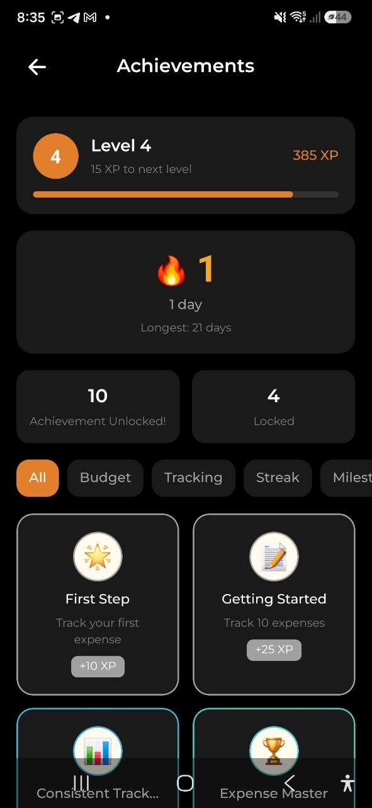

# Conquistas e gamificação

> Mantenha a motivação com conquistas, sequências diárias, XP e níveis. Acompanhe os seus hábitos financeiros e ganhe distintivos à medida que ganha consistência.

## Visão geral

O sistema de gamificação recompensa quem regista as finanças com regularidade. Cada despesa, receita e orçamento que gere contribui para o seu progresso. Ganhe conquistas, mantenha sequências diárias e suba de nível à medida que cria melhores hábitos financeiros.

## Widget do Painel

No ecrã inicial, encontra um cartão compacto de gamificação que mostra:

- **Nível** — o seu nível atual, com uma barra de progresso de XP
- **Sequência** — a sua sequência diária de registos atual (emoji de fogo quando está ativa, floco de neve quando está inativa)

Toque no widget para abrir o ecrã completo **Conquistas**.

## Conquistas

As conquistas são marcos que recompensam comportamentos financeiros específicos. Cada conquista tem:

- **Ícone** — um emoji que representa a conquista
- **Título e descrição** — o que é preciso fazer para a obter
- **Raridade** — Comum, Rara, Épica ou Lendária
- **Recompensa de XP** — os pontos de experiência ganhos ao concluí-la
- **Progresso** — a percentagem já cumprida (nas conquistas por concluir)

### Categorias de conquistas

| Categoria | Exemplos |
|---|---|
| **Marco** | Registar a primeira despesa, chegar a 10/50/100/500 despesas |
| **Orçamento** | Criar o primeiro orçamento, não ultrapassar o orçamento durante 1 ou 3 meses |
| **Sequência** | Manter uma sequência de registos de 3/7/30/100 dias |
| **Poupança** | Registar a primeira receita, terminar um mês com receitas superiores às despesas |

### Ver as conquistas

1. Toque no widget de gamificação no Painel ou abra o ecrã Conquistas
2. Use os **filtros por categoria** (Todas, Orçamento, Registo, Sequência, Marco, Poupança) para navegar
3. **Toque em qualquer distintivo** para ver a descrição completa, a raridade, o valor em XP e o seu progresso

As conquistas concluídas aparecem a cores, com o contorno da respetiva raridade. As conquistas bloqueadas aparecem a cinzento, com uma barra de progresso.

## Sequência diária

A sequência conta os dias consecutivos em que regista pelo menos uma despesa ou receita. A sequência recomeça do zero se falhar um dia.

- **Sequência ativa** — mostrada com um emoji de fogo e o número de dias
- **Sequência interrompida** — mostrada com um emoji de floco de neve e um convite para recomeçar
- **Sequência mais longa** — o seu recorde pessoal é guardado e apresentado no ecrã Conquistas

> **Dica:** Adicione pelo menos uma transação por dia para manter a sequência!

> **Lembrete de registo:** Se não registar despesas há 3 ou mais dias, a aplicação envia uma notificação push como incentivo para retomar os registos. O lembrete repete-se a cada 3 dias (dia 3, 6, 9…). Ative ou desative em **Definições → Notificações → Lembrete de registo**.

## XP e níveis

- Cada conquista concluída atribui XP (pontos de experiência)
- São necessários **100 XP** para subir um nível
- As recompensas vão de **10 XP** (conquistas comuns) a **500 XP** (conquistas lendárias)
- O nível e o progresso de XP aparecem tanto no widget do Painel como no ecrã Conquistas

## Raridade das conquistas

| Raridade | Cor | Intervalo de XP |
|---|---|---|
| **Comum** | Cinzento | 10-25 XP |
| **Rara** | Azul | 25-50 XP |
| **Épica** | Verde-azulado | 50-100 XP |
| **Lendária** | Dourado | 100-500 XP |

As conquistas lendárias têm um efeito especial de brilho dourado quando são desbloqueadas.

## Notificação de conquista desbloqueada

Quando obtém uma nova conquista (por exemplo, depois de adicionar uma despesa), aparece uma janela de celebração que mostra:

- O ícone e o nome da conquista
- O XP ganho
- Um botão para fechar

Esta notificação aparece automaticamente e não interrompe o que estiver a fazer.

## Perguntas frequentes

- **P: Como são acompanhadas as conquistas?**
  **R:** As conquistas são avaliadas automaticamente sempre que adiciona uma despesa, uma receita ou um orçamento. Não é preciso fazer nada manualmente.

- **P: A minha sequência recomeça se estiver sem ligação?**
  **R:** A sequência é calculada no servidor com base no seu fuso horário. Se adicionar uma transação sem ligação, ela é avaliada assim que sincronizar.

- **P: As conquistas estão disponíveis no plano Free?**
  **R:** Sim! Todas as conquistas, sequências e funcionalidades de gamificação são gratuitas para todos os utilizadores.

- **P: Posso ver o meu progresso nas conquistas bloqueadas?**
  **R:** Sim, toque em qualquer distintivo de conquista bloqueada para ver a percentagem de progresso atual e o que falta para a desbloquear.

---

*Ver também: [Painel](./02-dashboard.md) | [Despesas e receitas](./03-expenses-and-income.md)*
