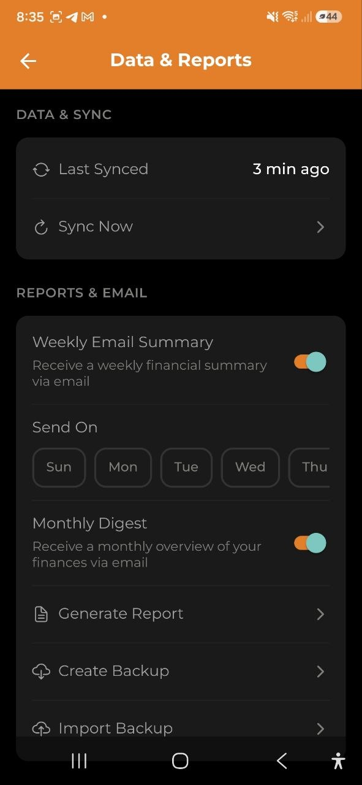

# Exportação e relatórios

> Gere relatórios das suas finanças em PDF, Excel e CSV. Consulte resumos mensais dos gastos, crie cópias de segurança encriptadas e receba resumos automáticos por e-mail.

## Visão geral

O ecrã **Exportação e relatórios** permite gerar relatórios financeiros, consultar resumos mensais, transferir e partilhar relatórios e gerir cópias de segurança dos dados. Aceda-lhe a partir do separador Análise, através do botão **Exportar relatório**, ou em **Definições** > **Relatórios e e-mail** > **Gerar relatório**.

## Formatos de relatório

Há três formatos de exportação disponíveis:

| Formato | Descrição | Disponibilidade |
|---|---|---|
| **CSV** | Valores separados por vírgulas, compatível com o Excel e o Google Sheets | Todos os planos |
| **PDF** | Relatório formatado com resumo, discriminação por categoria e lista de transações | Todos os planos |
| **Excel** | Livro com várias folhas: Resumo, Despesas e Receitas | Todos os planos |

Gerar relatórios e criar cópias de segurança é gratuito em todos os planos. Só o envio automático por e-mail, descrito abaixo, requer um plano pago.

Os totais são apresentados na **sua moeda de apresentação** — a que aparece no seletor do ecrã inicial, e não a moeda de uma transação em particular. Os montantes registados noutra moeda são convertidos às taxas atuais antes de qualquer soma, e o relatório indica-o. Cada transação da lista mantém a sua própria moeda, para que possa sempre ver o que foi realmente registado. Se uma taxa não estiver disponível, esse montante fica de fora dos totais, em vez de ser somado na moeda errada, e o relatório também o indica.

## Gerar um relatório

1. Escolha um **formato** (CSV, PDF ou Excel)
2. Escolha um **período**:
   - **Semana passada** — os últimos 7 dias
   - **Este mês** — do dia 1 do mês até hoje
   - **Último trimestre** — o último trimestre civil *completo* (se perguntar em agosto, é abril-junho). Um período fechado, por isso os valores já não mudam
   - **Este ano** — de 1 de janeiro até hoje
   - **Mês específico** — qualquer mês completo dos últimos 24
   - **Período personalizado** — com a data de início e de fim que escolher
3. Toque em **Gerar**
4. O relatório é gerado e **guardado**. No Android abre-se um seletor de pastas e o ficheiro é gravado onde escolher - a aplicação mostra depois o caminho. No iOS abre-se a folha de partilha para poder usar «Guardar em Ficheiros». Na aplicação web o ficheiro é simplesmente transferido. Se cancelar o seletor de pastas, nada é guardado; o relatório continua disponível mais abaixo.
5. O relatório aparece também em **Relatórios recentes**, mais abaixo, para acesso futuro

Se a sua conta tiver um **Mês financeiro** (por exemplo, a começar no dia do ordenado, dia 10), **Este mês** começa nesse dia e **Mês específico** cobre esse período — *outubro* vai de 10 de outubro a 9 de novembro. Semana, trimestre e ano continuam a seguir o calendário.

Por baixo dos botões vê as datas exatas que o relatório vai abranger — as mesmas que ficam impressas no cabeçalho do ficheiro. Se um período personalizado estiver incompleto ou a data de início for posterior à de fim, o botão **Gerar** fica desativado.

Se abrir este ecrã através de **Exportar relatório** no separador Análise, o período que estava a ver é mantido - recue até junho e o relatório é preparado para junho, não para o mês atual. Um período ainda a decorrer termina hoje; um período já terminado abrange toda a sua duração.

Os relatórios ficam guardados durante 7 dias e depois são eliminados automaticamente.

## Resumo mensal

Um retrato da atividade financeira do mês atual:

- **Receita total** e **Total de despesas**
- **Taxa de poupança** — percentagem das receitas que foi poupada
- **Principais categorias** — as categorias com mais gastos, com os respetivos montantes
- Os dados ficam em cache durante 7 dias e são atualizados automaticamente
- Mostra sempre o mês **atual** — não segue o período escolhido acima

## Relatórios recentes

Uma lista dos relatórios gerados recentemente, com:

- Ícone do formato (CSV/PDF/Excel)
- Nome do ficheiro e data de criação
- Tamanho do ficheiro
- Botão **Transferir** — guarda o ficheiro diretamente no dispositivo (Android: escolha a pasta através do Storage Access Framework; iOS: guarde em Ficheiros)
- Botão **Partilhar** — abre a folha de partilha do sistema para enviar o relatório por e-mail, mensagem ou outras aplicações

## Cópia de segurança dos dados

Disponível em **todos os planos**:

- **Criar cópia de segurança** — cria uma cópia de segurança completa em JSON dos dados da sua conta (despesas, receitas, orçamentos, categorias, etiquetas, projetos, carteiras, etc.)
  - **Onde o ficheiro é guardado:** No Android, abre-se um seletor de pastas e a cópia de segurança é gravada na pasta que escolher — a aplicação mostra depois o caminho exato. Se ignorar o seletor (ou no iOS), abre-se a folha de partilha do sistema para poder usar «Guardar em Ficheiros» ou guardá-la nas Transferências ou num serviço de armazenamento na nuvem. A mensagem de sucesso só aparece depois de o ficheiro ter sido efetivamente guardado ou partilhado.
- **Importar cópia de segurança** — importa uma cópia de segurança exportada anteriormente
- Se a encriptação estiver ativa, os campos encriptados são incluídos tal como estão na cópia de segurança

Aceda à cópia de segurança em **Definições** > **Relatórios e e-mail**.

## Relatórios por e-mail

Resumos automáticos entregues na sua caixa de correio:

| Funcionalidade | Descrição | Plano necessário |
|---|---|---|
| **Resumo semanal por e-mail** | Visão geral semanal dos gastos com as principais categorias | Business |
| **Resumo mensal** por e-mail | Resumo mensal com comparação com o mês anterior | Pro e Business |

O resumo mensal chega no dia 1 com o mês civil que acabou de terminar. Se a conta tiver um **Mês financeiro** (por exemplo, a começar no dia do ordenado, dia 10), chega nesse dia e cobre o período que acabou de terminar — de 10 de outubro a 9 de novembro — comparado com o anterior.

Configure-os em **Definições** > **Relatórios e e-mail**:

- Ativar/desativar os e-mails semanais e mensais
- Escolher o dia da semana dos relatórios semanais (segunda-feira por predefinição)

## Encriptação e relatórios

- **Nível 0** (sem encriptação) — todos os dados aparecem corretamente nos relatórios
- **Nível 1** (encriptação de texto) — os montantes aparecem corretamente; os nomes das categorias e as descrições podem aparecer vazios nos relatórios gerados pelo servidor. O resumo mensal obtém os nomes das categorias a partir dos dados locais do dispositivo
- **Nível 2** (encriptação total) — os relatórios não estão disponíveis (os montantes estão encriptados no servidor)

## Perguntas frequentes

- **P: Porque é que os nomes das categorias aparecem vazios no meu relatório em PDF?**
  **R:** Se tiver a E2EE ativa (Nível 1), os nomes das categorias estão encriptados no servidor. O relatório gerado pelo servidor não os consegue desencriptar. Os montantes continuam corretos.

- **P: Durante quanto tempo ficam guardados os relatórios?**
  **R:** Os relatórios são eliminados automaticamente ao fim de 7 dias. Transfira-os pouco depois de os gerar.

- **P: Posso exportar dados de uma conta partilhada?**
  **R:** Sim, qualquer membro da conta pode gerar relatórios e cópias de segurança da conta partilhada.

- **P: O que inclui uma cópia de segurança?**
  **R:** Tudo: despesas, receitas, orçamentos, categorias, etiquetas, projetos, carteiras, transferências e câmbios de moeda da conta atual.

---

*Ver também: [Análise](./06-analytics.md) | [Definições](./11-settings.md) | [Planos de subscrição](./12-subscription.md) | [Encriptação](./15-encryption.md)*
