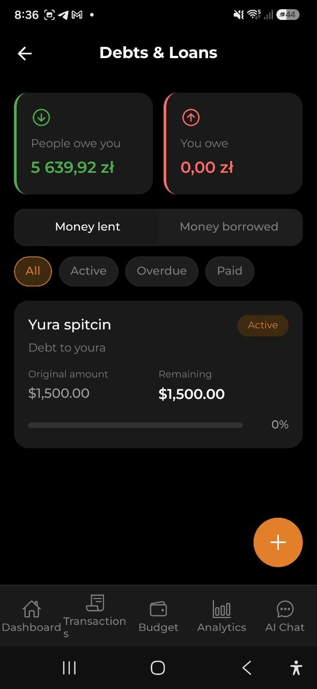

# Dívidas e empréstimos

> Registe o dinheiro que empresta e o que pede emprestado. Veja quem lhe deve, a quem deve, registe reembolsos e acompanhe os prazos — tudo integrado com as suas despesas e receitas.

## Visão geral

A funcionalidade Dívidas e empréstimos permite acompanhar dois tipos de obrigações financeiras:

- **Dinheiro emprestado a outros** — dinheiro que deu a alguém (registado como despesa marcada como dívida)
- **Dinheiro pedido emprestado** — dinheiro que alguém lhe deu (registado como receita marcada como dívida)

Os reembolsos funcionam da mesma forma:
- Quando alguém **lhe devolve o dinheiro**, fica registado como receita associada à despesa original da dívida
- Quando **reembolsa** alguém, fica registado como despesa associada à receita original da dívida

O estado da dívida é calculado automaticamente:
- **Ativa** — ainda há um saldo em falta
- **Paga** — a dívida foi totalmente reembolsada
- **Em atraso** — o prazo já passou e ainda há saldo em falta

## Criar uma dívida

A forma mais rápida de adicionar uma dívida é a partir do ecrã **Dívidas e empréstimos**:

1. Abra o ecrã **Dívidas e empréstimos** (a partir do widget do Painel ou das Definições)
2. Toque no botão **+** no canto inferior direito
3. Escolha **Emprestar dinheiro** ou **Pedir dinheiro emprestado**
4. Preencha o montante, a descrição, o nome da pessoa e, se quiser, o prazo
5. Toque em **Guardar**

Também pode criar dívidas manualmente a partir dos formulários de despesa ou de receita (ver abaixo).

## Emprestar dinheiro

### Passo a passo

1. Vá a **Transações** e toque no botão **+**
2. Selecione **Introdução manual**
3. Introduza o **montante** que está a emprestar
4. Introduza uma **descrição** (por exemplo, «Empréstimo ao João»)
5. Ative a opção **Emprestar dinheiro**
6. Introduza o **nome da pessoa** — a quem está a emprestar
7. Opcionalmente, defina um **prazo** — quando espera receber o dinheiro de volta
8. Toque em **Guardar despesa**

A despesa fica marcada como dívida e aparece no ecrã Dívidas e empréstimos.

> **Nota:** O montante afeta o saldo da carteira como uma despesa normal (dinheiro que sai).

## Pedir dinheiro emprestado

### Passo a passo

1. Vá a **Transações**, mude para o separador **Receitas** e toque em **+**
2. Introduza o **montante** que está a pedir emprestado
3. Introduza uma **descrição** (por exemplo, «Empréstimo da Maria»)
4. Ative a opção **Pedir dinheiro emprestado**
5. Introduza o **nome da pessoa** — a quem está a pedir emprestado
6. Opcionalmente, defina um **prazo** — quando tem de reembolsar
7. Toque em **Guardar receita**

A receita fica marcada como dívida e aparece no ecrã Dívidas e empréstimos.

> **Nota:** O montante afeta o saldo da carteira como uma receita normal (dinheiro que entra).

## Registar um reembolso

### Quando lhe devolvem o dinheiro (dinheiro que emprestou)

1. Abra a **despesa** original (o empréstimo que concedeu)
2. Toque em **Registar reembolso**
3. Abre-se um novo formulário de receita, já preenchido com o nome da pessoa e a moeda
4. Introduza o **montante do reembolso** (pode ser parcial)
5. Toque em **Guardar receita**

### Quando reembolsa alguém (dinheiro que pediu emprestado)

1. Abra a **receita** original (o empréstimo que recebeu)
2. Toque em **Registar reembolso**
3. Abre-se um novo formulário de despesa, já preenchido com o nome da pessoa e a moeda
4. Introduza o **montante do reembolso** (pode ser parcial)
5. Toque em **Guardar despesa**

> **Dica:** Pode registar vários reembolsos parciais. O saldo em falta é atualizado automaticamente.

## Ecrã Dívidas e empréstimos

Aceda ao ecrã Dívidas e empréstimos em **Definições > Dívidas e empréstimos**, ou tocando no widget de dívidas no Painel.

### Cartões de resumo

No topo do ecrã, dois cartões de resumo mostram:
- **Devem-lhe** — o total que os outros ainda lhe devem (a verde)
- **Deve** — o total que ainda deve aos outros (a vermelho)

Os montantes são convertidos automaticamente para a sua moeda base com as taxas de câmbio atuais.

### Separadores

Alterne entre duas vistas:
- **Dinheiro emprestado a outros** — dívidas em que emprestou dinheiro a alguém
- **Dinheiro pedido emprestado** — dívidas em que pediu dinheiro emprestado a alguém

### Filtros

Filtre as dívidas por estado:
- **Todas** — mostra todas as dívidas
- **Ativas** — apenas dívidas com saldo em falta
- **Em atraso** — apenas dívidas com o prazo ultrapassado
- **Pagas** — apenas dívidas totalmente reembolsadas

### Cartão da dívida

Cada dívida mostra:
- **Nome da pessoa** — com quem é a dívida
- **Descrição** — a que se refere a dívida
- **Etiqueta de estado** — Ativa (azul), Em atraso (vermelho) ou Paga (verde)
- **Montante original** — o montante inicial da dívida, na moeda original
- **Montante em falta** — quanto ainda está por pagar
- **Barra de progresso** — indicação visual do progresso do reembolso (percentagem)
- **Prazo** — quando vence a dívida (se tiver sido definido)

Toque num cartão de dívida para ver todos os detalhes da despesa ou receita, onde pode registar reembolsos.

## Lembretes por notificação

Quando uma dívida tem prazo, a aplicação envia notificações automáticas para não perder o controlo:

- **3 dias antes do prazo** — um lembrete antecipado: «Dívida vence daqui a 3 dias: João»
- **No dia seguinte ao prazo** — um alerta de atraso: «Dívida em atraso: João»

As notificações são enviadas a quem registou a dívida (o titular da dívida), não à outra parte.

Para ativar ou desativar estes lembretes, vá a **Definições → Notificações e integrações → Lembretes de dívidas**.

## Widget do Painel

O widget Dívidas e empréstimos está sempre visível no Painel (quando ativado nas definições de widgets):

- **Quando tem dívidas:** mostra os totais «Devem-lhe» e «Deve», além de um botão **+** para abrir rapidamente o ecrã Dívidas e empréstimos
- **Quando não tem dívidas:** mostra um estado vazio com o botão **Adicionar dívida** para começar

Toque no widget para ir diretamente para o ecrã Dívidas e empréstimos.

## Várias moedas

As dívidas podem estar em qualquer moeda suportada. Os totais de resumo no Painel e no ecrã de dívidas são convertidos automaticamente para a sua moeda base com taxas de câmbio em tempo real. Os cartões de cada dívida mostram sempre os montantes na moeda original.

## Perguntas frequentes

- **P: Posso emprestar dinheiro numa moeda e receber o reembolso noutra?**
  **R:** Os reembolsos são registados na mesma moeda da dívida original, para garantir um acompanhamento exato.

- **P: Emprestar dinheiro afeta o meu orçamento?**
  **R:** Sim. Emprestar é registado como despesa e pedir emprestado como receita. Ambos afetam o saldo da carteira e o acompanhamento do orçamento como qualquer outra transação.

- **P: Posso editar uma dívida depois de a criar?**
  **R:** Sim. Toque na dívida para ver os detalhes e use o botão Editar. Pode alterar a descrição, o nome da pessoa e o prazo.

- **P: O que acontece quando uma dívida é totalmente reembolsada?**
  **R:** O estado passa automaticamente a «Paga» e a barra de progresso mostra 100%. A dívida fica no histórico para consulta.

- **P: Como elimino uma dívida?**
  **R:** Abra os detalhes da dívida e toque em Eliminar. Tenha em conta que isto também elimina a despesa ou receita associada.

---

*Ver também: [Despesas e receitas](./03-expenses-and-income.md) | [Carteira e câmbio](./10-wallet-and-exchange.md)*
