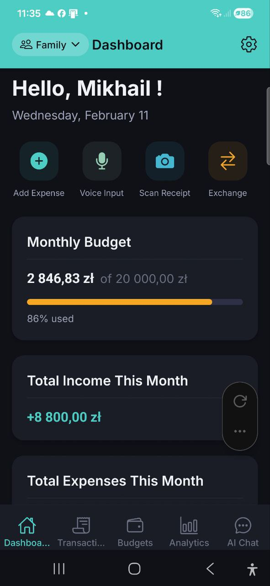

# Widgets do ecrã principal

> Adicione widgets Android ao ecrã principal para aceder num instante aos seus dados de gastos — ou para adicionar despesas sem sequer abrir a aplicação.

## O que são widgets?

Os widgets são pequenos painéis interativos que ficam no ecrã principal do Android. O AI Budget Assistant oferece quatro widgets:

| Widget | Tamanho | O que mostra |
|--------|------|---------------|
| **Orçamento – Hoje** | Pequeno | Total gasto hoje + variação face a ontem |
| **Orçamento – Semana** | Médio | Gráfico de barras dos últimos 7 dias |
| **Orçamento – Resumo** | Grande | Barras de progresso dos orçamentos + principais categorias de gastos |
| **Orçamento – Adição rápida** | Faixa compacta | Três botões que abrem a aplicação com um toque |

> **Só Android.** O iOS não suporta widgets no ecrã principal. Todas as mesmas funcionalidades estão disponíveis dentro da aplicação.

---

## Como adicionar um widget

1. **Toque sem soltar** numa área vazia do ecrã principal
2. Toque em **Widgets**
3. Percorra a lista até encontrar **AI Budget Assistant**
4. **Toque sem soltar** no widget que pretende e arraste-o para o ecrã principal
5. Solte para o colocar

Repita para adicionar vários widgets.

---

## Orçamento – Hoje (pequeno)



O widget mais pequeno mostra um resumo rápido do dia:

- **Total de hoje** — o montante gasto
- **Indicador de variação** — se gastou mais ou menos do que ontem (verde = menos, vermelho = mais)

**Tamanho**: 110 × 40 dp (cerca de 1 coluna × 1 linha na maioria dos launchers)

Toque no widget para abrir a aplicação.

---

## Orçamento – Semana (médio)

O widget médio dá-lhe uma visão geral da semana num relance:

- **Gráfico de barras** dos gastos de cada um dos últimos 7 dias
- **Total de hoje** apresentado por baixo do gráfico

**Tamanho**: 250 × 110 dp (cerca de 2 colunas × 2 linhas)

Toque no widget para abrir a aplicação.

---

## Orçamento – Resumo (grande)

O widget grande é o seu painel financeiro no ecrã principal:

- **Barras de progresso** de cada orçamento ativo — mostram quanto do período do orçamento já usou
- **Principais categorias** de gastos, com os montantes do período atual

**Tamanho**: 250 × 180 dp (cerca de 2 colunas × 4 linhas)

Toque no widget para abrir a aplicação.

---

## Orçamento – Adição rápida

O widget Adição rápida permite começar a adicionar uma despesa com um só toque — sem ter de abrir a aplicação primeiro.

```
┌──────────────────────────────────────┐
│   🎤 Voz   │ 📷 Digitalizar │ ✏️ Adicionar │
└──────────────────────────────────────┘
```

| Botão | O que acontece |
|--------|-------------|
| 🎤 **Voz** | Abre a aplicação no ecrã de gravação de voz |
| 📷 **Digitalizar** | Abre a aplicação no leitor de talões |
| ✏️ **Adicionar** | Abre a aplicação no formulário de despesa manual |

**Tamanho**: 250 × 60 dp (faixa horizontal compacta)

> **Dica:** A Adição rápida não mostra dados — está sempre atualizada e não gasta bateria com atualizações em segundo plano.

---

## Atualização dos dados dos widgets

| Widget | Intervalo de atualização |
|--------|-----------------|
| Orçamento – Hoje | A cada 30 minutos |
| Orçamento – Semana | A cada 30 minutos |
| Orçamento – Resumo | A cada 30 minutos |
| Orçamento – Adição rápida | Estático, nunca é atualizado |

Os widgets com dados leem o armazenamento local do dispositivo, por isso funcionam mesmo sem ligação à Internet.

---

## Perguntas frequentes

**P: Porque é que os widgets não aparecem na lista de widgets?**
R: Confirme que a aplicação está instalada e que já iniciou sessão pelo menos uma vez. Se os widgets continuarem sem aparecer, experimente reiniciar o launcher ou reinstalar a aplicação.

**P: O meu widget mostra «Ainda sem dados». O que devo fazer?**
R: Abra a aplicação e adicione pelo menos uma despesa, ou confirme que a sincronização terminou. O widget é atualizado dentro de 30 minutos, ou pode forçar uma sincronização manualmente em **Definições → Sincronizar agora**.

**P: Os widgets estão disponíveis no iOS?**
R: Não. Os widgets do ecrã principal exigem Android. No iOS, todas as mesmas funcionalidades estão disponíveis dentro da aplicação.

**P: Posso redimensionar os widgets?**
R: Orçamento – Hoje e Orçamento – Adição rápida têm tamanho fixo. Orçamento – Semana pode ser redimensionado na horizontal. Orçamento – Resumo pode ser redimensionado na horizontal e na vertical.

## Atalhos do launcher (Android)

Toque sem soltar no ícone da aplicação para ir diretamente para **Adicionar despesa**, **Digitalizar talão** ou **Voz**. Não é preciso configurar nada.

---

*Ver também: [Entrada por voz e digitalização de talões](./04-voice-and-receipt.md) | [Despesas e receitas](./03-expenses-and-income.md)*
