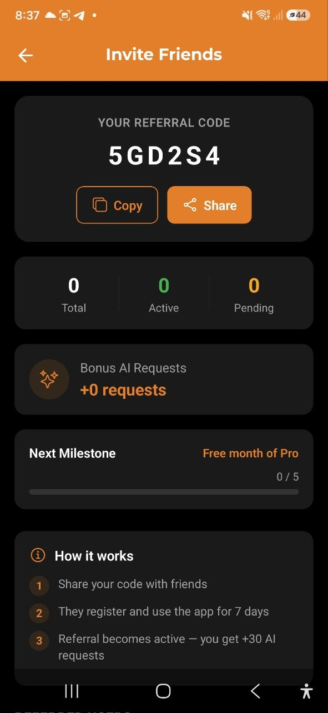

# Convidar amigos — Programa de recomendação

> Convide amigos, ganhe pedidos de IA de bónus e desbloqueie marcos. Partilhe o seu código de recomendação único e seja recompensado quando os seus amigos usarem a aplicação de forma ativa.

## Visão geral

O Programa de recomendação permite convidar amigos para o AI Budget Assistant. Quando se registam com o seu código e usam a aplicação de forma ativa durante 7 dias, recebe **+30 pedidos de IA de bónus**. Os amigos recomendados têm um **período experimental alargado de 14 dias**, em vez dos 7 dias habituais.

## O seu código de recomendação

Cada utilizador tem um código de recomendação único de 6 caracteres. Encontra-o no ecrã **Convidar amigos**:

1. Abra **Definições** → **Convidar amigos**
2. O seu código aparece no topo do ecrã
3. Use **Copiar** para copiar o código para a área de transferência
4. Use **Partilhar** para o enviar por qualquer aplicação de mensagens — a mensagem já inclui um link, e o amigo que a abrir encontra o seu código já preenchido

A aplicação também lhe sugere isto num momento específico: depois de um amigo lhe ter devolvido o dinheiro através de uma divisão de conta. É o único sítio onde pergunta — e, se fechar a sugestão duas vezes, deixa de perguntar.

## Como funciona

1. **Partilhe o seu código** — envie-o aos amigos por qualquer mensageiro ou rede social
2. **O amigo regista-se** — a partir do seu link, o código já está preenchido; se for escrito à mão, é um campo opcional
3. **Período de espera de 7 dias** — a recomendação fica no estado «Pendente»
4. **O amigo usa a aplicação** — tem de a usar de forma ativa (abri-la e adicionar despesas) durante esses 7 dias
5. **A recomendação passa a Ativa** — recebe **+30 pedidos de IA** de bónus

## Estados das recomendações

| Estado | Significado |
|---|---|
| **Pendente** | O amigo registou-se; aguarda-se 7 dias pela confirmação de atividade |
| **Ativa** | O amigo foi confirmado como utilizador ativo e o bónus foi atribuído a si |
| **Expirada** | Passaram 30 dias sem que o amigo se tornasse ativo |

## Estatísticas

O ecrã Convidar amigos mostra as estatísticas das suas recomendações:

- **Total** — quantas pessoas usaram o seu código
- **Ativas** — recomendações ativas confirmadas (bónus atribuído)
- **Pendentes** — a aguardar confirmação de atividade

## Pedidos de IA de bónus

Por cada recomendação que passa a **Ativa**, recebe **+30 pedidos de IA**. Estes pedidos de bónus somam-se ao limite mensal do seu plano e não são repostos todos os meses.

O total de pedidos de bónus aparece no ecrã Convidar amigos.

## Marcos

À medida que acumula recomendações ativas, desbloqueia marcos:

| Marco | Recompensa |
|---|---|
| **5 recomendações ativas** | Um mês de Pro grátis (código promocional enviado para o seu e-mail) |
| **10 recomendações ativas** | Distintivo de Embaixador |

O progresso até ao próximo marco aparece como uma barra de progresso no ecrã Convidar amigos.

## Vantagens para os amigos recomendados

Os amigos que se registam com o seu código de recomendação recebem:

- **Período experimental alargado de 14 dias** (em vez do período experimental habitual de 7 dias)
- A data de fim do período experimental aparece no ecrã **Subscrição**

## Partilhar a aplicação sem código

Quer recomendar a aplicação sem passar pelo programa de recomendação? Abra **Definições → Partilhar o AI Budget**. Abre-se o menu de partilha do telemóvel com uma mensagem curta, um link para o Google Play e uma ligação para o navegador, para quem usa iPhone ou computador. Na versão web, se o navegador não conseguir partilhar, a mensagem é copiada para a poder colar.

## Perguntas frequentes

- **P: Onde encontro o meu código de recomendação?**
  **R:** Abra Definições → Convidar amigos. O código aparece no topo.

- **P: Porque é que a minha recomendação continua «Pendente»?**
  **R:** As recomendações ficam pendentes durante pelo menos 7 dias. Nesse período, o amigo também tem de usar a aplicação de forma ativa (abri-la, adicionar despesas).

- **P: Quando é que uma recomendação expira?**
  **R:** Se o amigo recomendado não se tornar um utilizador ativo no prazo de 30 dias, a recomendação expira.

- **P: Os pedidos de IA de bónus são repostos todos os meses?**
  **R:** Não, os pedidos de bónus obtidos por recomendação são permanentes e não são repostos.

- **P: Posso usar o meu próprio código de recomendação?**
  **R:** Não, a autorrecomendação não é permitida.

---

*Ver também: [Subscrição](./12-subscription.md) | [Chat IA](./07-ai-chat.md)*
