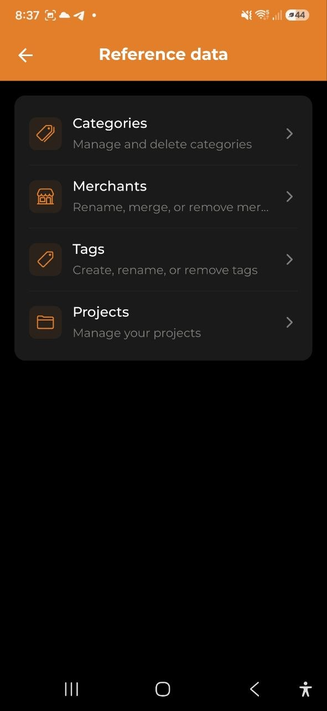

# Dados de referência

> Categorias, comerciantes, etiquetas e projetos são a base para organizar as suas despesas. Faça a gestão de todos eles em **Definições → Dados de referência**.

## Visão geral

Os quatro tipos de dados de referência são geridos a partir de um único ponto nas Definições. A interface é sempre a mesma: **toque numa linha para editar**, toque em **+** para adicionar e toque no **ícone do caixote do lixo** para eliminar.

> Função **Leitor**: os membros com acesso de Leitor podem consultar os dados de referência, mas não os podem adicionar, mudar de nome nem eliminar.

## Categorias

As categorias classificam as suas despesas e receitas. Cada uma tem um nome e uma cor.

- Toque numa categoria para lhe mudar o nome ou a cor
- Os nomes das categorias têm de ser únicos dentro de cada tipo, por isso mudar o nome de uma categoria para um nome que outra já usa é recusado, com uma explicação
- Toque em **+** junto a «Categorias de despesas» ou «Categorias de receitas» para criar uma nova
- Toque no ícone do caixote do lixo para eliminar uma categoria
  - A eliminação é bloqueada se a categoria estiver a ser usada por despesas ou orçamentos ativos
  - As categorias do sistema (predefinidas) não podem ser eliminadas
- Se uma categoria que atribuiu não aparecer nos seus outros dispositivos, abra a aplicação uma vez com ligação à internet — as atribuições são reenviadas automaticamente
- Uma categoria que ainda é usada por despesas, orçamentos ou subcategorias não pode ser eliminada — elimine ou reatribua primeiro esses elementos

**Dica:** Use cores bem distintas nas categorias que quer identificar rapidamente nos gráficos.

## Comerciantes

Os comerciantes são criados automaticamente quando adiciona despesas — por introdução manual, digitalização de talões ou voz. Use o ecrã Comerciantes para limpar duplicados ou corrigir erros de escrita.

- Toque num comerciante para lhe mudar o nome
- Mudar o nome junta todas as despesas existentes com o nome antigo sob o novo nome (atualização em massa)
- Eliminar remove o nome do comerciante de todas as despesas correspondentes (as despesas em si mantêm-se)

> Não é possível criar comerciantes manualmente — aparecem automaticamente à medida que adiciona despesas.

### Regras de categoria

A aplicação aprende com as suas correções. Sempre que altera a categoria de uma despesa que tem nome de comerciante, é guardada automaticamente uma **regra de categoria**. Da próxima vez que esse comerciante aparecer — num extrato bancário importado ou num CSV do Wise, num talão digitalizado ou numa notificação bancária capturada automaticamente (Android) — a aplicação aplica a sua regra e atribui a categoria sem qualquer correção manual.

- As regras aprendidas aparecem na secção **Regras de categoria**, no fundo do ecrã Comerciantes
- Cada linha mostra o nome do comerciante e a categoria a que corresponde
- Toque no ícone do caixote do lixo para eliminar uma regra (a aplicação deixa de atribuir essa categoria automaticamente)
- Toque no ícone de atualizar junto a uma regra para a **voltar a aplicar** — encontra as despesas desse comerciante já classificadas noutra categoria e propõe movê-las também para a categoria da regra, para que as despesas mais antigas acompanhem as regras que ensinou depois
- As regras ficam guardadas no servidor e sincronizam em todos os seus dispositivos

**Exemplo:** Importa um extrato do Revolut e corrige «AMAZON» → Compras. Na importação do mês seguinte, as transações da Amazon vão automaticamente para Compras.

### Limites mensais por comerciante

Defina um limite mensal para um comerciante no ecrã Comerciantes (toque em **+** no cartão *Limites mensais por comerciante*). Uma barra fina mostra os gastos deste mês e recebe um aviso a 80% e 100%. Os limites não alteram os seus orçamentos.

## Etiquetas

As etiquetas permitem marcar despesas com palavras-chave livres, independentemente das categorias.

- Toque em **+** para criar uma etiqueta (escreva um nome e escolha uma cor)
- Toque numa etiqueta para lhe mudar o nome ou a cor
- Toque no ícone do caixote do lixo para remover a etiqueta de todas as despesas

**Dica:** Use etiquetas para acompanhar coisas de curta duração: «Viagem de trabalho», «Obras», «Orçamento para presentes».

## Projetos

Os projetos agrupam despesas por objetivo ou atividade — trabalho para clientes, viagens, obras em casa, e assim por diante.

- Toque em **+** para criar um projeto (nome, descrição opcional, cor, limite de orçamento opcional)
- Toque num projeto para abrir o ecrã de detalhes
  - Veja todas as despesas associadas, o total gasto e o orçamento restante
  - Use o **ícone do lápis** (canto superior direito) para editar o projeto
  - Use o **ícone do caixote do lixo** (canto superior direito) para o eliminar
- Para associar uma despesa a um projeto, abra a despesa e escolha um projeto no campo Projeto

**Dica:** Defina um orçamento para um projeto para acompanhar os gastos face a um objetivo e ver o valor restante.

---

*Ver também: [Despesas e receitas](./03-expenses-and-income.md) | [Análise](./06-analytics.md) | [Definições](./11-settings.md)*
