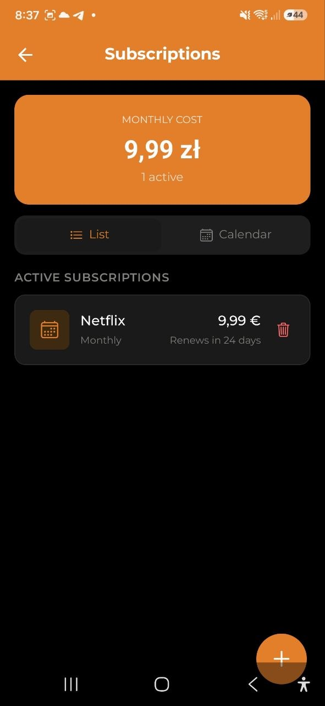

# Gestor de subscrições

> Acompanhe todas as suas cobranças recorrentes num só lugar — serviços de streaming, ferramentas SaaS, ginásio e muito mais.

## O que é o Gestor de subscrições?

O Gestor de subscrições é um registo dedicado aos seus pagamentos recorrentes. Ao contrário das transações, as subscrições não são detetadas automaticamente — adiciona-as manualmente ou através do botão **«Acompanhar esta subscrição»** numa descoberta do Fat Finder.

Cada subscrição guarda:
- Nome (Netflix, Spotify, ginásio…)
- Valor e moeda
- Ciclo de faturação (mensal, anual, trimestral, semanal)
- Data da próxima renovação
- Categoria (opcional)
- Notas (opcional)

## Adicionar uma subscrição

**Manualmente:**
1. Vá a **Definições → Subscrições** (ou toque no link Subscrições no ecrã inicial)
2. Toque no botão **+**
3. Preencha o nome, o valor, o ciclo de faturação e a data da próxima renovação
4. Toque em **Guardar**

**A partir do Fat Finder:**
Se o Fat Finder detetar uma cobrança recorrente, toque em **«Acompanhar esta subscrição»** no cartão da descoberta. O nome e o valor ficam pré-preenchidos — basta confirmar a data de renovação.

## Faixa do custo mensal

No topo do Gestor de subscrições aparece o seu **custo total equivalente por mês** — todas as subscrições ativas convertidas num valor mensal:
- Subscrições mensais → o valor tal como está
- Subscrições anuais → valor ÷ 12
- Subscrições trimestrais → valor ÷ 3
- Subscrições semanais → valor × (52 ÷ 12)

## Contagem até à renovação

Cada subscrição mostra quantos dias faltam até à próxima renovação:
- **Vermelho** — em atraso ou com renovação hoje
- **Amarelo** — renova nos próximos 3 dias
- **Normal** — faltam mais de 3 dias

## Notificações de renovação

Recebe uma notificação push **3 dias antes** de cada renovação. Para gerir isto:

1. Vá a **Definições → Notificações**
2. Ative ou desative **Renovações de subscrições**

## Editar e desativar

Toque em qualquer subscrição para abrir o ecrã de edição. Pode:
- Atualizar o valor, o ciclo de faturação ou a data de renovação
- Adicionar ou alterar a categoria
- Alternar entre **Ativa / Inativa** — as subscrições inativas continuam na lista, mas ficam fora do total mensal
- Eliminar a subscrição por completo

## Função Leitor

Se a sua função na conta for **Leitor**, pode ver a lista de subscrições, mas não pode adicionar, editar nem eliminar subscrições.
