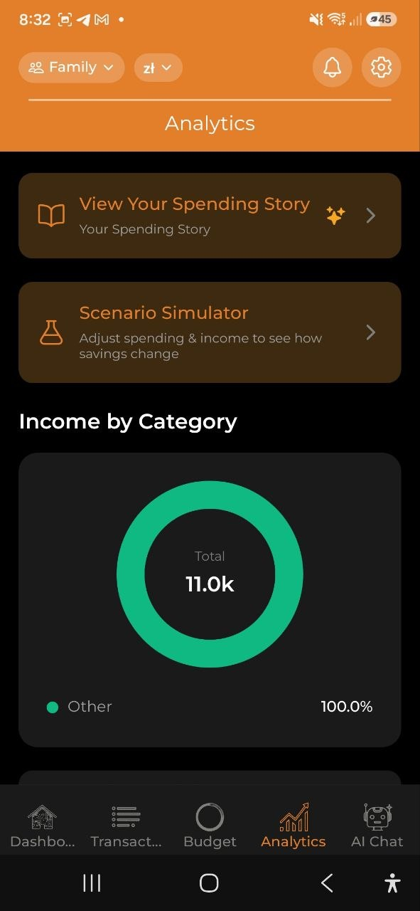

# Аналітика

> Візуалізуйте свої патерни витрат за допомогою інтерактивних графіків. Фільтруйте за періодом та валютою, заглиблюйтесь у деталі та отримуйте ШІ-інсайти для кращого розуміння ваших фінансів.

## Огляд

Вкладка **Аналітика** надає комплексний огляд ваших витрат через графіки, інсайти та дослідження даних. Усі дані базуються на ваших витратах в обраному рахунку.

## Часовий діапазон та фільтри

У верхній частині екрана Аналітика:

- **Перемикач часового діапазону**: **Тиждень** | **Місяць** | **Рік**
- **Фільтр валюти**: **Усі** валюти або оберіть конкретну (USD, EUR, PLN тощо)

Обраний діапазон впливає на всі графіки та інсайти нижче.

## Картки підсумків

- **Загальні витрати** — ваші загальні витрати за обраний період
  - **vs. попередній період** — "більше/менше, ніж за минулий тиждень/місяць/рік" з відсотком
  - **vs. середнє за 3 місяці** — напр. "18% вище середнього за 3 місяці" (зелений = нижче, червоний = вище), з'являється за наявності хоча б 1 повного попереднього місяця
- **Середнє за день** — середні щоденні витрати

## Карусель ШІ-інсайтів

Горизонтальна прокручувана карусель ШІ-інсайтів (потрібен тариф Pro):

- **Аномалії витрат** — виявлені незвичайні витрати (наприклад, "78% більше за звичайне на Транспорт")
- **Прогнози бюджету** — коли ваш бюджет прогнозовано закінчиться
- **Можливість заощадити** — пропозиції щодо зменшення витрат
- **Порівняння категорій** — як ваші витрати порівнюються між категоріями
- **Зміна тренду** — значні зміни у патернах витрат

Кожна картка інсайту має рівень важливості: критичний (червоний), попередження (жовтий) або інформація (синій).

> **Примітка:** Користувачі безкоштовного плану бачать пропозицію оновити: "Перейдіть на Pro для ШІ-інсайтів."

## Графіки

### Доходи за категоріями (Кільцева діаграма)

- Показує ваші доходи з розбивкою за категоріями за обраний період
- Відображається лише за наявності доходів з категоріями (наприклад, Зарплата, Фриланс, Дивіденди, Оренда)
- Кольорова палітра у зелено-бірюзових тонах для візуального відрізнення від діаграм витрат
- Некатегоризовані доходи об'єднуються в «Інші»
- Розташована вище графіка тенденції витрат
- Категорії доходів працюють так само: основні показують суму своїх підкатегорій, а натискання відкриває деталізацію.

### Тенденція витрат (стовпчаста діаграма)

- Показує щоденні або щомісячні витрати за обраний період
- Інтерактивна: натисніть будь-який стовпець для деталізації цього часового сегмента

### Витрати за категоріями (кільцева діаграма)

- Розподіл за категоріями з відсотками
- Кольорове позначення за категоріями
- Натисніть на сегмент основної категорії (позначена ›), щоб відкрити її підкатегорії; сегмент без підкатегорій під час натискання лише виділяється
- **Підкатегорії підсумовуються** — діаграма показує лише основні категорії, а сума основної категорії включає її підкатегорії. Основні категорії з підкатегоріями позначено значком ›. Натисніть на таку категорію (сегмент або рядок), і діаграма перемалюється для неї: її підкатегорії плюс «<Категорія> (без підкатегорії)» для витрат, записаних безпосередньо на основну категорію. Натисніть на ланцюжок «Усі категорії › <Категорія>», щоб повернутися. Деталізація скидається щоразу, коли дані аналітики перераховуються: під час нової чи зміненої операції, синхронізації, зміни мови або зміни періоду, рахунку чи валюти. Витрати видаленої підкатегорії залишаються окремим сегментом верхнього рівня, бо застосунок не зберігає видалені категорії на пристрої. Позначки «vs середнє» для основної категорії використовують сумарну величину. Те саме працює на картках аналітики у вебверсії для комп'ютера.

### Бюджет vs Факт (групована стовпчаста діаграма)

- Порівняння бюджетних лімітів та фактичних витрат поруч
- Показує **В нормі** або **Перевищено** для кожної категорії
- З'являється лише при наявності активних бюджетів

### Витрати за днями тижня (діаграма днів тижня)

- Аналіз патернів, що показує, у які дні ви витрачаєте найбільше
- Інсайт: "Найбільше ви витрачаєте по суботах"

### За магазинами

- Топ магазинів і сервісів, де ви витрачали гроші у вибраному періоді
- Показує до 8 окремих магазинів; решта об'єднується в «Інші»
- Відображається лише якщо хоча б одна витрата має вказаний магазин

Якщо один і той самий магазин зустрічається під кількома назвами, відкрийте **Налаштування → Магазини**, щоб навести лад: натисніть **Вибрати**, позначте варіанти і **Об'єднати** їх в одну назву. Застосунок також пропонує ймовірні групи (наприклад, кілька записів *Biedronka*), які можна об'єднати одним натисненням — тоді вони рахуватимуться як один продавець на цих діаграмах.

### За учасниками

- Хто записав яку частину витрат за вибраний період.
- З’являється лише в спільних рахунках, де витрати є щонайменше у двох учасників.

### За тегами / За проєктами

- **Розподіл за тегами** — витрати, згруповані за вашими тегами
- **Порівняння проєктів** — витрати, згруповані за проєктами
- Допомагає відстежувати тематичні витрати (наприклад, усі витрати з тегом #кава або витрати проєкту "Відпустка")

## Деталізація

Натисніть будь-який елемент графіка для поглибленого дослідження:

1. Перегляд **Рік** — натисніть стовпець місяця, щоб збільшити цей місяць
2. Перегляд **Місяць** — натисніть тиждень, щоб збільшити цей тиждень
3. Перегляд **Тиждень** — натисніть день, щоб переглянути денні транзакції
4. Перегляд **День** — переглядайте окремі транзакції

Використовуйте кнопку **Назад** для навігації вгору по рівнях.

## Короткий огляд

Під графіками ви знайдете текстові підсумкові інсайти:

- **Топ категорія** — ваша найбільша категорія витрат за цей період
- **Пік витрат** — день з найбільшими витратами
- **Порада щодо денного бюджету** — рекомендовані щоденні витрати для утримання в рамках бюджету
- **Заощадження по чеках** — загальна сума заощаджена на знижках. Торкніться, щоб побачити, які магазини дали найбільші знижки і з яких чеків вони походять.
- **Сплачена застава** — загальна сума застави за тару за відсканованими чеками. Торкніться, щоб побачити такий самий розподіл за магазинами/чеками. Це те, що ви сплатили на касі, а не повернення коштів — здана тара ніде не відстежується.

Обидва рядки з'являються лише тоді, коли за період зафіксовано знижку або заставу, і лише якщо ваш обліковий запис не повністю зашифрований (інакше застосунок не може прочитати суми, щоб розбити їх на деталі).

## Часто купувані товари

Таблиця ваших найпопулярніших позицій з чеків:
- Назва товару
- Всього витрачено
- Кількість покупок

## Експорт

Натисніть **Експорт звіту**, щоб перейти на екран [Експорт і звіти](./16-export-reports.md), де можна генерувати PDF, Excel та CSV звіти, переглядати щомісячні дайджести та керувати резервними копіями даних.

## Витрати на дітей

Подивіться, скільки коштує кожна дитина, без здогадок.

- **Додавання дітей:** Налаштування > Довідники > Діти. Зберігаються лише ім'я та колір. Замість видалення архівуйте дитину; її витрати залишаються прив'язаними.
- **Уся витрата:** у нової чи наявної витрати оберіть одну або кількох дітей. Якщо їх кілька, сума ділиться порівну, доки ви не змінете частки. Витрата має прив'язку цілком або за позиціями чека, але не обидві одразу; застосунок запитає перед зміною.
- **Позиції чека:** після сканування чека віднесіть окремі позиції (підгузки, шкільне приладдя) до дитини. Застосунок запам'ятає вибір і запропонує його наступного разу. Пропозиція ніколи не застосовується без вас. «Видобути позиції» зберігає прив'язку товарів, що лишилися в чеку, і повідомляє, скільки не вдалося перенести.
- **Масово:** виберіть кілька витрат і натисніть «Віднести до дитини». Витрати з прив'язкою за позиціями пропускаються, кількість показується.
- **Підсумки:** екран дитини (і картка у вкладці «Аналітика») показує цей місяць, цей рік і розбивку за категоріями у валюті відображення. Підсумок зі знаком ≈ містить наближення через відсутній курс; такі суми виключаються, а не вгадуються. Заплановані витрати та борги з розділених рахунків не враховуються.
- **800+ і покриття:** якщо дохід схожий на допомогу 800+ (наприклад, «800+» чи «rodzina 800» в описі), застосунок запропонує позначити його для дитини. Покриття — отримана допомога, поділена на витрати на дитину за той самий період.
- **Картка для поширення:** зображення з підсумками дитини. Ім'я приховане за замовчуванням; його можна ввімкнути.
- **Виписка в PDF (Pro, редактори):** «zestawienie» витрат на дитину за період до 24 місяців: підсумки, розбивка за місяцями й категоріями, список витрат і чеки. На кожній сторінці є примітка, що документ складено в застосунку за даними, введеними користувачем, і час «дані станом на». Це зведення ваших власних записів, а не юридичний документ і не засвідчене. До нього потрапляє лише те, що дійшло до сервера, тож застосунок спершу синхронізується й просить зачекати, якщо щось ще не надіслано. Недоступна для акаунтів зі наскрізним шифруванням.
- **Розлучені батьки:** тримайте дітей на особистому рахунку, щоб другий з батьків не бачив решту ваших витрат. Спільний рахунок показує все всім учасникам.

## Часті запитання

- **П:** Чому я не бачу жодних графіків?
  **В:** Графіки з'являються після додавання даних витрат. Спочатку додайте кілька витрат, потім перевірте Аналітика.

- **П:** Як генеруються ШІ-інсайти?
  **В:** Інсайти генеруються шляхом аналізу ваших патернів витрат, порівняння з історичними даними та виявлення аномалій. Для цього потрібна підписка Pro або Business.

---

*Див. також: [Бюджети](./05-budgets.md) | [Історія витрат](./08-spending-story.md) | [Експорт і звіти](./16-export-reports.md)*
